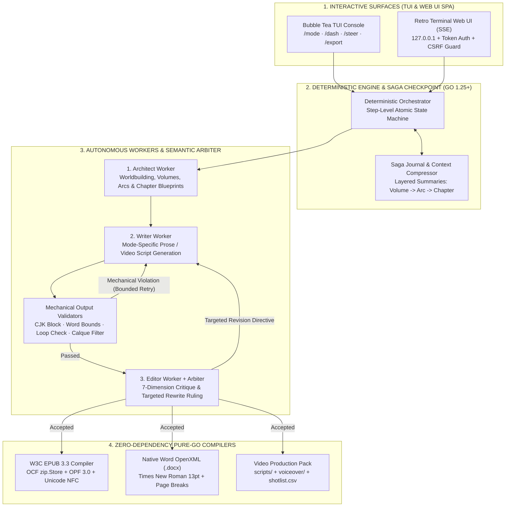

> *"Ask an LLM to write a 500-word paragraph and it shines. Ask it to write a 50-chapter detective novel or an 8-minute explainer script, and by chapter 3 the detective has morphed into the victim, paragraphs loop like a scratched record, and stray CJK characters or `[TODO: insert fight scene]` tags leak into the prose!"*

Anyone who has attempted long-form Vietnamese content generation with Large Language Models (LLMs) has encountered this exact wall.

At their core, LLMs are autoregressive next-token predictors rather than stateful narrative engines. Once generation spans tens of thousands of words across multiple chapters, three structural failure modes emerge:
1. **Context Drift & Continuity Collapse:** A character who died in chapter 2 reappears drinking tea in chapter 7; hard magic rules or whodunit clues are silently contradicted.
2. **CJK Token Leakage & Decoding Degeneration:** When running multilingual weights (Qwen, DeepSeek, GLM...), token probabilities frequently slip into Chinese/Japanese/Korean (CJK) glyphs, machine-translation calques, or repetitive paragraph loops.
3. **Catastrophic State Loss on Interruption:** If a network drop or API rate limit hits at chapter 18, all in-memory orchestration state vanishes.

To solve these challenges through software engineering discipline, I built **`ainovel-cli` (`aidoodle-cli`)** in **Go 1.25+**—an autonomous, deterministic multi-mode content engine featuring **7 specialized AI working modes**, dual **Bubble Tea TUI + Retro Terminal Web UI** interfaces, and a **zero-dependency pure-Go W3C EPUB 3.3 and Word DOCX compiler**.

---

## 1. System Overview & Engineering Evidence

| Dimension | Technical Specification & Evidence | Architectural Highlight |
|---|---|---|
| **Repository & Releases** | [`github.com/vinh-gogo/aidoodle-cli`](https://github.com/vinh-gogo/aidoodle-cli) | Written in **Go 1.25+**, ships as a single self-contained native binary (Windows / macOS / Linux) |
| **Core Orchestration** | **Deterministic Engine + Checkpoint Saga** | Coordinates 3 autonomous workers (**Architect / Writer / Editor**) + a semantic **Arbiter** with step-level atomic I/O |
| **7 Specialized AI Modes (`/mode`)** | **5 Novel Modes** (`novel-manga`, `suspense`, `romance`, `fantasy`, `vietnamese-history`) + **2 Video Script Modes** (`doodle-explainer`, `behavioral-psychology`) | 100% isolated prompt packs, voice/style layers, reference schemas, and mode-specific mechanical gates |
| **Output Verification** | **Mechanical Output Validators** + **7-Dimension Editor Review** | Zero-tolerance CJK glyph rejection, loop detection, strict word-count bounds (2,000–4,500 words/chapter), translation-calque filtering |
| **Interactive Surfaces** | **TUI (`Bubble Tea`)** + **Retro Terminal Web UI (`ainovel-cli web`)** | 3-panel SPA with live SSE streaming, loopback binding, `--token` auth, `Sec-Fetch-Site` CSRF guard, and XSS sanitization |
| **Publishing Compilers** | **W3C EPUB 3.3** · **Microsoft Word (`.docx`)** · **Video Production Pack (`.csv`/`.md`)** | Pure Go (zero external dependencies), Unicode NFC normalization, hierarchical Volume $\rightarrow$ Arc $\rightarrow$ Chapter navigation |

---

## 2. Deterministic Orchestration: The Saga State Machine

Instead of allowing LLM agents to converse in unconstrained multi-agent chat loops (which are prone to infinite loops and runaway token burn), `ainovel-cli` enforces a strict architectural invariant: **"Orchestration is deterministic; LLMs are invoked strictly as bounded, verifiable functions."**

### 2.1 Separation of Concerns: Architect, Writer, Editor, and Arbiter
1. **Architect Worker:** Never writes prose. Its sole responsibility is macro-structural planning: establishing world rules, character sheets, decomposing **Volumes $\rightarrow$ Arcs $\rightarrow$ Chapter Blueprints**, and maintaining the **Layered Summary Compression Pipeline** after each chapter so long-range context fits cleanly within LLM attention windows.
2. **Writer Worker:** Receives the active chapter blueprint, current character state, and the selected mode's Voice/Style layer to draft the chapter or script.
3. **Editor Worker (7-Dimension Review) & Arbiter:** Evaluates drafts across 7 orthogonal dimensions (logical continuity, pacing, character depth, Vietnamese prose naturalness, blueprint adherence, hook/cliffhanger strength, and genre-specific invariants). When continuity issues arise, the **Arbiter** issues targeted repair directives rather than regenerating blindly.

### 2.2 Crash Recovery via Step-Level Atomic Saga I/O
Every state transition in `ainovel-cli` is persisted atomically (writing to a `.tmp` file followed by an atomic `os.Rename` guarded by `gofrs/flock` file locks). If power fails mid-way through chapter 42 during `editor_review`, restarting the CLI reads the persisted `SagaLog` and resumes at the exact `editor_review` step of chapter 42—preserving 100% of chapters 1–41 without wasting a single token.

---

## 3. Seven Specialized AI Modes & Mechanical Output Validators

A common flaw in generic AI writing tools is feeding a single prompt template into every genre—resulting in detective fiction that reads like a romance novel, or video scripts that read like academic essays.

In `ainovel-cli`, the `/mode` command switches between **7 specialized engineering modes**, each backed by dedicated narrative frameworks and mechanical validators:

| Mode (`/mode`) | Target Output | Enforced Domain Framework & Invariants |
|---|---|---|
| **1. `novel-manga`** | Long-form Novel / Light Novel (2,000–4,000 words/ch) | Hierarchical `Volume -> Arc -> Chapter` planning, multi-layered worldbuilding, strict ban on script tag leakage. |
| **2. `suspense`** | Detective & Horror Fiction (2,500–4,500 words/ch) | **Fair-Play Whodunit 3:2 Rule** (3 genuine clues + 2 red herrings per case), Dual-Truth Matrix, zero *Deus Ex Machina*. |
| **3. `romance`** | Modern Romance & Healing (2,500–4,000 words/ch) | **Psychological Wound Profile (`Lie / Ghost / Need`)**, 6-Stage Slow-Burn Emotional Arc, rich subtext dialogue, zero domineering-CEO clichés. |
| **4. `fantasy`** | Epic Fantasy & Progression (2,500–4,500 words/ch) | **Hard Magic System (Sanderson's 3 Laws)**, 3-phase tactical combat choreography, automated filter banning Sino-Vietnamese machine-translation calques. |
| **5. `vietnamese-history`** | Vietnamese Historical Fiction (2,000–4,000 words/ch) | **Historical Invariant Table** (augmented with live **Tavily Search** fact-checking and graceful offline fallback), era-accurate Đại Việt honorifics, mandatory **Author Historical Postscript**. |
| **6. `doodle-explainer`** | Stick-Figure Explainer Script (5–8 min, 700–1,500 spoken words) | Strict **1:1 Audio (`LỜI:`) – Visual (`HÌNH:`)** alternation every 3–6 seconds, 5-stage narrative arc, Re-Hook every 60–90 seconds. |
| **7. `behavioral-psychology`** | Behavioral Science Script (5–8 min) | **8-Step Brain Science Framework**, strict correlation vs. causation separation, WEIRD sample caveats, actionable *Nudge*, and an ethical guardrail **prohibiting medical diagnosis**. |

Before any Writer output reaches the Editor LLM, it must pass deterministic **Mechanical Output Validators** written in pure Go:
* **Unicode Code-Point CJK Scanner:** Rejects any output containing Chinese, Japanese, or Korean characters leaked by multilingual LLM tokenizers.
* **Truncation & Degeneration Loop Detection:** Detects mid-sentence cutoffs, flags duplicate paragraphs exceeding Jaccard similarity thresholds, and enforces mode-specific word count floors and ceilings.
* **Script Linter (`lintScript` for video modes):** Verifies strict 1:1 `LỜI:` / `HÌNH:` pairing and validates estimated speaking duration within the 300–600 second window.

---

## 4. Zero-Dependency Pure-Go W3C EPUB 3.3 & Word DOCX Compilers

Most authoring pipelines rely on heavy external dependencies like `Calibre` or `Pandoc` to build e-books. To keep `ainovel-cli` a single portable binary, I implemented native **W3C EPUB 3.3** and **Microsoft Word OpenXML (`.docx`)** compilers using only Go's standard library (`archive/zip`, `encoding/xml`, `golang.org/x/text/unicode/norm`):

1. **Byte-Exact OCF Container Packaging:**
   - Per the W3C EPUB 3.3 specification, the very first entry in the ZIP archive (`Entry 0`) must be the `mimetype` file (`application/epub+zip`) written uncompressed (`zip.Store`) with zero extra header fields so hardware e-readers (Kindle, Kobo) can verify the magic signature at byte offset `30..58`.
2. **Unicode NFC Normalization & XML 1.0 Control-Byte Scrubbing:**
   - Vietnamese text frequently mixes precomposed (NFC) and decomposed (NFD) diacritics, causing rendering glitches on e-ink readers. The compiler normalizes all text to **`norm.NFC`** and strips illegal XML 1.0 control characters (`0x00`–`0x1F` except `\t`, `\n`, `\r`).
3. **3-Tier Hierarchical TOC (`nav.xhtml`) & EPUB Accessibility 1.1:**
   - Generates nested **Volume $\rightarrow$ Arc $\rightarrow$ Chapter** navigation trees alongside `<nav epub:type="landmarks">` and complete OPF 3.0 Dublin Core metadata.
4. **Automated Video Production Pack (`/export --video`):**
   - For video script modes, automatically extracts clean narration files into `voiceover/` (ready for TTS synthesis) and exports `shotlist.csv` and `publish.csv` prefixed with a **UTF-8 BOM (`0xEF 0xBB 0xBF`)** so Microsoft Excel renders Vietnamese diacritics cleanly out of the box.

---

## 5. Defense-in-Depth Security for the Retro Terminal Web UI (`ainovel-cli web`)

Alongside the Bubble Tea TUI, `ainovel-cli web` launches a 3-panel Retro Terminal single-page application in the browser with real-time **Server-Sent Events (SSE)** streaming.

Even as a local developer tool, the HTTP server enforces strict defense-in-depth security controls:
* **Safe Loopback Binding (`127.0.0.1` by default):** Prevents unauthorized access on shared networks, with optional `--external` LAN exposure gated behind `--token` authentication.
* **CSRF & Origin Protection:** Validates `Origin` and `Sec-Fetch-Site` headers on all state-mutating endpoints, blocking malicious websites from issuing cross-origin requests to `localhost`.
* **Path Traversal Prevention & XSS Sanitization:** Canonicalizes all file paths via `filepath.Clean` with strict prefix enforcement inside `output/`, and sanitizes streamed Markdown before DOM insertion.

---

## 6. Conclusion

**`ainovel-cli` (`aidoodle-cli`)** shows how pairing LLM creativity with a **deterministic Saga state machine**, **unforgiving mechanical validators**, and **Go's systems-level reliability** transforms long-form content generation from fragile prompt trial-and-error into a reproducible, crash-resilient publishing pipeline.
