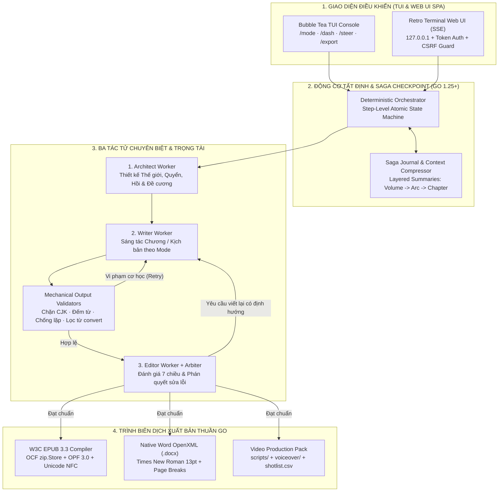

> *"Bảo ChatGPT viết một đoạn văn 500 chữ thì rất hay, nhưng bảo nó viết một cuốn tiểu thuyết trinh thám 50 chương hay một kịch bản video dài 8 phút thì đến chương thứ 3 hung thủ đã biến thành... nạn nhân, văn phong bắt đầu lặp từ như đĩa nhạc xước và thỉnh thoảng lại chèn cả chữ Hán lẫn câu nhắc `[TODO: thêm cảnh đánh nhau vào đây]`!"*

Nếu bạn từng thử dùng các mô hình ngôn ngữ lớn (LLM) để sáng tác nội dung dài kỳ (Long-Form Content Generation) bằng tiếng Việt, chắc chắn bạn đã nếm trải sự bất lực này. 

Các LLM bản chất là những cỗ máy dự đoán token kế tiếp theo xác suất thống kê (autoregressive token predictors), chứ không phải một hệ thống có bộ nhớ cấu trúc dài hạn. Khi ngữ cảnh vượt quá vài chục nghìn từ, ba hiện tượng suy thoái nghiêm trọng sẽ xảy ra:
1. **Trôi dạt ngữ cảnh & Sụp đổ logic (Context Drift & Continuity Collapse):** Nhân vật đã mất ở chương 2 bỗng nhiên xuất hiện uống trà ở chương 7; các quy tắc ma thuật hoặc manh mối phá án bị tự ý bẻ cong.
2. **Rò rỉ đa ngôn ngữ & Suy thoái giải mã (CJK Token Leakage & Degeneration Loops):** Khi dùng các mô hình đa ngôn ngữ (Qwen, DeepSeek, GLM...), xác suất giải mã rất dễ trượt sang các ký tự chữ Hán/Nhật/Hàn (CJK) hoặc rơi vào vòng lặp lặp lại một đoạn văn đến hết ngữ cảnh.
3. **Mất trắng tiến độ khi đứt gãy giữa chừng:** Đang sinh đến chương 18 thì rớt mạng hoặc quá hạn API timeout, toàn bộ trạng thái trung gian trong RAM bốc hơi hoàn toàn.

Để giải quyết triệt để bài toán này bằng kỷ luật kỹ thuật phần mềm, tôi đã xây dựng **`ainovel-cli` (`aidoodle-cli`)** bằng **Go 1.25+** — một động cơ sáng tác tự động hóa tất định hỗ trợ **7 chế độ AI chuyên biệt**, giao diện kép **TUI (Bubble Tea) + Web UI Dashboard**, và trình biên dịch sách điện tử **W3C EPUB 3.3 / Word DOCX thuần Go (Zero Dependency)**.

---

## 1. Minh Chứng & Tổng Quan Hệ Thống (System Overview & Evidence)

| Hạng mục | Minh chứng & Thông số kỹ thuật | Điểm nhấn kiến trúc |
|---|---|---|
| **Mã nguồn & Phát hành** | [`github.com/vinh-gogo/aidoodle-cli`](https://github.com/vinh-gogo/aidoodle-cli) | Ngôn ngữ **Go 1.25+**, biên dịch binary độc lập đa nền tảng (Windows / macOS / Linux) |
| **Kiến trúc điều phối lõi** | **Deterministic Engine + Checkpoint Saga** | Điều phối 3 tác tử (**Architect / Writer / Editor**) + trọng tài ngữ nghĩa (**Arbiter**), lưu vết nguyên tử từng bước |
| **7 Chế độ AI chuyên biệt (`/mode`)** | **5 Mode Tiểu thuyết** (`novel-manga`, `suspense`, `romance`, `fantasy`, `vietnamese-history`) + **2 Mode Kịch bản Video** (`doodle-explainer`, `behavioral-psychology`) | Cô lập 100% kho tài nguyên prompt, style, reference và luật kiểm định cơ học theo từng chế độ |
| **Kiểm soát đầu ra (Validators)** | **Mechanical Output Validators** + **7-Dimension Editor Review** | Chặn 100% ký tự CJK, chống lặp đoạn, kiểm soát ngưỡng từ (2.000–4.500 từ/chương), lọc từ cấm convert Hán-Việt |
| **Giao diện tương tác** | **TUI (`Bubble Tea`)** + **Retro Terminal Web UI (`ainovel-cli web`)** | SPA 3 panel, SSE live streaming, bảo vệ Origin/CSRF (`Sec-Fetch-Site`), chống Path Traversal & XSS |
| **Trình xuất bản đa định dạng** | **W3C EPUB 3.3** · **Microsoft Word (`.docx`)** · **Video Pack (`.csv`/`.md`)** | Thuần Go (Zero Dependency), chuẩn hóa Unicode NFC tiếng Việt, mục lục phân cấp Quyển $\rightarrow$ Hồi $\rightarrow$ Chương |

---

## 2. Kiến Trúc Điều Phối Tất Định: Deterministic Engine & Checkpoint Saga

Thay vì để các LLM Agent tự do trò chuyện vòng tròn với nhau trong một vòng lặp vô tận (vốn rất dễ rơi vào trạng thái deadlock hoặc đốt sạch token), `ainovel-cli` áp dụng nguyên tắc **"Tầng điều phối là tất định, LLM chỉ là hàm tính toán có kiểm soát"**:

### 2.1 Phân rã trách nhiệm 3 Tác tử (Architect – Writer – Editor) và Arbiter
1. **Architect (Kiến trúc sư cốt truyện):** Không viết văn xuôi. Nhiệm vụ duy nhất của Architect là xây dựng cấu trúc vĩ mô: thiết lập quy tắc thế giới (Worldbuilding), hồ sơ tâm lý nhân vật, phân chia **Quyển (Volume) $\rightarrow$ Hồi (Arc) $\rightarrow$ Đề cương từng Chương (Chapter Blueprint)** và cập nhật bảng tóm tắt phân tầng (Layered Summaries) sau mỗi chương để nén ngữ cảnh.
2. **Writer (Người chấp bút):** Nhận đề cương chương hiện tại, trạng thái nhân vật mới nhất và bộ quy tắc giọng văn (Voice/Style layer) của chế độ đang chọn để sáng tác bản thảo.
3. **Editor (Biên tập viên 7 chiều) & Arbiter (Trọng tài):** Chấm điểm bản thảo trên 7 chiều độc lập (tính nhất quán logic, nhịp độ, chiều sâu nhân vật, chất lượng văn phong tiếng Việt, độ bám sát đề cương, sức hút mở/kết chương, và quy tắc đặc thù của từng thể loại). Nếu phát hiện mâu thuẫn cốt truyện, **Arbiter** sẽ ra phán quyết cụ thể cần sửa đoạn nào thay vì viết lại mù quáng.

### 2.2 Khôi phục tức thì với Step-Level Atomic Saga
Mỗi bước chuyển trạng thái trong `ainovel-cli` đều được ghi xuống đĩa theo cơ chế nguyên tử (ghi vào tệp tạm `.tmp` rồi thực hiện `os.Rename` kèm khóa tệp `gofrs/flock`). Nếu quá trình sinh một cuốn tiểu thuyết 100 chương bị ngắt điện ở chương 42 (bước `editor_review`), ngay khi khởi động lại lệnh, hệ thống đọc `SagaLog` và tiếp tục chính xác từ bước `editor_review` của chương 42 mà không tốn lại dù chỉ 1 token cho 41 chương trước đó.

---

## 3. Thiết Kế 7 Chế Độ AI Chuyên Biệt & Chốt Chặn Cơ Học (Mechanical Validators)

Một sai lầm phổ biến của các công cụ viết bằng AI là dùng chung một hệ thống prompt cho mọi thể loại, khiến truyện trinh thám đọc giống hệt truyện ngôn tình, còn kịch bản video thì dài dòng như văn nghị luận.

Trong `ainovel-cli`, lệnh `/mode` cho phép chuyển đổi tức thì giữa **7 chế độ chuyên biệt**, mỗi chế độ sở hữu khung lý thuyết biên kịch và bộ quy tắc kiểm định cơ học riêng biệt:

| Chế độ (`/mode`) | Định dạng đầu ra | Khung lý thuyết & Bất biến nghiệp vụ được cưỡng chế |
|---|---|---|
| **1. `novel-manga`** | Tiểu thuyết / Light Novel (2.000–4.000 từ/chương) | Phân cấp `Volume -> Arc -> Chapter`, phát triển nội tâm đa chiều, cấm rò rỉ thẻ kịch bản. |
| **2. `suspense`** | Trinh thám & Kinh dị (2.500–4.500 từ/chương) | **Luật chơi công bằng Fair-Play 3:2** (mỗi vụ án cài cắm đúng 3 manh mối thật + 2 manh mối giả/red herring), Ma trận Chân tướng Kép, cấm tuyệt đối *Deus Ex Machina*. |
| **3. `romance`** | Ngôn tình & Chữa lành (2.500–4.000 từ/chương) | **Hồ sơ Vết thương Tâm lý (`Lie / Ghost / Need`)**, Thang đo Cảm xúc 6 cấp độ chuyển biến chậm (*Slow-burn*), đối thoại giàu ẩn ý (*Subtext*), loại bỏ 100% sáo ngữ tổng tài. |
| **4. `fantasy`** | Kỳ ảo & Tiên hiệp (2.500–4.500 từ/chương) | **Hệ thống ma thuật quy tắc cứng (3 Định luật Sanderson)**, chiến thuật giao chiến 3 pha, bộ lọc sạch từ rác dịch máy convert Hán-Việt (*"hít một ngụm khí lạnh"*, *"không khỏi"*...). |
| **5. `vietnamese-history`** | Lịch sử Việt Nam (2.000–4.000 từ/chương) | **Bảng bất biến lịch sử** (tích hợp tra cứu thực tế qua **Tavily Search** có cơ chế Graceful Fallback), xưng hô Đại Việt chuẩn niên đại, bắt buộc có **Hậu ký & Ghi chú lịch sử tác giả**. |
| **6. `doodle-explainer`** | Kịch bản Video Người Que (5–8 phút, 700–1.500 từ LỜI) | Nhịp **1:1 Thoại (`LỜI:`) – Hình (`HÌNH:`)** xen kẽ liên tục mỗi 3–6 giây, cấu trúc 5 giai đoạn, Tái Hook mỗi 60–90 giây. |
| **7. `behavioral-psychology`** | Kịch bản Tâm lý học Hành vi (5–8 phút) | **Khung khoa học não bộ 8 bước**, phân biệt tương quan vs. nhân quả, cảnh báo mẫu WEIRD, Cú hích hành vi (*Nudge*), rào chắn đạo đức **cấm chẩn đoán y tế**. |

Trước khi bản thảo của Writer được phép chuyển sang Editor, nó phải vượt qua **Bộ Kiểm Tra Cơ Học (`Mechanical Output Validators`)** viết bằng Go thuần:
* **Quét mã điểm Unicode CJK:** Phát hiện và từ chối ngay lập tức bất kỳ ký tự chữ Hán, Hiragana, Katakana hay Hangul nào lọt vào văn bản tiếng Việt.
* **Kiểm tra cấu trúc & suy thoái giải mã:** Phát hiện câu kết thúc cụt giữa chừng (thiếu dấu kết câu hợp lệ), phát hiện các đoạn văn lặp lại quá ngưỡng tương đồng Jaccard, và kiểm tra nghiêm ngặt số lượng từ tối thiểu/tối đa của từng chế độ.
* **Bộ kiểm tra kịch bản `lintScript` (dành cho 2 mode video):** Đảm bảo tỷ lệ cặp thẻ `LỜI:` / `HÌNH:` khớp 1:1 và thời lượng đọc ước tính nằm đúng trong khung 300–600 giây.

---

## 4. Trình Biên Dịch W3C EPUB 3.3 & Word OpenXML Thuần Go (Zero Dependency)

Hầu hết các công cụ xuất sách điện tử hiện nay đều phải gọi các công cụ bên ngoài nặng nề như `Calibre` hoặc `Pandoc`. Để đảm bảo một tệp thực thi `ainovel-cli.exe` duy nhất chạy được ngay lập tức trên mọi máy tính, tôi đã tự cài đặt trình biên dịch **W3C EPUB 3.3** và **Microsoft Word (`.docx`)** bằng thư viện chuẩn của Go (`archive/zip`, `encoding/xml`, `golang.org/x/text/unicode/norm`):

1. **Đóng gói chuẩn OCF (Open Container Format) ở mức Byte:**
   - Theo đặc tả W3C EPUB 3.3, tệp đầu tiên trong kho lưu trữ ZIP (`Entry 0`) bắt buộc phải là tệp `mimetype` chứa chuỗi `application/epub+zip`, được lưu ở chế độ **không nén (`zip.Store`)** và không có trường mở rộng header để các máy đọc sách phần cứng (Kindle, Kobo) nhận diện chữ ký byte ở offset `30..58`.
2. **Chuẩn hóa Unicode NFC & Lọc ký tự điều khiển XML 1.0:**
   - Tiếng Việt copy từ nhiều nguồn thường lẫn lộn giữa Unicode dựng sẵn (NFC) và tổ hợp (NFD), gây lỗi vỡ dấu trên các trình đọc sách cũ. Trình biên dịch tự động ép toàn bộ văn bản qua bộ chuẩn hóa **`norm.NFC`** và lọc sạch các byte điều khiển cấm trong XML 1.0 (`0x00`–`0x1F` trừ `\t`, `\n`, `\r`).
3. **Mục lục phân cấp 3 tầng (`nav.xhtml`) & EPUB Accessibility 1.1:**
   - Tự động sinh cây mục lục lồng nhau **Quyển (Volume) $\rightarrow$ Hồi (Arc) $\rightarrow$ Chương (Chapter)** kèm vùng định hướng `<nav epub:type="landmarks">` và đầy đủ siêu dữ liệu Dublin Core (`dc:title`, `dc:language`, `dc:identifier`, `dcterms:modified`).
4. **Xuất gói sản xuất Video (`/export --video`):**
   - Đối với hai chế độ kịch bản video, hệ thống tự động bóc tách lời thoại sạch vào `voiceover/` (sẵn sàng đưa vào pipeline TTS), đồng thời xuất bảng phân cảnh `shotlist.csv` và `publish.csv` có đính kèm chữ ký byte **UTF-8 BOM (`0xEF 0xBB 0xBF`)** để mở trực tiếp trên Microsoft Excel không bao giờ bị lỗi phông tiếng Việt.

---

## 5. Gia Cố An Ninh Cho Retro Terminal Web UI (`ainovel-cli web`)

Bên cạnh giao diện dòng lệnh TUI, `ainovel-cli web` cung cấp một giao diện điều khiển trực quan trên trình duyệt theo phong cách Retro Terminal 3 cột với luồng truyền dữ liệu thời gian thực qua **Server-Sent Events (SSE)**. 

Dù là công cụ chạy cục bộ, hệ thống vẫn được thiết kế theo chuẩn an ninh phòng thủ chiều sâu (Defense-in-Depth):
* **Mặc định Bind Loopback (`127.0.0.1`):** Ngăn chặn các thiết bị khác trong cùng mạng Wi-Fi công cộng truy cập trái phép. Khi người dùng chủ động bật cờ `--external` để dùng qua điện thoại trong mạng LAN, hệ thống hỗ trợ xác thực qua khóa `--token`.
* **Chống tấn công Cross-Site Request Forgery (CSRF) & DNS Rebinding:** Kiểm tra nghiêm ngặt header `Origin` và `Sec-Fetch-Site` trên mọi request thay đổi trạng thái (`POST`), chặn đứng việc trang web độc hại trên trình duyệt lén gọi vào `localhost:8080`.
* **Chống Path Traversal & Khử độc XSS:** Mọi đường dẫn đọc chương hoặc tải file xuất bản đều được chuẩn hóa qua `filepath.Clean` và kiểm tra tiền tố tuyệt đối nằm trong thư mục `output/`, kết hợp lọc sạch mã thực thi trước khi render Markdown.

---

## 6. Kết Luận

**`ainovel-cli` (`aidoodle-cli`)** chứng minh rằng: khi kết hợp sức mạnh biểu đạt ngôn ngữ của LLM với một **kiến trúc máy trạng thái tất định (Deterministic Saga Engine)**, **bộ kiểm định cơ học không khoan nhượng** và **hiệu năng biên dịch của ngôn ngữ Go**, chúng ta có thể biến quá trình sáng tác nội dung dài kỳ từ những phép thử may rủi thành một dây chuyền kỹ thuật ổn định, có thể phục hồi và xuất bản trực tiếp ra chuẩn công nghiệp.
