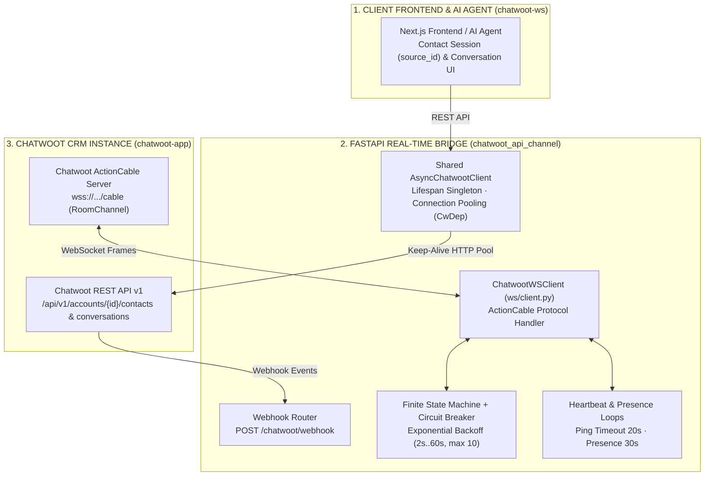
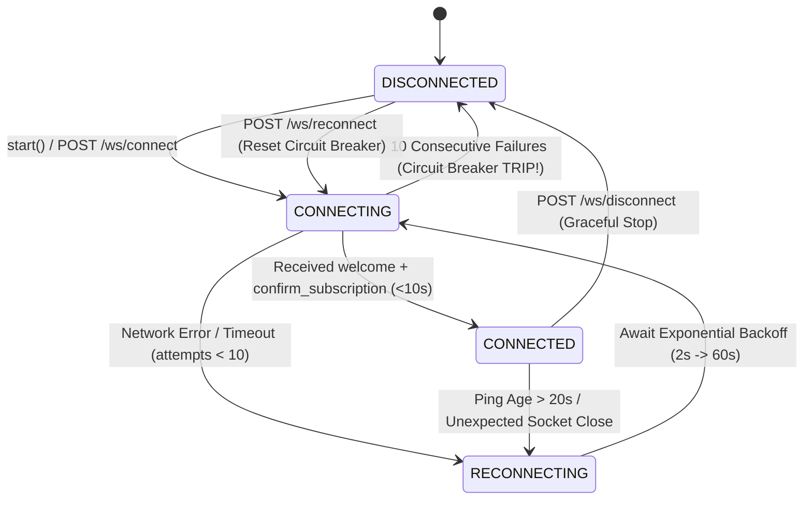

> *"Your custom customer-support gateway talks to Chatwoot cleanly on localhost. Then you deploy to production with hundreds of concurrent conversations: every outbound message pays a 300ms TLS handshake penalty, and the ActionCable WebSocket silently enters a half-open zombie state after a brief network blip without raising a single exception!"*

When integrating the open-source customer engagement platform **Chatwoot** into a custom web/mobile frontend or an AI Agent gateway via **API Channel (`Channel::Api`)**, many implementations stop at a basic webhook receiver.

In production environments, however, a reliable real-time messaging bridge must overcome three classic distributed-systems pitfalls:
1. **Silent Zombie Connections in Rails ActionCable:** Chatwoot streams real-time events over Ruby on Rails ActionCable (`wss://.../cable`). If a client opens a raw WebSocket without periodically dispatching `update_presence` frames and actively monitoring server-side `ping` frames, transient NAT or load-balancer drops leave the client stuck in a *half-open zombie connection*—believing it is connected while missing every live event.
2. **Reconnection Storms (Thundering Herd):** When a Chatwoot instance restarts for maintenance, naive clients spinning in tight `while True` reconnect loops hammer the server simultaneously, triggering self-inflicted denial-of-service.
3. **Socket Exhaustion on Outbound REST Calls:** Instantiating a fresh `httpx.AsyncClient` per request destroys HTTP Keep-Alive connection reuse, inflating latency and exhausting ephemeral ports under load.

This article examines the architecture of **`chatwoot_api_channel`** (Python 3.12+ FastAPI service) and **`chatwoot-ws`** (Next.js frontend)—a resilient bidirectional real-time bridge between custom applications, AI agents, and Chatwoot.

---

## 1. System Overview & Technical Specifications

| Dimension | Component & Specification | Core Engineering Solution |
|---|---|---|
| **Ecosystem Components** | **`chatwoot_api_channel`** (FastAPI Backend) · **`chatwoot-ws`** (Next.js App) · **`chatwoot-app`** (Docker Stack) | Clean separation between Client UI, Real-Time API/WS Bridge, and Chatwoot Core |
| **HTTP Connection Management** | **Shared `AsyncChatwootClient` (Lifespan Singleton)** | Initialized once during FastAPI `lifespan` and injected via `CwDep` for persistent HTTP connection pooling |
| **WebSocket State Machine** | **`ChatwootWSClient` (ActionCable State Machine)** | 4 explicit states: `DISCONNECTED` $\rightarrow$ `CONNECTING` $\rightarrow$ `CONNECTED` $\rightarrow$ `RECONNECTING` |
| **Liveness & Health Monitoring** | **Heartbeat Watchdog (`20s`)** + **Presence Loop (`30s`)** | Detects half-open zombie sockets whenever ActionCable `ping` age exceeds `20 seconds` |
| **Self-Healing & Fault Isolation** | **Exponential Backoff (`2s` $\rightarrow$ `60s`)** + **Circuit Breaker (`10` max attempts)** | Trips the circuit breaker after 10 consecutive failures; supports manual reset via `POST /ws/reconnect` |
| **Verification & Load Testing** | **Unit Test Suite (`pytest`)** + **Load Test Router (`/load-test`)** | Deterministic mock testing of state transitions and high-concurrency stress testing |

---

## 2. End-to-End Architecture: Dual-Stream Webhook + ActionCable Bridge

The architecture pairs Chatwoot's REST API with dual event streams to guarantee both low latency and delivery durability:
* **Outbound (Application $\rightarrow$ Chatwoot REST API):** Manages the contact identity lifecycle (`Contact` $\rightarrow$ `source_id`), conversation creation, and message dispatch through the shared `AsyncChatwootClient` connection pool.
* **Inbound (Chatwoot $\rightarrow$ Application / AI Agent):** Consumes both **ActionCable WebSocket** frames (sub-second latency for typing indicators, presence updates, and instant messages) and **HTTP Webhooks (`/chatwoot/webhook`)**.

---

## 3. Engineering the ActionCable WebSocket State Machine & Circuit Breaker

Unlike raw WebSockets that stream payloads immediately upon handshake, Rails **ActionCable** requires a multi-stage protocol negotiation:
1. Establish the `wss://.../cable` connection and await the server's `{"type": "welcome"}` frame.
2. Dispatch a `subscribe` command for `RoomChannel` carrying the `pubsub_token`, `account_id`, and `user_id`.
3. Await `{"type": "confirm_subscription"}` within `SUBSCRIBE_TIMEOUT` (`10 seconds`).
4. Continuously emit `update_presence` every `30 seconds` (`PRESENCE_INTERVAL`) while monitoring incoming `{"type": "ping"}` frames (treating any silence exceeding `HEARTBEAT_TIMEOUT = 20 seconds` as a dead connection).

To orchestrate these concurrent coroutines without race conditions, `ws/client.py` models the connection lifecycle as a strict **Finite State Machine** protected by a **Circuit Breaker**:

### Three Reliability Mechanisms Inside `ChatwootWSClient`:
1. **Proactive Zombie-Socket Detection (Heartbeat Watchdog):** A dedicated watchdog coroutine tracks `last_ping_age`. If `20 seconds` elapse without an ActionCable `ping`, the watchdog forcibly terminates the stale socket and transitions to `RECONNECTING`—eliminating silent message drops.
2. **Capped Exponential Backoff:** Reconnection intervals scale exponentially:
   $$\text{delay} = \min\left(\text{RECONNECT\_BASE\_DELAY} \times 2^{\text{attempt} - 1}, \text{RECONNECT\_MAX\_DELAY}\right)$$
   stepping from `2s` $\rightarrow$ `4s` $\rightarrow$ `8s` up to a `60s` ceiling so recovering upstream servers are never overwhelmed.
3. **Automatic Circuit Breaker & Control Plane Endpoints:** After `10` consecutive failed attempts (`RECONNECT_MAX_ATTEMPTS`), the circuit breaker trips (`circuit_breaker_tripped = True`), halting further retries and transitioning to `DISCONNECTED`. Operators can inspect live telemetry (`state`, `attempt`, `last_ping_age`, `circuit_breaker`) via `GET /ws/status` and reset the breaker on demand via `POST /ws/reconnect`.

---

## 4. Connection Pooling with Shared `AsyncChatwootClient` & the 3-Step Channel Flow

Creating a new HTTP client per request wastes CPU and network round-trips on repeated TCP/TLS handshakes. In `chatwoot_api_channel`, **`AsyncChatwootClient`** is instantiated once inside FastAPI's `lifespan` context manager and injected into route handlers via `CwDep`:
* Reuses persistent HTTP Keep-Alive connections across all outbound REST requests.
* Drains and closes sockets cleanly during application shutdown.

On the client side, **`chatwoot-ws` (Next.js)** implements the canonical 3-step Chatwoot API Channel lifecycle:
1. **Step 1 — Contact Provisioning (`POST /api/v1/accounts/{id}/contacts`):** Registers the contact against the target API `inbox_id` and persists the returned session **`source_id`** (`contact_inboxes[0].source_id`).
2. **Step 2 — Conversation Initialization (`POST /api/v1/accounts/{id}/conversations`):** Binds the `source_id` and `inbox_id` to open or resume a stateful `conversation_id`.
3. **Step 3 — Bidirectional Messaging (`POST .../messages` & ActionCable Stream):** Dispatches customer (`incoming`) and agent/bot (`outgoing`) messages while streaming real-time updates back to the UI.

---

## 5. Conclusion

Building **`chatwoot_api_channel`** and **`chatwoot-ws`** highlights a core lesson in distributed systems engineering: calling a third-party REST endpoint is only 20% of an integration; the remaining 80% lies in **persistent connection pooling, proactive heartbeat watchdogs, exponential-backoff state machines, and circuit breakers** that keep real-time channels alive when networks inevitably falter.
