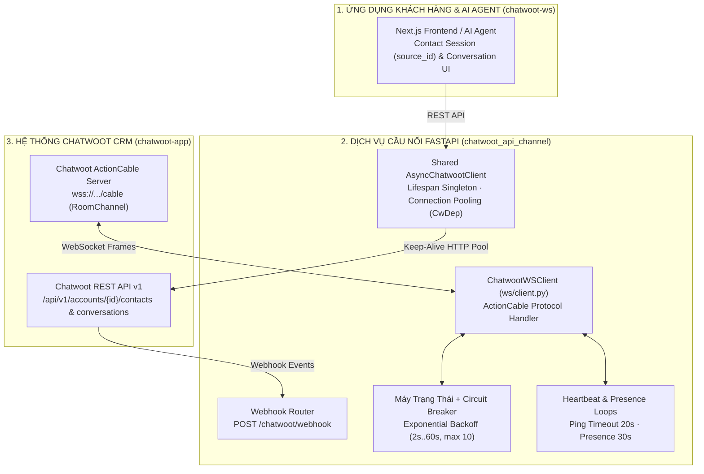
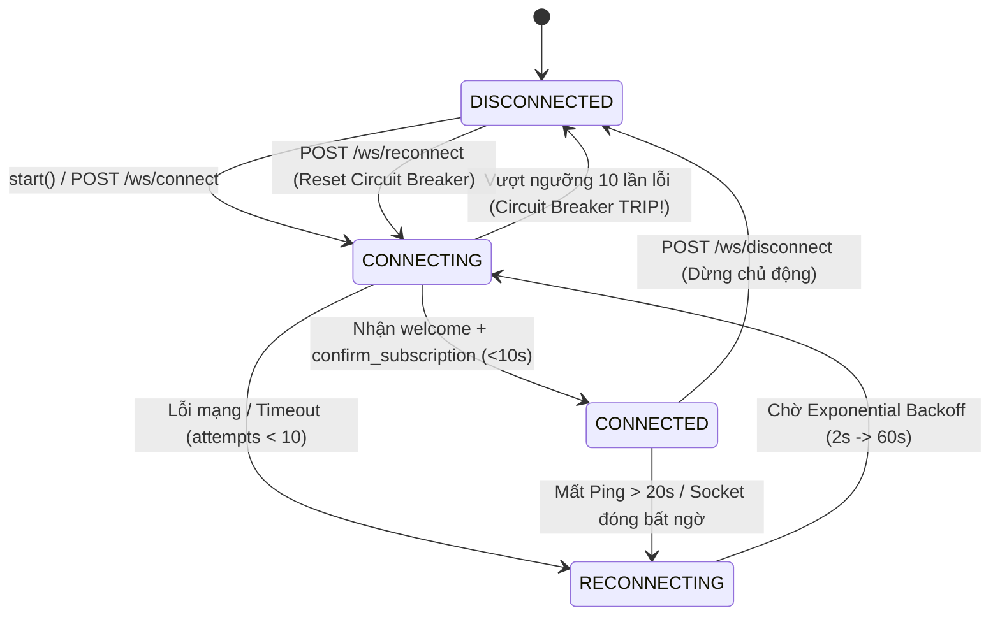

> *"Dựng xong cổng chat CSKH kết nối với Chatwoot qua Webhook, chạy thử trên máy local thì mượt. Nhưng khi đưa lên môi trường thật với hàng trăm cuộc hội thoại đồng thời, mỗi lần gửi tin nhắn hệ thống lại khởi tạo mới một kết nối TLS tốn 300ms, còn kênh WebSocket ActionCable thì âm thầm 'chết lâm sàng' (half-open socket) sau 15 phút mạng chập chờn mà không báo một dòng lỗi!"*

Khi tích hợp nền tảng chăm sóc khách hàng mã nguồn mở **Chatwoot** vào một hệ thống ứng dụng riêng (Custom Web/Mobile App hoặc AI Agent Gateway) thông qua **API Channel (`Channel::Api`)**, nhiều lập trình viên thường chỉ dừng lại ở việc viết vài endpoint nhận Webhook đơn giản.

Tuy nhiên, trong môi trường vận hành thực tế (Production), một cầu nối giao tiếp thời gian thực đòi hỏi phải giải quyết ba bài toán kỹ thuật hệ thống gai góc:
1. **Giao thức ActionCable WebSocket đỏng đảnh của Rails:** Chatwoot sử dụng ActionCable trên nền Ruby on Rails (`wss://.../cable`). Nếu client chỉ mở kết nối WebSocket thông thường mà không gửi gói tin duy trì hiện diện (`update_presence`) định kỳ hoặc không giám sát nhịp tim (`ping` frame), kết nối rất dễ rơi vào trạng thái "sống thực vật" (*zombie connection*): socket phía client vẫn báo mở nhưng server đã ngắt phân phối sự kiện từ lâu.
2. **Bão kết nối lại (Thundering Herd) khi máy chủ Chatwoot bảo trì:** Nếu kết nối bị đứt và client cứ lặp `while True` gọi kết nối lại ngay lập tức, nó sẽ tự thực hiện một cuộc tấn công từ chối dịch vụ (DoS) vào chính máy chủ Chatwoot khi dịch vụ vừa khởi động lại.
3. **Cạn kiệt cổng mạng (Socket Exhaustion) khi gọi REST API:** Khởi tạo mới đối tượng `httpx.AsyncClient` cho mỗi lượt gửi tin nhắn sẽ phá hủy cơ chế tái sử dụng kết nối (HTTP Keep-Alive Connection Pooling), làm tăng độ trễ bắt tay TCP/TLS và gây nghẽn ở tải cao.

Bài viết này phân tích chi tiết kiến trúc của hai dự án **`chatwoot_api_channel`** (Backend FastAPI Python 3.12+) và **`chatwoot-ws`** (Frontend Next.js) — giải pháp cầu nối hai chiều thời gian thực giữa ứng dụng tùy chỉnh, AI Agent và Chatwoot.

---

## 1. Tổng Quan Kiến Trúc & Thông Số Kỹ Thuật (System Overview & Specs)

| Hạng mục | Thành phần & Thông số kỹ thuật | Giải pháp kỹ thuật cốt lõi |
|---|---|---|
| **Dự án trong Hệ sinh thái** | **`chatwoot_api_channel`** (FastAPI Backend) · **`chatwoot-ws`** (Next.js App) · **`chatwoot-app`** (Docker Stack) | Kiến trúc tách lớp giữa Giao diện khách hàng, Cầu nối API/WebSocket và Lõi CRM Chatwoot |
| **Quản lý Kết nối HTTP** | **Shared `AsyncChatwootClient` (Lifespan Singleton)** | Khởi tạo 1 lần duy nhất trong `lifespan` của FastAPI, dùng chung HTTP/1.1 & HTTP/2 Connection Pool qua `CwDep` |
| **Máy trạng thái WebSocket** | **`ChatwootWSClient` (ActionCable State Machine)** | 4 trạng thái tường minh: `DISCONNECTED` $\rightarrow$ `CONNECTING` $\rightarrow$ `CONNECTED` $\rightarrow$ `RECONNECTING` |
| **Giám sát Sức khỏe Kết nối** | **Heartbeat Monitor (`20s`)** + **Presence Loop (`30s`)** | Tự động phát hiện kết nối "chết lâm sàng" khi quá `20s` không nhận được `ping` từ ActionCable |
| **Cơ chế Tự phục hồi & Cầu chì** | **Exponential Backoff (`2s` $\rightarrow$ `60s`)** + **Circuit Breaker (`10` lần thử)** | Tự động ngắt cầu chì sau 10 lần kết nối thất bại liên tiếp, hỗ trợ khôi phục chủ động qua `POST /ws/reconnect` |
| **Kiểm thử & Chịu tải** | **Bộ Unit Tests (`pytest`)** + **Load Testing Router (`/load-test`)** | Giả lập luồng sự kiện WebSocket & kiểm chứng độ bền dưới tải đồng thời cao |

---

## 2. Kiến Trúc Tổng Thể: Cầu Nối Kép Webhook + ActionCable WebSocket

Hệ thống kết hợp cả hai kênh giao tiếp của Chatwoot để đảm bảo không bao giờ rơi rớt tin nhắn:
* **Chiều từ Ứng dụng vào Chatwoot (REST API Channel):** Quản lý vòng đời định danh liên hệ (`Contact` $\rightarrow$ `source_id`), khởi tạo hội thoại (`Conversation`) và đẩy tin nhắn qua `AsyncChatwootClient` dùng chung hồ kết nối (Connection Pool).
* **Chiều từ Chatwoot ra Ứng dụng / AI Agent (Dual-Stream):** Nhận song song qua **ActionCable WebSocket** (độ trễ mili-giây cho trạng thái đang gõ `typing_on/off`, hiện diện trực tuyến và tin nhắn tức thì) và **HTTP Webhook (`/chatwoot/webhook`)** làm kênh đảm bảo toàn vẹn dữ liệu.

---

## 3. Thiết Kế Máy Trạng Thái ActionCable WebSocket & Circuit Breaker

Giao thức **ActionCable** của Chatwoot không hoạt động như một WebSocket thuần túy gửi dữ liệu ngay khi mở socket. Để nhận được sự kiện thời gian thực, client phải trải qua quy trình bắt tay nhiều bước:
1. Mở kết nối `wss://.../cable` và chờ gói tin `{"type": "welcome"}`.
2. Gửi lệnh đăng ký kênh (`subscribe`) tới `RoomChannel` kèm `pubsub_token`, `account_id` và `user_id`.
3. Chờ gói tin xác nhận `{"type": "confirm_subscription"}` trong vòng `SUBSCRIBE_TIMEOUT` (`10 giây`).
4. Duy trì vòng lặp gửi lệnh `update_presence` mỗi `30 giây` (`PRESENCE_INTERVAL`) và giám sát gói tin `{"type": "ping"}` từ server (nếu quá `HEARTBEAT_TIMEOUT = 20 giây` không có ping, kết nối bị coi là đứt ngầm).

Để quản lý chặt chẽ vòng đời phức tạp này mà không xảy ra điều kiện tranh chấp (race condition) giữa các coroutine bất đồng bộ, `ws/client.py` mô hình hóa kết nối thành một **Máy trạng thái hữu hạn (Finite State Machine)** kết hợp **Cầu chì ngắt mạch (Circuit Breaker)**:

### Ba cơ chế bảo vệ sống còn trong `ChatwootWSClient`:
1. **Phát hiện sớm kết nối "Chết lâm sàng" (Heartbeat Watchdog):** Một tác vụ nền độc lập liên tục kiểm tra độ tuổi của gói tin `ping` gần nhất (`last_ping_age`). Ngay khi vượt quá `20 giây`, watchdog chủ động hủy socket bị treo và đẩy máy trạng thái sang `RECONNECTING`, loại bỏ hoàn toàn tình trạng mất tin nhắn âm thầm.
2. **Lùi lũy thừa có trần (Capped Exponential Backoff):** Khoảng thời gian chờ giữa các lần thử kết nối lại tăng theo cấp số nhân:
   $$\text{delay} = \min\left(\text{RECONNECT\_BASE\_DELAY} \times 2^{\text{attempt} - 1}, \text{RECONNECT\_MAX\_DELAY}\right)$$
   (từ `2s` $\rightarrow$ `4s` $\rightarrow$ `8s` $\rightarrow$ ... trần tối đa `60s`), giúp máy chủ Chatwoot có thời gian hồi phục khi khởi động lại.
3. **Cầu chì bảo vệ (Circuit Breaker):** Nếu kết nối thất bại liên tiếp `10 lần` (`RECONNECT_MAX_ATTEMPTS`), cầu chì sẽ tự động ngắt (`circuit_breaker_tripped = True`), đưa trạng thái về `DISCONNECTED` và ngừng bắn request vô ích. Quản trị viên hoặc hệ thống giám sát có thể kiểm tra sức khỏe qua `GET /ws/status` và đóng lại cầu chì tức thì qua `POST /ws/reconnect`.

---

## 4. Tối Ưu Hóa Hiệu Năng Với Shared `AsyncChatwootClient` & Quy Trình Nghiệp Vụ 3 Bước

Trong nhiều dự án FastAPI viết vội, lập trình viên thường viết `async with httpx.AsyncClient() as client:` ngay bên trong từng hàm xử lý request. Ở mức 100 request/giây, việc đóng mở kết nối TCP và bắt tay TLS lặp đi lặp lại sẽ làm độ trễ tăng vọt.

Tại `chatwoot_api_channel`, đối tượng **`AsyncChatwootClient`** được khởi tạo **một lần duy nhất** trong hàm quản lý vòng đời ứng dụng (`lifespan` của FastAPI) và được tiêm (inject) vào mọi route thông qua Dependency Injection (`CwDep`):
* Tái sử dụng toàn bộ các kết nối TCP/TLS đang mở trong Connection Pool cho hàng nghìn lượt gọi API liên tiếp.
* Đóng kết nối êm ái (graceful shutdown) khi tiến trình FastAPI dừng hoạt động.

Song song đó, giao diện **`chatwoot-ws` (Next.js)** chuẩn hóa luồng nghiệp vụ 3 bước bất biến khi giao tiếp với kênh API của Chatwoot:
1. **Bước 1 — Khởi tạo & Định danh Liên hệ (`POST /api/v1/accounts/{id}/contacts`):** Truyền `inbox_id` của kênh API để nhận về mã định danh phiên **`source_id`** trong `contact_inboxes[0].source_id`.
2. **Bước 2 — Khởi tạo Hội thoại (`POST /api/v1/accounts/{id}/conversations`):** Gắn `source_id` vừa tạo với `inbox_id` để mở phiên chat và nhận `conversation_id`.
3. **Bước 3 — Luồng Tin nhắn Hai chiều (`POST .../messages` & ActionCable Stream):** Gửi tin nhắn chiều đi (`message_type: "incoming"` đối với khách hàng, `"outgoing"` đối với tư vấn viên/bot) và nhận phản hồi trực tiếp qua luồng WebSocket thời gian thực.

---

## 5. Kết Luận

Việc xây dựng **`chatwoot_api_channel`** và **`chatwoot-ws`** cho thấy: để tích hợp một hệ thống hội thoại thời gian thực đạt chuẩn doanh nghiệp, việc gọi đúng REST endpoint mới chỉ là 20% chặng đường; 80% giá trị cốt lõi nằm ở **quản lý vòng đời kết nối (`Connection Pooling`), giám sát nhịp tim chủ động (`Heartbeat Watchdog`), máy trạng thái tự phục hồi (`Exponential Backoff`) và cầu chì chống sập dây chuyền (`Circuit Breaker`)**.
