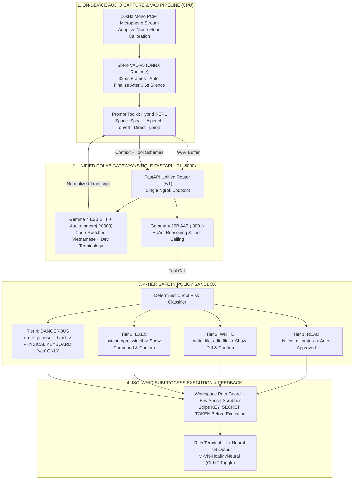

> *"You want to tell your terminal agent 'run pytest on the tests folder and summarize the failures' in natural Vietnamese mixed with English developer jargon—but standard speech recognizers mangle 'pytest' and 'git commit' into gibberish, or worse, mishear background noise and execute a destructive shell command!"*

Building a production-grade **Voice-Controlled Terminal Agent** for Vietnamese developers requires solving two fundamental engineering challenges:
1. **Vietnamese–English Code-Switching & Hands-Free Latency:** Developers in Vietnam naturally mix Vietnamese grammar with English technical terms (*"Kiểm tra `git status`, chạy `pytest` file `test_agent.py` rồi mở `VS Code`"*). Furthermore, if speaking requires pressing a button to start and pressing `Enter` to stop, voice input becomes slower than typing.
2. **Catastrophic Security Risks of Voice-Triggered Shell Execution:** What happens if ambient noise or a speech-to-text (STT) hallucination gets interpreted as `rm -rf` or `git reset --hard`, and the agent executes it autonomously?

To solve both problems cleanly, I engineered **`claw-cli`** ([`github.com/vinh-gogo/claw-cli`](https://github.com/vinh-gogo/claw-cli))—a **Hybrid Voice & Text Terminal Assistant** combining real-time CPU **Silero VAD v5 ONNX** voice activity detection, a **Unified Colab Gateway (`Gemma 4 26B + Gemma 4 E2B STT`)**, and a strict **4-Tier Safety Policy Sandbox**.

---

## 1. System Overview & Technical Specifications

| Dimension | Specification & Evidence | Core Engineering Solution |
|---|---|---|
| **Source Repository** | [`github.com/vinh-gogo/claw-cli`](https://github.com/vinh-gogo/claw-cli) | Python 3.11+, Typer, Rich, Prompt Toolkit, SoundDevice, ONNX Runtime |
| **On-Device Voice Detection** | **Silero VAD v5 (ONNX Runtime CPU)** | Adaptive Noise-Floor Hysteresis, automatic end-of-utterance finalization after `0.6s` of silence |
| **3 Seamless Input Modes** | **Hybrid Mode** (default) · **`/speech on`** (continuous hands-free) · **`/speech off`** (text-only) | Instant runtime mode switching without restarting the REPL session |
| **Unified AI Gateway (Colab GPU)** | **Gemma 4 26B A4B** (`Port 8001`) + **Gemma 4 E2B STT + Audio mmproj** (`Port 8003`) | Multiplexed behind a single **FastAPI Gateway (`Port 8000`)**, booting in `~45 seconds` via pre-built `llama.cpp` CUDA binaries |
| **Execution Safety Sandbox** | **4-Tier Safety Policy Sandbox** (`read`, `write`, `exec`, `dangerous`) | Strictly prohibits voice approval for `dangerous` commands (requires physical keyboard `yes`), blocks path traversal, and scrubs env secrets |
| **OS Control & Neural TTS** | **`winctl`** Windows 10/11 automation + **`vi-VN-HoaiMyNeural`** TTS | Instant barge-in cancellation via `Esc` key or spoken *"dừng"* (*"stop"*) command |

---

## 2. End-to-End Architecture: From 32ms Audio Frames to Sandboxed Execution

Every spoken or typed command in `claw-cli` flows through four isolated architectural layers across the local workstation and the Unified Gateway:

---

## 3. Hands-Free End-of-Utterance Detection with Silero VAD v5 ONNX

Traditional energy-based voice detectors (RMS amplitude thresholds) fail in real developer environments: laptop cooling fans and mechanical keyboard clicks constantly trip the microphone, preventing the system from detecting when the speaker has finished talking.

In `claw-cli`, the `16kHz` audio stream is processed locally on the CPU by **Silero VAD v5** via **ONNX Runtime** in `32ms` (`512-sample`) frames:
1. **Adaptive Noise-Floor Hysteresis:** The detector combines the neural speech probability $p_{\text{speech}} \in [0, 1]$ with dual hysteresis watermarks—a high watermark to transition into `SPEAKING` state and a lower watermark to maintain the utterance across brief natural breathing pauses.
2. **Automatic `0.6s` Silence Finalization:** Once speech probability stays below the low watermark for `600ms` following valid speech, the capture loop automatically seals the audio buffer and dispatches it for transcription—**requiring zero `Enter` key presses**.
3. **Three Ergonomic Input Modes:**
   - **Hybrid Mode (Default):** Pressing `Space` on an empty prompt immediately activates voice capture; typing any character treats `Space` as a normal whitespace character.
   - **Continuous Voice Mode (`/speech on`):** Automatically re-arms the microphone after each agent turn, enabling a 100% hands-free conversational coding loop.
   - **Text-Only Mode (`/speech off`):** Disables microphone triggers entirely when working in shared or noisy spaces.

---

## 4. Single-URL Unified Colab Gateway: 45-Second Cold Boot

To run both multimodal speech recognition and high-parameter tool-calling inference without taxing local laptop RAM, `claw-cli` includes a custom-engineered Google Colab notebook ([`colab/colab_llama_cpp_ngrok.ipynb`](https://github.com/vinh-gogo/claw-cli)):

* **~45-Second Cold Boot:** Instead of compiling `llama.cpp` from source (which takes 10–15 minutes), the setup cell pulls pre-built Ubuntu CUDA `llama-server` binaries and downloads all GGUF weights in parallel via `hf_transfer` at `500–800 MB/s`.
* **Dual Models Behind One FastAPI Gateway (`Port 8000`):**
  - **Port 8001 (Main LLM Backend):** Runs **Gemma 4 26B A4B** for ReAct reasoning and structured tool calling.
  - **Port 8003 (Multimodal STT Backend):** Runs **Gemma 4 E2B STT + Audio `mmproj`**, accurately transcribing code-switched Vietnamese and English software engineering terms (`git rebase`, `docker compose`, `pyproject.toml`, `FastAPI`).
  - **Port 8000 (FastAPI Unified Gateway):** Routes both `/v1/chat/completions` and `/v1/audio/transcriptions` through **a single Ngrok tunnel URL** (`CLAW_BASE_URL`).

---

## 5. The 4-Tier Safety Policy Sandbox: Why Voice Never Gets Root Power

The centerpiece of `claw-cli`'s security model is its deterministic **4-Tier Safety Policy Sandbox**. Every tool invocation proposed by the LLM is intercepted and classified into one of four strict risk tiers before touching the operating system:

| Risk Tier | Representative Actions & Tools | Enforcement Policy |
|---|---|---|
| **Tier 1: `read`** | `ls`, `cat`, `git status`, `git diff`, `pytest --collect-only`, reading workspace files | **Auto-Approved** — executes immediately for zero-friction inspection. |
| **Tier 2: `write`** | `write_file`, `edit_file`, creating or modifying files inside the workspace | **Displays Unified Diff Preview** and requires user confirmation (via voice or keyboard). |
| **Tier 3: `exec`** | `pytest`, `python main.py`, `npm install`, `winctl` window management | **Displays Exact Command Line** and requires explicit user confirmation before spawning. |
| **Tier 4: `dangerous`** | `rm -rf`, `del /f /s`, `git reset --hard`, `git push --force`, `sudo`, `format` | **VOICE APPROVAL STRICTLY FORBIDDEN!** Requires typing **`yes` on the physical keyboard**. |

In addition to permission tiers, the subprocess execution layer enforces **two mechanical isolation guards**:
1. **Workspace Path Sandboxing:** Every file path argument is canonicalized with `Path.resolve()` and verified against the active workspace root, blocking `../` path traversal and protecting sensitive dotfiles (`.env`, `.ssh/`, `.git/config`).
2. **Environment Secret Scrubbing:** Before spawning any shell command, the executor strips all environment variables matching `KEY`, `SECRET`, `TOKEN`, `PASSWORD`, or `CREDENTIAL` from the child process environment—preventing accidental credential exfiltration via prompt injection or shell output.

---

## 6. Conclusion

**`claw-cli`** bridges **on-device neural audio processing (Silero VAD v5 ONNX)**, **multimodal LLM reasoning (Gemma 4)**, and **deterministic systems security (4-Tier Sandbox)**—proving that a voice-driven terminal assistant can be both effortlessly natural for bilingual developers and mechanically safe on production workstations.
