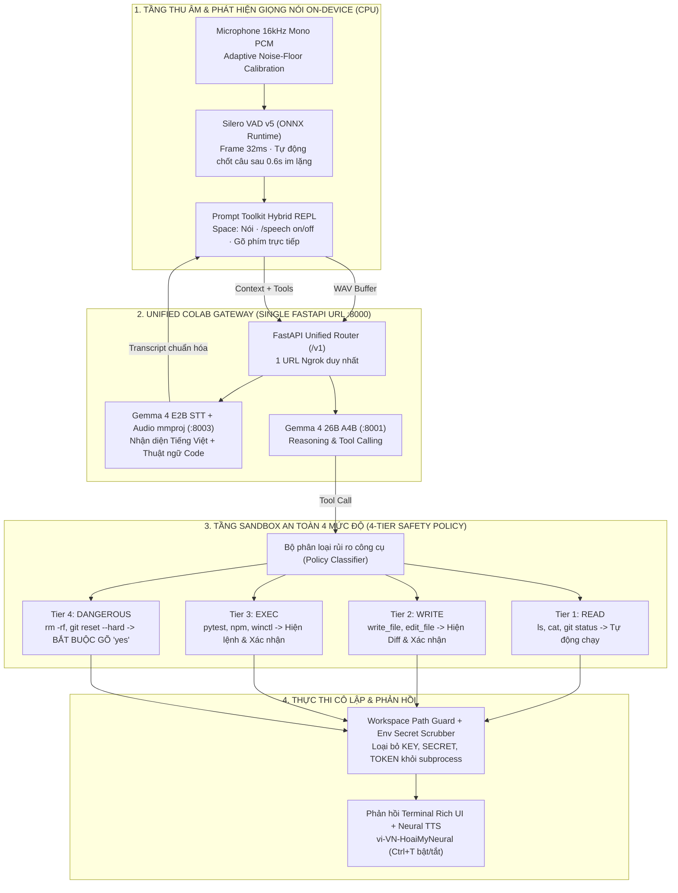

> *"Đang gõ dở tay trên bàn phím mà muốn bảo AI 'chạy pytest thư mục tests rồi tóm tắt lỗi cho anh' bằng giọng nói tiếng Việt pha lẫn thuật ngữ tiếng Anh, nhưng các bộ nhận diện giọng nói thông thường cứ dịch 'pytest' thành 'phai tết' và 'git commit' thành 'gít có mịt'—hoặc nguy hiểm hơn là nghe nhầm rồi tự ý xóa sạch thư mục dự án!"*

Đó là hai rào cản lớn nhất khi xây dựng một **Trợ lý dòng lệnh điều khiển bằng giọng nói (Voice-Controlled Terminal Agent)** dành cho lập trình viên Việt Nam:
1. **Bài toán trộn mã ngôn ngữ (Vietnamese–English Code-Switching) & Độ trễ thu âm:** Lập trình viên người Việt không bao giờ nói thuần một ngôn ngữ khi làm việc. Một câu lệnh tự nhiên luôn có dạng: *"Kiểm tra `git status`, chạy `pytest` file `test_agent.py` rồi mở `VS Code` lên"*. Thêm vào đó, nếu người dùng phải bấm nút bắt đầu nói rồi lại phải bấm `Enter` để kết thúc câu thì thao tác còn chậm hơn gõ phím.
2. **Rủi ro an ninh thảm khốc khi cấp quyền Shell cho Giọng nói:** Điều gì xảy ra nếu môi trường xung quanh ồn ào, mô hình Speech-to-Text (STT) nghe nhầm một câu nói bâng quơ thành lệnh xóa file hoặc `git reset --hard`, và Agent cứ thế tự động thực thi?

Để giải quyết trọn vẹn cả hai bài toán này, tôi đã xây dựng **`claw-cli`** ([`github.com/vinh-gogo/claw-cli`](https://github.com/vinh-gogo/claw-cli)) — một trợ lý dòng lệnh tương tác bằng cả **Giọng nói và Văn bản (Hybrid Voice & Text REPL)** tích hợp **Silero VAD v5 ONNX** chạy thời gian thực trên CPU, cổng suy luận hợp nhất **Unified Colab Gateway (`Gemma 4 26B + Gemma 4 E2B STT`)**, và đặc biệt là kiến trúc **Sandbox An Toàn 4 Tầng (`4-Tier Safety Policy Sandbox`)** bất khả xâm phạm.

---

## 1. Minh Chứng & Thông Số Kỹ Thuật (System Overview & Evidence)

| Hạng mục | Minh chứng & Thông số kỹ thuật | Giải pháp kỹ thuật cốt lõi |
|---|---|---|
| **Mã nguồn (GitHub)** | [`github.com/vinh-gogo/claw-cli`](https://github.com/vinh-gogo/claw-cli) | Python 3.11+, Typer, Rich, Prompt Toolkit, SoundDevice, ONNX Runtime |
| **Phát hiện giọng nói (On-Device VAD)** | **Silero VAD v5 (ONNX Runtime CPU)** | Lọc nhiễu thích ứng (Adaptive Noise-Floor Hysteresis), tự động chốt câu sau `0.6 giây` im lặng |
| **3 Chế độ nhập liệu linh hoạt** | **Hybrid Mode** (mặc định) · **`/speech on`** (rảnh tay liên tục) · **`/speech off`** (thuần văn bản) | Chuyển đổi tức thì không cần khởi động lại phiên làm việc |
| **Unified AI Gateway (Colab GPU)** | **Gemma 4 26B A4B** (`Port 8001`) + **Gemma 4 E2B STT + Audio mmproj** (`Port 8003`) | Đóng gói sau 1 cổng **FastAPI Gateway (`Port 8000`)** duy nhất, khởi động trong `~45 giây` với pre-built `llama.cpp` CUDA |
| **Kiểm soát an toàn thực thi** | **4-Tier Safety Policy Sandbox** (`read`, `write`, `exec`, `dangerous`) | Cấm phê duyệt lệnh `dangerous` bằng giọng nói (bắt buộc gõ phím `yes`), chống Path Traversal & lọc sạch biến môi trường nhạy cảm |
| **Điều khiển hệ điều hành & TTS** | Công cụ **`winctl`** (Windows 10/11) + Giọng đọc **`vi-VN-HoaiMyNeural`** | Hỗ trợ ngắt lời tức thì bằng phím `Esc` hoặc khẩu lệnh *"dừng"* |

---

## 2. Kiến Trúc Tổng Thể: Từ Luồng Âm Thanh Vi Mô Đến Sandbox Thực Thi

Toàn bộ vòng đời của một khẩu lệnh trong `claw-cli` đi qua 4 tầng xử lý tách biệt rõ ràng giữa thiết bị cục bộ (Local Client) và cổng suy luận hợp nhất (Unified Gateway):

---

## 3. Phát Hiện Điểm Cuối Câu Nói Với Silero VAD v5 ONNX & Hysteresis Thích Ứng

Nếu dùng phương pháp cắt âm thanh theo ngưỡng biên độ (RMS Energy Threshold) cổ điển, tiếng quạt tản nhiệt laptop hoặc tiếng gõ bàn phím cơ sẽ liên tục kích hoạt nhầm microphone, khiến hệ thống không bao giờ biết khi nào bạn đã nói xong.

Trong `claw-cli`, luồng âm thanh `16kHz` được đưa qua mô hình mạng nơ-ron **Silero VAD v5** chạy trực tiếp trên CPU bằng **ONNX Runtime** với các khung mẫu (frames) siêu nhỏ `32ms` (`512 samples`):
1. **Hiệu chuẩn nền nhiễu động (Adaptive Noise-Floor Hysteresis):** Khi bắt đầu lắng nghe, hệ thống kết hợp xác suất giọng nói $p_{\text{speech}} \in [0, 1]$ từ Silero VAD với ngưỡng trễ kép (High-Watermark để kích hoạt trạng thái `SPEAKING` và Low-Watermark để duy trì câu nói khi người dùng lấy hơi ngắn giữa câu).
2. **Tự động chốt câu sau `0.6s` im lặng (Hands-Free End-of-Utterance):** Ngay khi xác suất giọng nói rơi xuống dưới ngưỡng Low-Watermark liên tục trong `600ms` sau khi đã phát hiện câu nói hợp lệ, bộ thu tự động đóng gói buffer âm thanh và gửi đi nhận diện mà người dùng **không cần chạm tay vào phím `Enter`**.
3. **Ba chế độ tương tác linh hoạt:**
   - **Chế độ Hỗn hợp (`Hybrid` — Mặc định):** Khi dòng nhắc đang trống, nhấn phím `Space` để nói ngay lập tức; hoặc gõ chữ bình thường thì phím `Space` tự động đóng vai trò dấu cách văn bản.
   - **Chế độ Rảnh tay hoàn toàn (`/speech on`):** Hệ thống tự động lắng nghe liên tục từng lượt đối thoại (sau khi Agent trả lời xong liền mở lại mic cho câu tiếp theo), cho phép lập trình viên vừa tựa lưng xem màn hình vừa điều khiển terminal bằng giọng nói.
   - **Chế độ Văn bản thuần (`/speech off`):** Tắt hoàn toàn kích hoạt microphone khi làm việc ở nơi công cộng.

---

## 4. Kiến Trúc Unified Colab Gateway: Khởi Động Trong 45 Giây, 1 URL Duy Nhất

Để chạy mượt đồng thời cả mô hình nhận diện giọng nói đa phương thức lẫn mô hình suy luận gọi công cụ (Tool Calling) chất lượng cao mà không làm nặng máy cá nhân, `claw-cli` đi kèm notebook [`colab/colab_llama_cpp_ngrok.ipynb`](https://github.com/vinh-gogo/claw-cli) được tối ưu hóa đặc biệt:

* **Khởi động thần tốc (~45 giây):** Thay vì biên dịch `llama.cpp` từ mã nguồn mất 10–15 phút trên Colab, script tải trực tiếp bản thực thi `llama-server` Ubuntu CUDA dựng sẵn kết hợp tải song song các tệp trọng số GGUF qua `hf_transfer` ở tốc độ `500–800 MB/s`.
* **Hợp nhất 2 mô hình sau 1 cổng FastAPI (`Port 8000`):**
  - **Cổng 8001 (Main LLM Backend):** Phục vụ **Gemma 4 26B A4B** chuyên xử lý suy luận ReAct và sinh cấu trúc gọi hàm JSON chuẩn OpenAI API.
  - **Cổng 8003 (Multimodal STT Backend):** Phục vụ **Gemma 4 E2B STT + Audio `mmproj`** chuyên giải mã trực tiếp âm thanh tiếng Việt pha lẫn thuật ngữ kỹ thuật tiếng Anh (`git rebase`, `docker compose`, `pyproject.toml`, `FastAPI`...) với độ chính xác vượt trội so với các bộ STT thông thường.
  - **Cổng 8000 (FastAPI Unified Gateway):** Đứng phía trước định tuyến cả `/v1/chat/completions` lẫn `/v1/audio/transcriptions` qua **một đường dẫn Ngrok duy nhất** (`CLAW_BASE_URL`), giúp cấu hình tại máy trạm cực kỳ gọn nhẹ.

---

## 5. Sandbox An Toàn 4 Tầng (`4-Tier Safety Policy Sandbox`): Khi Giọng Nói Không Được Quyền Phá Hủy

Đây là thành phần quan trọng nhất đảm bảo `claw-cli` an toàn khi vận hành trên máy thật. Mọi lời gọi công cụ (Tool Call) do LLM đề xuất đều bị chặn lại tại tầng **Safety Policy Sandbox** và phân loại cứng vào 4 mức độ rủi ro:

| Tầng rủi ro | Nhóm hành động & Công cụ điển hình | Chính sách kiểm soát thực thi |
|---|---|---|
| **Tier 1: `read`** | `ls`, `cat`, `git status`, `git diff`, `pytest --collect-only`, đọc file trong workspace | **Tự động phê duyệt (`Auto-approve`)** — thực thi ngay không làm gián đoạn luồng làm việc. |
| **Tier 2: `write`** | `write_file`, `edit_file`, tạo/sửa file mã nguồn bên trong thư mục dự án | **Hiển thị bản xem trước Diff** và yêu cầu người dùng xác nhận (bằng giọng nói *"đồng ý"* hoặc bàn phím). |
| **Tier 3: `exec`** | `pytest`, `python main.py`, `npm install`, điều khiển cửa sổ ứng dụng `winctl` | **Hiển thị rõ toàn bộ câu lệnh** và yêu cầu xác nhận trước khi khởi chạy tiến trình con. |
| **Tier 4: `dangerous`** | `rm -rf`, `del /f /s`, `git reset --hard`, `git push --force`, `sudo`, `format`, ghi đè hệ thống | **CẤM PHÊ DUYỆT BẰNG GIỌNG NÓI!** Bắt buộc người dùng phải **gõ trực tiếp từ khóa `yes` trên bàn phím vật lý**. |

Bên cạnh phân tầng quyền hạn, tầng thực thi hệ thống (`subprocess`) áp dụng thêm **2 lớp giáp bảo vệ kỹ thuật**:
1. **Chống leo thang thư mục (Workspace Path Sandboxing):** Mọi thao tác đọc/ghi tệp đều được kiểm tra đường dẫn tuyệt đối sau khi giải tham chiếu symlink (`Path.resolve()`), chặn đứng mọi nỗ lực dùng `../` để thoát ra ngoài thư mục làm việc hoặc chạm vào các tệp nhạy cảm (`.env`, `.ssh/id_rsa`, `.git/config`).
2. **Tẩy rửa biến môi trường (Environment Secret Scrubbing):** Trước khi khởi chạy bất kỳ câu lệnh shell nào do AI yêu cầu, bộ lọc tự động quét và loại bỏ toàn bộ các biến môi trường có tên chứa `KEY`, `SECRET`, `TOKEN`, `PASSWORD`, `CREDENTIAL` khỏi môi trường của tiến trình con, ngăn chặn hoàn toàn nguy cơ lộ khóa API qua lệnh `env` hoặc `printenv`.

---

## 6. Kết Luận

**`claw-cli`** là bước kết hợp giữa **Xử lý tín hiệu âm thanh On-Device (Silero VAD v5 ONNX)**, **Mô hình ngôn ngữ đa phương thức (Gemma 4)** và **Kỹ thuật bảo mật hệ thống (4-Tier Sandbox)**. Dự án cho thấy một trợ lý AI trên Terminal chỉ thực sự hữu ích khi nó vừa hiểu tự nhiên ngôn ngữ giao tiếp hàng ngày của lập trình viên, vừa tuân thủ những ranh giới an toàn cơ học tuyệt đối.
