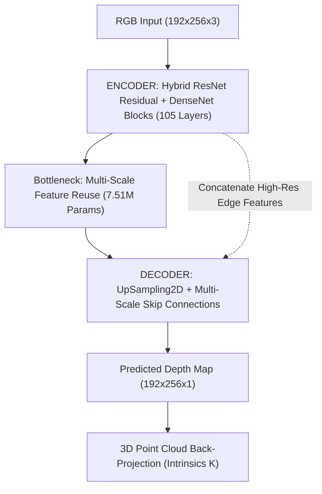

> **Academic Milestone:** B.S. in Computer Science Graduation Thesis — Industrial University of Ho Chi Minh City (IUH), awarded a perfect **4.0 / 4.0** score and selected for official presentation at the **Student Scientific Research Conference (SSRC)**.


*Figure 0: Core vision: Utilizing deep Convolutional Neural Networks (Depth CNNs) to decode dense metric depth fields from single 2D RGB frames, laying the foundation for full 3D spatial reconstruction without active hardware sensors.*

---

## 1. Scientific Record & Artifacts

All research milestones, mathematical formulations, source code, and validation data are openly available for reproducibility:

| Record / Metric | Specification | Details |
|---|---|---|
| **Thesis Title** | *CNN-Based Image Depth Estimation Methods* | Full scientific monograph (*Monocular Depth Estimation*) |
| **Institution** | Industrial University of Ho Chi Minh City (IUH) | Department of Computer Science (2021–2025) |
| **Advisor** | M.Sc. Nguyen Ngoc Le | Department of Information Technology Review Board |
| **Thesis Evaluation** | **4.0 / 4.0 (Perfect Grade)** | Highest honors, presented at SSRC Conference |
| **GitHub Repository** | [`github.com/vinh-gogo/depth-estimation`](https://github.com/vinh-gogo/depth-estimation) | Complete pipeline: Data Prep, 3 Architectures, Multi-loss, 3D Point Cloud |
| **Monograph (73 pages)** | [`Report_GRADUATION_THESIS.txt`](/posts/depth-estimation-cnn-ssrc/Report_GRADUATION_THESIS.txt) | Complete 5-chapter thesis, mathematical proofs, ablation studies |
| **Model Code** | [`paper4_dense_unet.py`](/posts/depth-estimation-cnn-ssrc/paper4_dense_unet.py) | TensorFlow/Keras implementation of hybrid ResNet–DenseNet U-Net |
| **Benchmark Dataset** | **LineMOD Dataset (RGB-D)** | PrimeSense Carmine sensor, 13 object categories in cluttered scenes |
| **Hardware** | Linux Workstation · NVIDIA RTX A4000 (16GB VRAM) | TensorFlow / Keras with real-time memory monitoring |

---

## 2. Theoretical Motivation: The Inverse 3D Problem

In industrial robotics and autonomous navigation, acquiring 3D spatial perception traditionally requires specialized hardware:
- **LiDAR Units:** Cost thousands of dollars, consume substantial power, and are physically bulky.
- **RGB-D Sensors (e.g. PrimeSense Carmine, Microsoft Kinect):** Emit structured infrared patterns. They fail catastrophically on specular reflections, infrared-absorbent black surfaces, or under direct outdoor sunlight.

Mathematically, **Monocular Depth Estimation (MDE)** is an **ill-posed inverse problem**. Projecting a 3D Euclidean space through camera optics onto a 2D sensor plane annihilates the depth dimension $Z$. A single pixel coordinate $(u, v)$ can correspond to infinite potential 3D world coordinates:


*Figure 1: RGB-D pair captured via PrimeSense Carmine sensor in the LineMOD dataset following bilateral filtering.*

To resolve this ambiguity, Convolutional Neural Networks must learn to synthesize complex monocular visual cues:
1. **Linear Perspective:** Parallel geometric lines converging toward horizon vanishing points.
2. **Texture Gradients:** Increasing surface frequency and grain compression at greater distances.
3. **Occlusion Boundaries:** Foreground geometry abruptly interrupting background contours.
4. **Relative Size:** Familiar reference objects providing contextual metric anchors.

---

## 3. Dataset Preprocessing & Metric Standards

The investigation targets the **LineMOD Dataset**, tracking 13 household and industrial artifacts across cluttered tabletop environments with heavy occlusion:


*Figure 2: Depth normalization pipeline: Mapping 16-bit raw millimeter depth streams into bounded floating-point distributions.*

### Mathematical Loss Function & Evaluation Metrics:
Rather than relying solely on standard $\mathcal{L}_2$ regression (which blurs object boundaries), the thesis formulates a **Multi-Component Composite Loss**:

$$\mathcal{L}_{\text{total}}(y, \hat{y}) = w_1 \cdot \underbrace{(1 - \text{SSIM}(y, \hat{y}))}_{\mathcal{L}_{\text{SSIM}}} + w_2 \cdot \underbrace{\frac{1}{N}\sum_{i} \left(|\nabla_x y_i - \nabla_x \hat{y}_i| + |\nabla_y y_i - \nabla_y \hat{y}_i|\right)}_{\mathcal{L}_{\text{grad}}} + w_3 \cdot \underbrace{\frac{1}{N}\sum_{i} |y_i - \hat{y}_i|}_{\mathcal{L}_1}$$

To evaluate both pixel-level accuracy and global distributional geometry across **1,200 hold-out test images** ($192 \times 256$ resolution), we measure **RMSE**, **MAE**, **1–SSIM**, **Cosine Similarity**, **Wasserstein (Earth Mover's) Distance**, and **Hausdorff Distance**.

---

## 4. Architectural Evolution & Empirical Findings (LineMOD 1,200 Test Set)



### 4.1 Comparative Architecture Specifications
By integrating **Dense Block** feature concatenation alongside **ResNet** residual shortcuts within a U-Net topology, our **Enhanced U-Net (`paper4_dense_unet.py`)** increases network depth to **105 layers** while actually **reducing parameter count by 3.7%** compared to standard U-Net ResNet:

| Model Architecture | Depth (Layers) | Total Parameters | Trainable Params | Peak GPU Memory | Training Time (40 Epochs) |
|---|---|---|---|---|---|
| **1. CAE ResNet** (`paper1_cae.py`) | 64 layers | `7,090,625` (~7.09M) | `7,082,561` | 5,902 MB | 18.88 mins |
| **2. U-Net ResNet** (`paper3_unet.py`) | 68 layers | `7,800,769` (~7.80M) | `7,792,705` | 5,902 MB | 24.49 mins |
| **3. Enhanced U-Net (ResNet + DenseNet)** | **105 layers** | **`7,510,593` (~7.51M)** | **`7,498,945`** | 5,902 MB | 26.86 mins |

*(Extended in [`github.com/vinh-gogo/depth-estimation`](https://github.com/vinh-gogo/depth-estimation) with a lightweight 3M-parameter variant and a 13M-parameter **Squeeze-and-Excitation (SE) Attention** variant).*

### 4.2 Quantitative Evaluation on 1,200 Hold-out Test Images (LineMOD)

| Architecture | MAE $\downarrow$ | MSE $\downarrow$ | RMSE $\downarrow$ | 1 – SSIM $\downarrow$ | Cosine Sim $\uparrow$ | Pixel Accuracy $\uparrow$ | Wasserstein Dist $\downarrow$ | Hausdorff Dist $\downarrow$ |
|---|---|---|---|---|---|---|---|---|
| **1. CAE ResNet** | `0.0209` | `0.0020` | `0.0410` | `0.130` | `0.968` | `0.816` | `14.200` | `11.16` |
| **2. U-Net ResNet** | `0.0176` | `0.0017` | `0.0381` | `0.111` | `0.973` | `0.818` | `9.805` | `10.67` |
| **3. Enhanced U-Net (Ours)** | **`0.0175`** | **`0.0016`** | **`0.0370`** | **`0.110`** | **`0.974`** | **`0.819`** | **`9.603`** *(-32.4%)* | **`10.65`** |

On the strict maximum pixel-wise depth deviation threshold ($< 0.1$ across the entire frame), **Enhanced U-Net achieved `92.5%` (`1,123 / 1,214` test images)**, compared to `89.3%` for U-Net ResNet and `71.7%` for CAE ResNet.

---

## 5. 3D Point Cloud Reconstruction

Using calibrated intrinsic camera matrices $K$, dense depth predictions are back-projected into Euclidean 3D coordinates:

$$X = \frac{(u - c_x) \cdot Z}{f_x}, \quad Y = \frac{(v - c_y) \cdot Z}{f_y}$$

The reconstructed point clouds demonstrate sharp boundary preservation around fine geometries, enabling real-time 3D perception from solitary RGB cameras.

---

## 6. References

```
[01] Eigen, D., Puhrsch, C., & Fergus, R. (2014). Depth Map Prediction from a Single Image
     using a Multi-Scale Deep Network. NeurIPS 2014. arXiv:1406.2283.
[02] Ronneberger, O., Fischer, P., & Brox, T. (2015). U-Net: Convolutional Networks for
     Biomedical Image Segmentation. MICCAI 2015.
[03] He, K., Zhang, X., Ren, S., & Sun, J. (2016). Deep Residual Learning for Image
     Recognition. CVPR 2016.
[04] Huang, G., Liu, Z., Van Der Maaten, L., & Weinberger, K. Q. (2017). Densely
     Connected Convolutional Networks. CVPR 2017.
[05] Hinterstoisser, S., et al. (2012). Model Based Training, Detection and Pose Estimation
     of Texture-Less 3D Objects in Heavily Cluttered Scenes. ACCV 2012.
```

---

## 7. Related Technical Logs

- [Quantization Int8/FP4: Serving Large AI Models on Hardware Constraints](/en/posts/quantization-int8-fp4-inference/)
- [OpenVideoLab: Multimodal AI Video Generation on 16GB GPUs](/en/posts/openvideolab-video-diffusion/)
