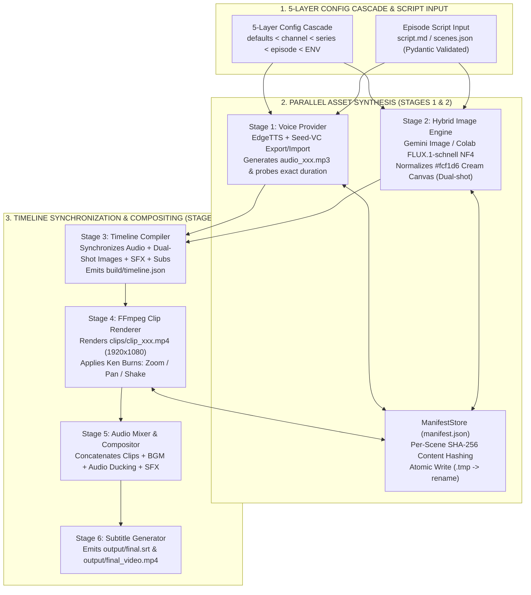

> *"You just finished rendering a 10-minute explainer video with 155 scenes. On review, you spot a single typo in scene 47's narration. With a typical monolithic AI video script, you face two painful choices: manually patch the timeline in Premiere, or re-run the entire pipeline—wasting 45 minutes and burning API credits across 154 scenes that were already perfect!"*

This operational bottleneck plagues almost every first-generation AI video automation script. Many engineers start with a monolithic Python script that runs top-to-bottom: parse script $\rightarrow$ call TTS $\rightarrow$ call Image API $\rightarrow$ concatenate with FFmpeg. While that works for a 3-scene, 15-second tech demo, it collapses under real YouTube production workloads (100–200 scenes per episode):
1. **Zero Idempotency:** Tweaking one line of dialogue in scene 47 forces redundant regeneration across the remaining 154 scenes.
2. **Corrupted Partial Artifacts:** If an API timeout or Ctrl+C interrupt occurs while generating scene 89, a 0-byte `.png` or `.mp4` file is left behind in `build/`, breaking downstream FFmpeg concatenation.
3. **Visual Style Drift Across Models:** Mixing cloud image models and self-hosted open-weight models often yields inconsistent background tones—jarring viewers with alternating gray, white, and yellow canvases.

To solve these engineering problems systematically, I built **Video Factory (`doodle_explainer`)**—a modular **2D Minimalist Doodle Explainer** production system structured around a **6-Stage Decoupled Pipeline**, a **SHA-256 Content-Addressed Manifest Cache (`manifest.json`)**, **Atomic File Writes**, and a **Hybrid AI Engine (`Gemini Image + Colab FLUX NF4 + Seed-VC`)**.

---

## 1. Architectural Overview & System Specifications

| Dimension | Technical Implementation | Production Impact |
|---|---|---|
| **Pipeline Architecture** | **6 Decoupled Stages** | `Stage 1: Voice` $\rightarrow$ `Stage 2: Images` $\rightarrow$ `Stage 3: Timeline` $\rightarrow$ `Stage 4: Render Clips` $\rightarrow$ `Stage 5: Audio Mix` $\rightarrow$ `Stage 6: Subtitles` |
| **Configuration Management** | **5-Layer Configuration Cascade** | `defaults.yaml < channels/<ch>.yaml < series/<s>.yaml < episodes/<ep>/episode.yaml < Env Vars` |
| **Caching & Partial Rebuilds** | **Content-Addressed Cache (`manifest.json` SHA-256)** + **Targeted Rebuild** | Running `vf rebuild --scene 47` recomputes strictly scene 47 while preserving all other 154 scenes untouched |
| **Crash Safety** | **Atomic File Writes (`.tmp` $\rightarrow$ `os.replace`)** | Guarantees zero corrupted or half-written audio, image, or video files upon power loss or `Ctrl+C` |
| **Hybrid Image Engine** | **Google Gemini (`gemini-3.1-flash-image`)** + **Colab FLUX Studio (`FLUX.1-schnell` 4-bit NF4)** | Automated warm cream-paper background normalization (**`#fcf1d6`**) across all providers + **Dual-shot** (2 images/scene) |
| **Voice & Voice Conversion** | **EdgeTTS** + **Seed-VC (Colab GPU Voice Conversion)** | Millisecond-exact duration probing with seamless `vf vc export / import` voice conversion workflows |
| **FFmpeg Compositor** | **Dynamic Ken Burns Camera & Audio Ducking** | Smooth Zoom In/Out, Pan Left/Right, Camera Shake, automated BGM sidechain ducking, and frame-accurate SFX placement |

---

## 2. The 6-Stage Pipeline & SHA-256 Content-Addressed Manifest Store

At the core of `doodle_explainer` (`src/factory/runner.py` & `src/factory/store/`) is a strict decoupling of the six production stages, communicating exclusively through validated **Pydantic domain contracts** (`Scene`, `SceneDocument`, `timeline.json`) and the cryptographic **`manifest.json`** store:

### 2.1 Content-Addressed Caching (`manifest.json`) & $O(1)$ Targeted Scene Rebuilds
Checking whether `build/images/img_047_a.png` merely exists on disk is insufficient—if you edit the prompt or camera motion in `scenes.json`, a naive file-existence check serves stale assets. Instead, `ManifestStore` computes deterministic **SHA-256 content hashes** over every stage's exact inputs:
* **Stage 1 (Voice):** `SHA256(tts_text + voice_id + rate + pitch)`
* **Stage 2 (Images):** `SHA256(image_prompt + style_prefix + negative_prompt + resolution + seed)`
* **Stage 4 (Render Clips):** `SHA256(audio_hash + image_a_hash + image_b_hash + camera_motion + duration)`

When you modify `image_prompt` or `tts_text` in **scene 47** and run `.\vf.ps1 rebuild --scene 47` (or `.\vf.ps1 build`):
* Only scene 47's input hash changes.
* Stages 1, 2, and 4 bypass all 154 unchanged scenes in `0ms`, regenerate only scene 47's assets and `.mp4` clip, and Stage 5 re-muxes the final episode in seconds.

### 2.2 Crash-Proof Atomic File Writes
Every asset generator and FFmpeg invocation in `doodle_explainer` adheres to an atomic write protocol:
1. Stream output to a temporary sibling file (`asset.ext.tmp`).
2. Verify non-zero byte length and container integrity.
3. Execute an OS-level atomic rename (`os.replace(tmp_path, final_path)`) before committing the new SHA-256 digest to `manifest.json`.
Even if the machine loses power mid-render, `build/` never contains corrupted artifacts.

---

## 3. Hybrid Doodle Image Engine & `#fcf1d6` Cream-Paper Normalization

A signature aesthetic of high-retention Doodle Explainer channels is expressive minimalist stick-figure line art drawn over a warm cream-paper canvas (`#fcf1d6`) that prevents eye strain during 10-minute deep dives.

The pipeline supports two interchangeable image providers:
1. **Google Gemini Image (`gemini-3.1-flash-image`):** Excels at complex visual metaphors, nuanced facial micro-expressions, and accurate short text labels.
2. **Google Colab FLUX Studio (`FLUX.1-schnell` 4-bit NF4):** Runs on free/low-cost Colab GPUs via [`colab/colab_image_server.py`](file:///D:/doodle_explainer/colab/colab_image_server.py) (FastAPI + Cloudflare Tunnel), generating 16:9 illustrations in just 4 diffusion steps.

To prevent background color shifts when mixing providers across scenes, the post-processing pipeline applies **Cream-Paper Canvas Normalization**: analyzing background pixel distributions and mapping the paper tone to the exact canonical hex **`#fcf1d6`** while preserving crisp ink lines and semantic accent colors.

Additionally, for longer narration segments (>5 seconds), **Stages 2 & 3** support **Dual-Shot Scenes (`img_xxx_a` & `img_xxx_b`)**, automatically splitting the scene duration to cut from a setup illustration to a visual punchline mid-sentence.

---

## 4. FFmpeg Compositor: Dynamic Ken Burns Camera & Sidechain Audio Ducking

To achieve broadcast-ready pacing without manual timeline editing:
* **Dynamic Ken Burns Filtergraphs:** In **Stage 4**, static illustrations are transformed into smooth 1080p motion clips via parameterized FFmpeg `zoompan` filtergraphs (`zoom_in`, `zoom_out`, `pan_left`, `pan_right`, and dramatic camera `shake` for high-tension moments).
* **Automated Audio Ducking & Millisecond SFX Placement:** In **Stage 5**, the audio mixer combines narration tracks with royalty-free background music (`library/bgm/`), automatically ducking BGM volume beneath active speech, swelling gently during narrative pauses, and aligning sound effects (`pop`, `whoosh`, `pencil`, `ding` from `library/sfx/`) to exact millisecond offsets defined in `timeline.json`.

---

## 5. Conclusion

By applying **deterministic build-system principles (inspired by Bazel and Make)** to generative media orchestration, **Video Factory (`doodle_explainer`)** turns 2D explainer video production into a reproducible, fault-tolerant engineering pipeline—testable offline in 2 seconds via `MockProvider` and capable of surgical single-scene rebuilds at scale.
