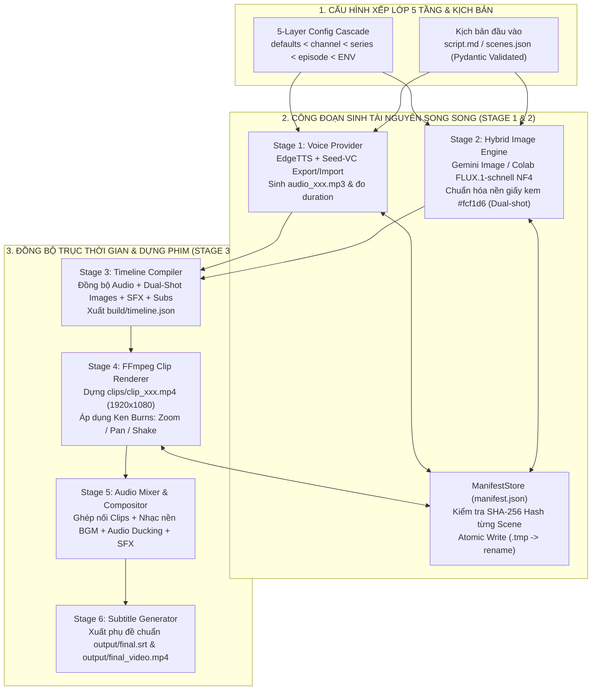

> *"Làm xong một video giải thích dài 10 phút gồm 155 phân cảnh. Khi xem lại phát hiện cảnh thứ 47 bị đọc sai một từ. Với các script làm video tự động thông thường, bạn chỉ có hai lựa chọn đau đớn: hoặc mở Premiere cắt ghép thủ công lại từ đầu, hoặc bấm chạy lại toàn bộ pipeline mất thêm 45 phút và đốt sạch tiền API cho 154 cảnh vốn đã hoàn hảo!"*

Đó chính là "cơn ác mộng vận hành" của hầu hết các dự án tự động hóa video bằng AI hiện nay. Nhiều lập trình viên viết một file script Python khổng lồ chạy thẳng từ đầu đến cuối: đọc kịch bản $\rightarrow$ gọi TTS $\rightarrow$ gọi API vẽ ảnh $\rightarrow$ nối FFmpeg. Kiến trúc nguyên khối (monolithic script) đó trông có vẻ chạy tốt với video thử nghiệm 3 cảnh dài 15 giây, nhưng lập tức sụp đổ khi bước vào sản xuất thực tế cấp độ YouTube (100–200 phân cảnh/tập):
1. **Không có tính lũy đẳng (Non-Idempotent):** Sửa 1 câu thoại ở cảnh 47 kéo theo phải chạy lại 154 cảnh còn lại.
2. **Rác file hỏng khi ngắt quãng (Corrupted Partial Files):** Đang sinh ảnh cảnh 89 thì rớt mạng hoặc hết quota GPU, một file `.png` hoặc `.mp4` 0-byte nằm lại trong thư mục `build/`, khiến các bước ghép video phía sau báo lỗi hàng loạt.
3. **Lệch tông màu & Nhân vật giữa các mô hình:** Cảnh dùng Gemini vẽ thì nền màu trắng xám, cảnh dùng FLUX vẽ trên Colab thì nền màu vàng đậm, ghép lại thành một video chắp vá thiếu chuyên nghiệp.

Để giải quyết triệt để những bài toán này, tôi đã thiết kế **Video Factory (`doodle_explainer`)** — một hệ thống sản xuất video hoạt hình giải thích dạng người que (**2D Minimalist Doodle Explainer**) theo kiến trúc **Pipeline 6 Công Đoạn Độc Lập**, trang bị **Bộ Nhớ Đệm Định Danh Theo Nội Dung (`Content-Addressed Manifest Cache` SHA-256)**, **Ghi File Nguyên Tử (`Atomic Writes`)** và **Động Cơ AI Lai (`Gemini Image + Colab FLUX NF4 + Seed-VC`)**.

---

## 1. Tổng Quan Kiến Trúc & Thông Số Kỹ Thuật (System Specifications)

| Hạng mục | Thông số & Giải pháp kỹ thuật | Giá trị mang lại trong sản xuất |
|---|---|---|
| **Kiến trúc Pipeline** | **6 Công đoạn độc lập (Decoupled Stages)** | `Stage 1: Voice` $\rightarrow$ `Stage 2: Images` $\rightarrow$ `Stage 3: Timeline` $\rightarrow$ `Stage 4: Render Clips` $\rightarrow$ `Stage 5: Audio Mix` $\rightarrow$ `Stage 6: Subtitles` |
| **Quản lý cấu hình** | **Cấu hình xếp lớp 5 tầng (5-Layer Config Cascade)** | `defaults.yaml < channels/<ch>.yaml < series/<s>.yaml < episodes/<ep>/episode.yaml < Env Vars` |
| **Bộ nhớ đệm & Tái dựng** | **Content-Addressed Cache (`manifest.json` SHA-256)** + **Targeted Rebuild** | Lệnh `vf rebuild --scene 47` chỉ tính toán lại đúng cảnh 47, bảo toàn 100% 154 cảnh còn lại |
| **An toàn tệp tin** | **Atomic File Writes (`.tmp` $\rightarrow$ `os.replace`)** | Không bao giờ tồn tại file âm thanh/hình ảnh/video dở dang khi mất điện hay `Ctrl+C` |
| **Động cơ Hình ảnh Lai** | **Google Gemini (`gemini-3.1-flash-image`)** + **Colab FLUX Studio (`FLUX.1-schnell` 4-bit NF4)** | Tự động chuẩn hóa màu nền giấy kem ấm **`#fcf1d6`** đồng nhất 100% toàn kênh, hỗ trợ **Dual-shot** (2 ảnh/cảnh) |
| **Động cơ Giọng đọc & VC** | **EdgeTTS** + **Seed-VC (Voice Conversion trên Colab GPU)** | Đo thời lượng chính xác từng mili-giây, xuất/nhập gói đổi chất giọng `vf vc export / import` |
| **Kỹ xảo Dựng hình & Âm thanh** | **FFmpeg Video Compositor** | Chuyển động camera **Ken Burns** (Zoom In/Out, Pan Left/Right, Shake), **Audio Ducking** tự động hạ nhạc nền khi có thoại, chèn SFX chính xác theo mốc thời gian |

---

## 2. Kiến Trúc Pipeline 6 Công Đoạn & Bộ Nhớ Đệm Băm SHA-256

Trái tim của `doodle_explainer` (`src/factory/runner.py` & `src/factory/store/`) là sự tách rời hoàn toàn giữa 6 công đoạn sản xuất, được kết nối thông qua các hợp đồng dữ liệu bất biến (`Pydantic Schemas`: `Scene`, `SceneDocument`, `timeline.json`) và sổ cái băm **`manifest.json`**:

### 2.1 Cơ chế Content-Addressed Manifest (`manifest.json`) & Tái dựng cục bộ $O(1)$
Thay vì kiểm tra xem file `build/images/img_047_a.png` "đã tồn tại hay chưa" (vốn không phát hiện được khi nội dung prompt đã thay đổi), `ManifestStore` tính toán mã băm **SHA-256** từ tổ hợp:
* Đối với **Stage 1 (Voice):** `SHA256(tts_text + voice_id + rate + pitch)`
* Đối với **Stage 2 (Images):** `SHA256(image_prompt + style_prefix + negative_prompt + resolution + seed)`
* Đối với **Stage 4 (Render Clips):** `SHA256(audio_hash + image_a_hash + image_b_hash + camera_motion + duration)`

Nhờ cơ chế này:
* Khi bạn sửa `image_prompt` hoặc `tts_text` của **cảnh 47** và chạy `.\vf.ps1 rebuild --scene 47` (hoặc `.\vf.ps1 build`), chỉ riêng cảnh 47 có mã băm SHA-256 thay đổi.
* Các công đoạn Stage 1, Stage 2 và Stage 4 lập tức bỏ qua 154 cảnh không đổi trong `0ms`, chỉ sinh lại đúng tài nguyên của cảnh 47, sau đó Stage 5 nối lại các file `.mp4` đã dựng sẵn thành video hoàn chỉnh chỉ trong vài giây!

### 2.2 Nguyên tắc Ghi File Nguyên Tử (Atomic Writes)
Mọi công đoạn sinh file trong `doodle_explainer` đều tuân thủ nghiêm ngặt quy tắc:
1. Ghi dữ liệu ra tệp tạm `ten_file.ext.tmp` trong cùng thư mục.
2. Kiểm tra kích thước tệp `> 0 bytes` và xác thực header hợp lệ.
3. Thực hiện phép đổi tên nguyên tử ở mức hệ điều hành (`os.replace(tmp_path, final_path)`), rồi mới cập nhật mã băm vào `manifest.json`.
Nhờ đó, dù bạn bấm `Ctrl+C` hay sập nguồn giữa lúc đang render FFmpeg, thư mục `build/` luôn ở trạng thái sạch 100%.

---

## 3. Động Cơ Hình Ảnh Doodle Kép & Thuật Toán Chuẩn Hóa Nền Giấy Kem (`#fcf1d6`)

Phong cách đặc trưng của kênh video người que giải thích (Doodle Explainer) đòi hỏi nét vẽ tối giản nhưng giàu biểu cảm hài hước trên nền giấy kem ấm áp (`#fcf1d6`) để người xem không bị mỏi mắt khi theo dõi các video dài 8–12 phút.

Hệ thống hỗ trợ chuyển đổi linh hoạt giữa **2 động cơ sinh ảnh**:
1. **Google Gemini Image (`gemini-3.1-flash-image`):** Thế mạnh vượt trội về khả năng hiểu ẩn dụ phức tạp, vẽ biểu cảm gương mặt nhân vật người que sinh động và chèn nhãn chữ tiếng Việt/tiếng Anh ngắn gọn chính xác.
2. **Google Colab FLUX Studio (`FLUX.1-schnell` 4-bit NF4):** Chạy miễn phí trên GPU T4/L4 của Google Colab thông qua [`colab/colab_image_server.py`](file:///D:/doodle_explainer/colab/colab_image_server.py) (FastAPI + Cloudflare Tunnel), tốc độ sinh ảnh siêu tốc chỉ 4 bước khuếch tán (4-step denoising).

Để đảm bảo hình ảnh từ cả hai nguồn không bao giờ bị lệch tông màu nền khi ghép chung trong một tập phim, bước hậu xử lý ảnh tự động áp dụng thuật toán **Chuẩn hóa nền giấy kem (`Cream Paper Background Normalization`)**: phân tích phân phối các điểm ảnh vùng biên, ánh xạ dải nền sáng về đúng mã màu chuẩn **`#fcf1d6`** trong khi vẫn giữ nguyên vẹn độ sắc nét của nét mực đen và các mảng màu nhấn (accent colors).

Hơn nữa, để tránh cảm giác nhàm chán khi một câu thoại dài 8 giây chỉ đứng yên một bức ảnh, **Stage 2 & Stage 3** hỗ trợ cơ chế **Dual-Shot (`img_xxx_a` & `img_xxx_b`)**: tự động chia đôi thời lượng câu thoại để lật sang bức ảnh phản ứng thứ hai đúng vào nhịp cao trào của câu nói.

---

## 4. Kỹ Xảo FFmpeg Compositor: Chuyển Động Camera Ken Burns & Audio Ducking Tự Động

Một video giải thích cuốn hút không chỉ có kịch bản hay mà còn nằm ở nhịp điệu hình ảnh và âm thanh:
* **Chuyển động Camera động (Dynamic Ken Burns Filtergraph):** Ở **Stage 4**, thay vì ghép ảnh tĩnh đơn điệu, mỗi phân cảnh được biên dịch thành một biểu thức bộ lọc `zoompan` chuẩn xác trong FFmpeg ở tốc độ khung hình mượt mà (`zoom_in`, `zoom_out`, `pan_left`, `pan_right`, hoặc hiệu ứng rung lắc `shake` khi nhân vật hoảng hốt).
* **Tự động hạ nhạc nền thông minh (Sidechain Audio Ducking) & Định vị SFX:** Ở **Stage 5**, hệ thống trộn âm thanh tự động điều chỉnh đường bao âm lượng (volume envelope) của nhạc nền `library/bgm/`: tự động hạ nhỏ nhạc nền xuống mức êm dịu khi giọng đọc vang lên, nâng nhẹ ở các khoảng nghỉ chuyển ý, và chèn các hiệu ứng âm thanh (`pop`, `whoosh`, `pencil_scribble`, `ding` từ `library/sfx/`) khớp chính xác tới từng mili-giây trên `timeline.json`.

---

## 5. Kết Luận

Bằng cách áp dụng tư duy **Hệ thống बिल्ड tất định (Deterministic Build Systems — tương tự Bazel/Make)** vào bài toán sản xuất đa phương tiện, **Video Factory (`doodle_explainer`)** đã biến quy trình làm video hoạt hình từ một chuỗi thao tác thủ công dễ lỗi thành một dây chuyền công nghiệp mô-đun hóa: có thể kiểm thử offline bằng `MockProvider` trong 2 giây, tái dựng cục bộ từng phân cảnh tức thì và mở rộng quy mô cho nhiều kênh nội dung song song.
