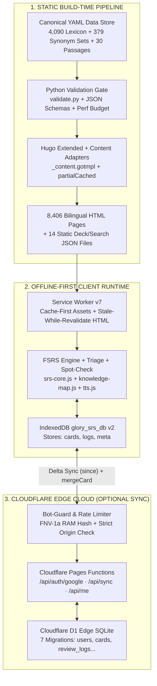

> *"How do you serve tens of thousands of mobile learners arriving from viral TikTok videos with instant page loads, 100% offline study capability, and seamless cross-device progress synchronization—all at near-zero server infrastructure cost?"*

That was the core engineering challenge behind **Glory Vocab** ([`gloryvocab.com`](https://gloryvocab.com))—a mobile-first TOEIC vocabulary dictionary and spaced-repetition learning platform built to companion the [@wbk.lqv](https://www.tiktok.com/@wbk.lqv) TikTok channel.

Following a conventional server-rendered architecture (a Node.js or Python backend querying a relational database on every word lookup) exposes three critical bottlenecks whenever a TikTok video goes viral:
1. **Database & Cold-Start Latency:** Every bio-link tap triggers multi-table SQL joins across headwords, collocations, synonym sets, examples, and reading passages, quickly saturating connection pools.
2. **Unnecessary Compute Overhead:** Dictionary entries are fundamentally read-heavy, immutable reference data. Re-computing HTML on a server for every visitor wastes CPU cycles and inflates cloud bills.
3. **Fragile Mobile Connectivity:** Learners frequently review flashcards on buses, subways, or elevators with spotty cellular reception. A strictly online web app fails the moment connectivity drops.

This article documents the production architecture of **Glory Vocab** (open-source at [`github.com/vinh-gogo/GLORY-TIKTOK`](https://github.com/vinh-gogo/GLORY-TIKTOK)): combining **Hugo Extended Static Site Generation** across 8,400+ bilingual pages, an **Offline-First FSRS** memory engine running on **IndexedDB + Service Worker v7**, and **Zero-PII** bidirectional delta synchronization powered by **Cloudflare Pages Functions and Cloudflare D1**.

---

## 1. Live Production Metrics & System Scale

The platform runs in production at [`gloryvocab.com`](https://gloryvocab.com), governed by automated schema and performance gates in CI:

| Dimension | Production Metric & Evidence | Architectural Foundation |
|---|---|---|
| **Live Production URL** | [`gloryvocab.com`](https://gloryvocab.com) (VI) · [`gloryvocab.com/en/`](https://gloryvocab.com/en/) (EN) | Hugo Extended + PaperMod (Custom Overrides) + Cloudflare Pages |
| **Source Repository** | [`github.com/vinh-gogo/GLORY-TIKTOK`](https://github.com/vinh-gogo/GLORY-TIKTOK) | Governed by 31 Architecture Decision Records (`ADR-004` → `ADR-031`) |
| **Lexicon & Corpus Scale** | **4,090 headwords** (A–Z) · **16,360 collocations** (4 tiers/word) · **379 synonym sets** (3,774 groups) · **30 ETS-style workplace passages** | Single Source of Truth in `data/lexicon/<initial>/<id>.yaml`, verified via JSON Schema (`validate.py`) |
| **Published Static Pages** | **8,406 static pages** (4,235 VI + 4,171 EN) + **14 static JSON decks** | Generated dynamically at build time via Hugo Content Adapters (`_content.gotmpl`) |
| **Web Performance** | **100 / 100 Lighthouse Performance** (Mobile & Desktop across all 7 representative page templates `T1`–`T7`) | `partialCached`, lazy DOM rendering, Service Worker v7, CI performance budget gate (`check_perf_budget.py`) |
| **Learning Engine** | **FSRS (Free Spaced Repetition Scheduler)** multi-deck engine + **Triage / Spot-Check / 13-Topic Knowledge Map** | 100% client-side execution on IndexedDB `glory_srs_db` (v2) + Web Speech TTS & Active Typed Recall |
| **Edge Sync & Privacy** | **Cloudflare Pages Functions** + **Cloudflare D1 (Edge SQLite)** | Bidirectional `since` Delta Sync, deterministic `mergeCard` conflict resolution, **Zero-PII** Google JWT auth |

---

## 2. High-Level Architecture: Separating Immutable Knowledge from Personal State

The key insight allowing Glory Vocab to absorb massive traffic spikes at $0 cost is a strict separation between two data planes:
* **Immutable Public Knowledge:** All 4,090 vocabulary words, IPA transcriptions, 4-tier collocations, synonym sets, quotes, and reading passages are pre-compiled at build time into static HTML and on-demand JSON assets served directly from Cloudflare's global edge CDN.
* **Mutable Personal State:** Individual FSRS card memory states, review logs, word triage statuses (`Known/Unsure/Unknown`), and placement test histories live locally on the learner's device (**Local-First IndexedDB**), syncing only compact deltas to **Cloudflare D1** when cloud sync is enabled.



---

## 3. Single Source of Truth & Zero-Tolerance Schema Validation

Managing over 4,000 vocabulary entries alongside tens of thousands of collocations and cross-linked synonym groups in loose Markdown files quickly leads to data rot—broken synonym links, inconsistent IPA transcriptions, or hardcoded TOEIC score ranges.

In Glory Vocab, all domain data follows a strict **Single Source of Truth** model:
* Every word resides in a single canonical file: `data/lexicon/<initial>/<id>.yaml` (paired with 100% English translation sidecars in `data/lexicon_i18n/en/<initial>/<id>.yaml`).
* Every word includes **4 graded Collocations** (*Easy / Medium / Hard / Challenge*) so learners master contextual phrase patterns rather than isolated words.
* All 3,774 contextual synonym groups are organized into **379 fixed Synonym Sets** (10 groups per set under `ADR-028`) partitioned across 4 proficiency bands (`foundation`, `core`, `target`, `advanced`), slashing HTML DOM payload size on `/synonyms/` by over **50%**.

Before any build succeeds, [`scripts/validate/validate.py`](https://github.com/vinh-gogo/GLORY-TIKTOK) validates every YAML file against strict **JSON Schemas** (`schemas/word.v3.json`, `synonym_sets.v1.json`, `passage.v1.json`, `deck.v1.json`):
* Enforces 100% referential integrity across vocabulary entries, TikTok video packs (`/v/<slug>/`), the 20-question placement test (`/placement/`), Part 5/6 mini-tests (`/minitest/`), and the 30 workplace reading passages (`/passages/`).
* Verifies exact word-boundary matching and morphological inflections when highlighting target vocabulary inside reading passages.

---

## 4. Offline-First FSRS Engine & Deterministic Conflict Resolution (`mergeCard`)

Rather than relying on the 1980s SM-2 algorithm—which notoriously traps learners in "ease hell"—Glory Vocab implements the modern **FSRS (Free Spaced Repetition Scheduler)** mathematical memory model in pure JavaScript (`assets/js/srs-core.js`), persisted asynchronously in **IndexedDB (`glory_srs_db` v2)**.

### 4.1 Memory State Modeling & Triage / Spot-Check (`ADR-031`)
Each flashcard is uniquely namespaced across multiple study modes:
* `<word_id>` for core vocabulary cards (e.g., `allocate`),
* `c:<word_id>:<slug>` for collocation cards,
* `q:<quote_id>` for inspirational quote cards,
* `s:<word_id>` for contextual synonym cards added via daily study chains.

Each card's memory state is governed by $(S, D, R, \text{state}, \text{reps}, \text{lapses})$, where retrievability $R$ after $t$ elapsed days decays according to stability $S$:

$$R(t, S) = \left(1 + \text{FACTOR} \cdot \frac{t}{S}\right)^{\text{DECAY}}$$

To prevent experienced learners from having to grind through basic words they already know, the system introduces **3-State Vocabulary Triage (`Known / Unsure / Unknown`)** paired with **Implicit Spot-Check Verification**:
* Marking a word as **"✓ Known"** (`known = 1`) exempts it from routine review queues.
* To guard against false fluency, `maybeInjectSpotCheck` in `assets/js/review.js` silently injects up to 5% (max 2 cards per session) of `known = 1` cards that haven't been verified in over 14 days into active review sessions. If the learner misses a spot-check (`Again`), the card automatically reverts to `known = 0` and re-enters the standard FSRS schedule.

### 4.2 Bidirectional Delta Sync & Deterministic `mergeCard` (`ADR-016`)
When a learner reviews flashcards offline on a smartphone during their commute and later opens their laptop at home, state divergence is inevitable. To synchronize seamlessly without stateful WebSockets, Glory Vocab uses a **Delta Sync** protocol over `POST /api/sync` backed by an identical, deterministic **`mergeCard(local, remote)`** function shared between Client (`assets/js/srs-core.js`) and Edge Server (`functions/_lib/merge.js`):

```javascript
// Deterministic Conflict Resolution between Client IndexedDB and Edge D1
export function mergeCard(a, b) {
  if (!a) return b;
  if (!b) return a;

  // 1. Prefer the record with higher total repetitions (reflecting further real study progress)
  if ((a.reps || 0) !== (b.reps || 0)) {
    var winner = (a.reps || 0) > (b.reps || 0) ? a : b;
    var loser  = winner === a ? b : a;
    return mergeKnownField(winner, loser);
  }

  // 2. On equal reps, prefer the record with the newer timestamp (updated_at / last_review)
  var timeA = Date.parse(a.updated_at || a.last_review || 0) || 0;
  var timeB = Date.parse(b.updated_at || b.last_review || 0) || 0;
  var primary   = timeA >= timeB ? a : b;
  var secondary = primary === a ? b : a;
  return mergeKnownField(primary, secondary);
}

// 3. Independent Last-Write-Wins resolution for the `known` triage status via `known_at`
function mergeKnownField(base, other) {
  var merged = Object.assign({}, base);
  var ka = base.known_at || 0;
  var kb = other.known_at || 0;
  if (kb > ka) {
    merged.known = other.known || 0;
    merged.known_at = kb;
  }
  return merged;
}
```

Because `mergeCard` is both commutative and idempotent ($\text{merge}(A, B) = \text{merge}(B, A)$), even if a mobile device remains offline for days before reconnecting, both client and Cloudflare D1 deterministically converge to the exact same state—verified by **42/42 Node.js unit tests** in `tests/srs/`.

---

## 5. Zero-PII Privacy Architecture & Edge Bot Protection

A foundational engineering pillar of Glory Vocab (`ADR-016` & `ADR-019`) is **Zero-PII Privacy by Design**:
1. **100% Telemetry-Free Guest Mode:** Anonymous learners can use the full dictionary, FSRS flashcards, placement tests, and on-device Web Speech TTS offline without creating an account. Zero analytics or behavioral tracking scripts are loaded.
2. **Anonymous Google JWT Authentication:** When a learner optionally signs in with Google for cloud backup, `functions/api/auth/google.js` cryptographically verifies the Google ID Token JWT (`aud`, `iss`, `exp`) and **extracts solely the opaque `sub` identifier** as the primary key in Cloudflare D1. The system **never stores names, avatars, or IP addresses**, and only stores an email address if the user explicitly opts into study reminders.
3. **In-Memory Edge Rate Limiting (`ADR-022`):** To protect Cloudflare Pages Functions quotas from aggressive scrapers, `functions/api/_middleware.js` scopes protection strictly to `/api/*` routes (keeping all 8,406 static pages on unmetered CDN edge caching) and enforces a `60 req/min/client` rate limit using an **in-memory FNV-1a hash** without logging raw IP addresses to disk.

---

## 6. Engineering 100/100 Lighthouse Performance & CI Budget Gates (`ADR-029` & `ADR-030`)

At a scale of 4,090 words and 379 synonym sets, naively rendering all DOM nodes into static HTML bloats individual pages past 1.5 MB, spiking Total Blocking Time (TBT) on mid-range Android devices.

To achieve a verified **100/100 Lighthouse Performance score** across both Mobile and Desktop on all 7 representative templates (`T1` Home, `T2` Glossary, `T3` Word Detail, `T4` Synonyms, `T5` FSRS Review, `T6` Search, `T7` Passages), we implemented a three-tier optimization pipeline:

1. **919 KB HTML Payload Reduction & Lazy DOM Rendering:**
   - Leveraged Hugo `partialCached` keyed by language and topic (`ADR-018`) to keep full-site compilation of 8,400+ pages under a few seconds.
   - On `/review/` and `/synonyms/`, replaced pre-rendered hidden selector grids with on-demand lazy DOM rendering, eliminating **919.28 KB of raw HTML (-103.49 KB gzip)** and cutting **Total Blocking Time (TBT)** from `170 ms` down to **`40 ms`**.
2. **Service Worker v7 & Instant bfcache Navigation (`window.GloryUiState`):**
   - Upgraded `static/sw.js` to v7 with `cache-first` immutable caching for `/assets/*` and `/js/*`, paired with `stale-while-revalidate` for the 5 primary bottom-tab routes and homepage.
   - Explicitly closed IndexedDB connections on `pagehide` (`assets/js/srs-store.js`) to unlock 100% browser **bfcache (Back/Forward Cache)** eligibility, making tab-bar switching instantaneous (`0 ms`).
3. **Automated CI Performance Budget Gate (`check_perf_budget.py`):**
   - Every build runs `scripts/validate/check_perf_budget.py` against strict ceilings defined in `docs/perf/web/budget.json` (enforcing caps on raw/gzip HTML bytes, JS/CSS bundle sizes, and maximum DOM node counts per template). Any regression fails CI before merge.

---

## 7. Conclusion

**Glory Vocab** ([`gloryvocab.com`](https://gloryvocab.com)) demonstrates that a **Static-First + Local-First (IndexedDB + FSRS) + Edge Serverless (Cloudflare D1)** architecture can deliver a rich, interactive, privacy-preserving language learning platform achieving 100/100 Lighthouse performance—without maintaining a single traditional backend server.
