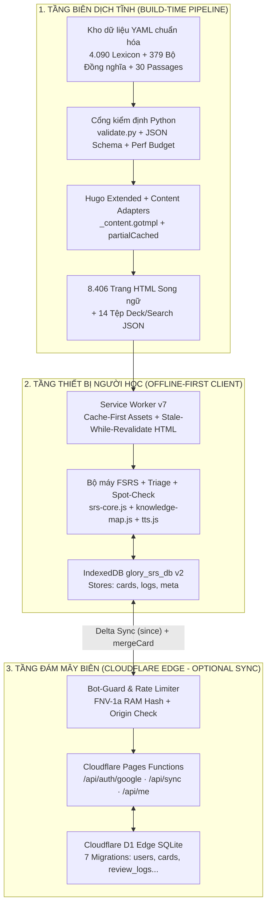

> *"Làm sao để phục vụ hàng chục nghìn người học từ vựng trên điện thoại mỗi ngày từ các video TikTok với tốc độ tải trang tức thì, học ngoại tuyến 100% khi mất mạng, đồng bộ tiến độ đa thiết bị mà chi phí vận hành máy chủ gần như bằng 0?"*

Đó là bài toán kỹ thuật đặt ra khi tôi xây dựng **Glory Vocab** ([`gloryvocab.com`](https://gloryvocab.com)) — nền tảng từ điển và học từ vựng TOEIC mobile-first bổ trợ cho kênh TikTok [@wbk.lqv](https://www.tiktok.com/@wbk.lqv).

Nếu đi theo lối mòn truyền thống (dựng backend Node.js/Python + cơ sở dữ liệu PostgreSQL + SSR mỗi lần người dùng tra một từ vựng), hệ thống sẽ nhanh chóng đối mặt với ba tử huyệt khi một video TikTok bất ngờ lên xu hướng (viral):
1. **Độ trễ truy vấn (Cold-start & DB Latency):** Mỗi lượt bấm vào link bio trên TikTok sẽ kích hoạt hàng loạt truy vấn SQL nối bảng (từ vựng, collocations, từ đồng nghĩa, ví dụ, đoạn đọc), gây nghẽn cổ chai kết nối.
2. **Chi phí hạ tầng phình to:** Hàng nghìn trang từ điển vốn dĩ là dữ liệu tra cứu bất biến (read-heavy, hiếm khi thay đổi theo từng giây), việc tính toán lại HTML ở phía server cho mỗi lượt xem là sự lãng phí tài nguyên vô lý.
3. **Trải nghiệm di động đứt gãy:** Người học thường mở điện thoại ôn từ vựng trên xe buýt, trong thang máy hoặc nơi sóng 4G chập chờn. Một web app phụ thuộc hoàn toàn vào mạng sẽ trở nên vô dụng khi mất kết nối.

Bài viết này đúc kết toàn bộ kiến trúc của **Glory Vocab** (mã nguồn tại [`github.com/vinh-gogo/GLORY-TIKTOK`](https://github.com/vinh-gogo/GLORY-TIKTOK)): sự kết hợp giữa **Static Site Generation (Hugo Extended)** ở quy mô hơn 8.400 trang, bộ máy lặp lại ngắt quãng **FSRS Offline-First** trên **IndexedDB + Service Worker v7**, và cơ chế đồng bộ hai chiều **Zero-PII** trên **Cloudflare Pages Functions & Cloudflare D1**.

---

## 1. Minh Chứng & Quy Mô Hệ Thống Thực Tế (Production Metrics)

Toàn bộ nền tảng đang vận hành thực tế tại [`gloryvocab.com`](https://gloryvocab.com) với các thông số kỹ thuật đã được kiểm chứng qua hệ thống CI/CD tự động:

| Hạng mục | Thông số & Minh chứng thực tế | Giải pháp kiến trúc cốt lõi |
|---|---|---|
| **Website Production** | [`gloryvocab.com`](https://gloryvocab.com) (VI) · [`gloryvocab.com/en/`](https://gloryvocab.com/en/) (EN) | Hugo Extended + PaperMod (Custom Layouts) + Cloudflare Pages |
| **Mã nguồn (GitHub)** | [`github.com/vinh-gogo/GLORY-TIKTOK`](https://github.com/vinh-gogo/GLORY-TIKTOK) | Quản lý kiến trúc theo 31 bản thiết kế ADR (`ADR-004` → `ADR-031`) |
| **Quy mô kho dữ liệu** | **4.090 mục từ vựng** (A–Z) · **16.360 collocations** (4 cấp độ/từ) · **379 bộ từ đồng nghĩa** (3.774 nhóm) · **30 đoạn đọc công sở ETS-style** | Single Source of Truth tại `data/lexicon/<chữ>/<id>.yaml`, kiểm định bằng JSON Schema (`validate.py`) |
| **Tổng số trang xuất bản** | **8.406 trang tĩnh** (4.235 trang VI + 4.171 trang EN) + **14 tệp JSON deck** | Sinh tự động qua Content Adapters (`_content.gotmpl`) |
| **Hiệu suất Web (Core Web Vitals)** | **100 / 100 Lighthouse Performance** (Mobile & Desktop trên cả 7 mẫu trang đại diện `T1`–`T7`) | `partialCached`, render lười DOM, Service Worker v7, cổng kiểm định ngân sách CI (`check_perf_budget.py`) |
| **Động cơ học & Ôn tập** | **FSRS (Free Spaced Repetition Scheduler)** đa bộ thẻ + **Triage / Spot-Check / Knowledge Map 13 chủ đề** | Chạy 100% client-side trên IndexedDB `glory_srs_db` (v2), kết hợp Web Speech TTS & Active Typed Recall |
| **Đồng bộ Đám mây & Bảo mật** | **Cloudflare Pages Functions** + **Cloudflare D1 (SQLite Edge)** | Đồng bộ hai chiều Delta `since`, giải quyết xung đột tất định `mergeCard`, xác thực Google JWT **Zero-PII** |

---

## 2. Kiến Trúc Tổng Thể: Tách Biệt "Tri Thức Bất Biến" Và "Trạng Thái Cá Nhân"

Triết lý cốt lõi giúp Glory Vocab chịu tải hàng chục nghìn lượt truy cập đồng thời với chi phí $0 nằm ở sự phân tách rạch ròi giữa hai luồng dữ liệu:
* **Tri thức từ điển chung (Immutable Public Knowledge):** Toàn bộ 4.090 từ vựng, IPA, collocations, từ đồng nghĩa, câu nói hay và đoạn đọc được biên dịch trước (pre-compiled) thành HTML tĩnh và JSON tĩnh đặt trên mạng lưới CDN toàn cầu của Cloudflare.
* **Trạng thái học tập cá nhân (Mutable Personal State):** Tiến độ nhớ/quên của từng thẻ FSRS, lịch sử ôn tập, phân loại từ đã biết (`Known/Unsure/Unknown`) và kết quả kiểm tra trình độ được xử lý hoàn toàn trên thiết bị của người học (**Local-First IndexedDB**), và chỉ đồng bộ phần chênh lệch (Delta Sync) lên cơ sở dữ liệu biên **Cloudflare D1** khi người dùng bật đồng bộ.



---

## 3. Single Source of Truth & Kiểm Định Dữ Liệu Không Khoan Nhượng

Khi quản lý hơn 4.000 mục từ vựng cùng hàng chục nghìn cụm collocations và nhóm đồng nghĩa, nếu viết nội dung trực tiếp vào các file Markdown rời rạc, dữ liệu sẽ nhanh chóng rơi vào cảnh hỗn loạn: từ A liên kết tới từ đồng nghĩa B nhưng từ B không tồn tại, hoặc điểm số TOEIC bị viết cứng (hard-code) lệch nhau giữa các trang.

Tại Glory Vocab, mọi dữ liệu đều tuân thủ nguyên tắc **Single Source of Truth**:
* Mỗi từ vựng nằm tại một tệp YAML duy nhất: `data/lexicon/<chữ_cái>/<id>.yaml` (kèm bản dịch tiếng Anh tương ứng 1:1 tại `data/lexicon_i18n/en/<chữ_cái>/<id>.yaml`).
* Mỗi từ bắt buộc có đủ **4 cấp độ Collocations** (*Dễ / Trung bình / Khó / Cực khó*) để người học không chỉ biết nghĩa đơn lẻ mà nắm vững cách ghép cụm thực tế trong đề thi.
* Toàn bộ 3.774 nhóm từ đồng nghĩa được gom thành **379 Bộ từ đồng nghĩa cố định** (10 nhóm/bộ theo `ADR-028`) chia theo 4 band (`foundation`, `core`, `target`, `advanced`), giúp giảm hơn **50% dung lượng DOM HTML** trên trang `/synonyms/` và cho phép người học chinh phục từng bộ nhỏ trên điện thoại.

Trước mỗi lần build, bộ kiểm định [`scripts/validate/validate.py`](https://github.com/vinh-gogo/GLORY-TIKTOK) đối chiếu toàn bộ kho YAML với bộ khung **JSON Schema** (`schemas/word.v3.json`, `synonym_sets.v1.json`, `passage.v1.json`, `deck.v1.json`):
* Chặn tuyệt đối các liên kết chéo bị gãy (broken cross-references) giữa từ vựng, bộ từ theo video TikTok (`/v/<slug>/`), bài kiểm tra xếp lớp (`/placement/`), mini-test Part 5/6 (`/minitest/`) và 30 đoạn đọc công sở (`/passages/`).
* Kiểm tra tính toàn vẹn của ranh giới từ (word boundary) và biến thể hình thái học (morphological inflections) khi tô sáng từ vựng mục tiêu trong đoạn đọc.

---

## 4. Thuật Toán FSRS Offline-First & Giải Quyết Xung Đột Tất Định (`mergeCard`)

Thay vì sử dụng thuật toán SM-2 cổ điển từ thập niên 1980 vốn dễ gây "tắc nghẽn thẻ ôn" (ease hell), Glory Vocab cài đặt trực tiếp mô hình toán học bộ nhớ **FSRS (Free Spaced Repetition Scheduler)** thuần JavaScript tại `assets/js/srs-core.js`, lưu trữ bất đồng bộ trên **IndexedDB (`glory_srs_db` v2)**.

### 4.1 Mô hình trạng thái thẻ & Mở rộng Triage / Spot-Check (`ADR-031`)
Mỗi thẻ học được định danh duy nhất theo không gian tên:
* `<word_id>` cho thẻ từ vựng gốc (ví dụ: `allocate`),
* `c:<word_id>:<slug>` cho thẻ collocation,
* `q:<quote_id>` cho thẻ danh ngôn,
* `s:<word_id>` cho thẻ nhóm đồng nghĩa trong chuỗi gợi ý hằng ngày.

Trạng thái trí nhớ của mỗi thẻ được biểu diễn bởi bộ tham số $(S, D, R, \text{state}, \text{reps}, \text{lapses})$, trong đó xác suất nhớ lại $R$ sau khoảng thời gian $t$ ngày kể từ lần ôn cuối cùng suy giảm theo hàm lũy thừa dựa trên độ ổn định $S$ (Stability):

$$R(t, S) = \left(1 + \text{FACTOR} \cdot \frac{t}{S}\right)^{\text{DECAY}}$$

Đặc biệt, để giải quyết tình trạng người học đã có vốn từ nền tảng nhưng ngại bắt đầu vì sợ phải học lại từ những từ quá dễ, hệ thống tích hợp **Cơ chế Phân loại 3 mức (`Known / Unsure / Unknown`)** kèm **Kiểm tra ngầm Spot-Check**:
* Khi người học đánh dấu một từ là **"✓ Đã biết"** (`known = 1`), thẻ sẽ được miễn đưa vào hàng đợi ôn tập thường xuyên.
* Tuy nhiên, để chống hiện tượng "ảo tưởng đã thuộc", hàm `maybeInjectSpotCheck` trong `assets/js/review.js` sẽ chọn ngẫu nhiên tối đa 5% (không quá 2 thẻ mỗi phiên) từ tập thẻ `known = 1` đã quá 14 ngày chưa kiểm tra để đưa vào phiên ôn. Nếu người học trả lời sai (`Again`), thẻ lập tức được thu hồi trạng thái `known = 0` và quay trở lại lộ trình FSRS tiêu chuẩn!

### 4.2 Đồng bộ hai chiều Delta Sync & Hàm hợp nhất tất định `mergeCard` (`ADR-016`)
Khi người học sử dụng cả điện thoại (lúc đi đường, offline) lẫn máy tính cá nhân (ở nhà), xung đột dữ liệu là điều chắc chắn xảy ra. Để giải quyết bài toán này mà không cần giữ kết nối WebSocket tốn kém, Glory Vocab thiết kế giao thức **Delta Sync** qua endpoint `POST /api/sync` kết hợp hàm hợp nhất tất định **`mergeCard(local, remote)`** chạy giống hệt nhau 100% ở cả Client (`assets/js/srs-core.js`) và Server (`functions/_lib/merge.js`):

```javascript
// Nguyên tắc giải quyết xung đột tất định (Deterministic Conflict Resolution)
export function mergeCard(a, b) {
  if (!a) return b;
  if (!b) return a;

  // 1. Ưu tiên bản ghi có tổng số lượt ôn (reps) cao hơn (phản ánh tiến độ thực tế xa hơn)
  if ((a.reps || 0) !== (b.reps || 0)) {
    var winner = (a.reps || 0) > (b.reps || 0) ? a : b;
    var loser  = winner === a ? b : a;
    return mergeKnownField(winner, loser);
  }

  // 2. Nếu cùng số reps, ưu tiên bản ghi có thời điểm cập nhật (updated_at / last_review) mới hơn
  var timeA = Date.parse(a.updated_at || a.last_review || 0) || 0;
  var timeB = Date.parse(b.updated_at || b.last_review || 0) || 0;
  var primary   = timeA >= timeB ? a : b;
  var secondary = primary === a ? b : a;
  return mergeKnownField(primary, secondary);
}

// 3. Trường trạng thái phân loại `known` được đồng bộ theo mốc `known_at` độc lập (Last-Write-Wins)
function mergeKnownField(base, other) {
  var merged = Object.assign({}, base);
  var ka = base.known_at || 0;
  var kb = other.known_at || 0;
  if (kb > ka) {
    merged.known = other.known || 0;
    merged.known_at = kb;
  }
  return merged;
}
```

Nhờ thiết kế giao hoán và lũy đẳng ($\text{merge}(A, B) = \text{merge}(B, A)$), dù điện thoại mất mạng 3 ngày rồi mới kết nối lại, cả thiết bị lẫn Cloudflare D1 đều hội tụ về đúng một trạng thái duy nhất (Strong Eventual Consistency), được bảo chứng bởi **42/42 unit tests Node.js** trong `tests/srs/`.

---

## 5. Kiến Trúc Quyền Riêng Tư Zero-PII & Phòng Tuyến Bảo Mật Biên

Một trong những cam kết kỹ thuật nghiêm ngặt nhất của Glory Vocab (`ADR-016` & `ADR-019`) là **Bảo vệ quyền riêng tư tuyệt đối (Zero-PII)**:
1. **Học vãng lai 100% không dấu vết:** Người học không cần đăng ký tài khoản vẫn sử dụng được trọn vẹn mọi tính năng từ điển, FSRS, bài kiểm tra trình độ, phát âm Web Speech TTS trên thiết bị. Không có bất kỳ script theo dõi hành vi (telemetry) nào.
2. **Xác thực Google JWT Vô danh:** Khi người dùng tùy chọn đăng nhập Google để đồng bộ đám mây, Cloudflare Pages Function `functions/api/auth/google.js` xác minh chữ ký mật mã của Google ID Token JWT (`aud`, `iss`, `exp`), rồi **chỉ trích xuất duy nhất mã định danh kỹ thuật `sub`** để tạo khóa người dùng trong bảng `users` trên D1. Hệ thống **không lưu họ tên, không lưu ảnh đại diện, không lưu địa chỉ IP**, và chỉ lưu email nhận nhắc học khi người dùng chủ động bật opt-in.
3. **Chống Bot & Giới hạn tần suất trong RAM (`ADR-022`):** Để bảo vệ định mức truy vấn miễn phí của Cloudflare Pages Functions khỏi các bot cào dữ liệu AI, middleware `functions/api/_middleware.js` chỉ gắn riêng trên nhánh `/api/*` (giữ toàn bộ 8.406 trang tĩnh đi qua CDN miễn phí không giới hạn), sử dụng hàm băm **FNV-1a trong bộ nhớ RAM** để giới hạn `60 requests/phút/client` mà không cần lưu IP người dùng xuống đĩa.

---

## 6. Tối Ưu Hóa 100/100 Điểm Lighthouse & Cổng Ngân Sách Hiệu Năng CI (`ADR-029` & `ADR-030`)

Khi số lượng từ vựng vượt mốc 4.000 từ và số bộ đồng nghĩa lên tới 379 bộ, nếu render ngây thơ toàn bộ danh sách ra HTML, một trang đơn lẻ có thể phình to tới hơn 1.5 MB, gây nghẽn luồng chính (Total Blocking Time - TBT) trên các dòng điện thoại tầm trung.

Để đạt điểm tuyệt đối **100/100 Lighthouse Performance** trên cả Mobile lẫn Desktop cho toàn bộ 7 mẫu trang đại diện (`T1` Trang chủ, `T2` Glossary, `T3` Trang từ, `T4` Đồng nghĩa, `T5` Ôn tập FSRS, `T6` Tìm kiếm, `T7` Đoạn đọc), tôi đã triển khai chương trình tối ưu hóa 3 lớp:

1. **Rút gọn hơn 919 KB HTML Raw ở tầng Build & Render lười DOM:**
   - Sử dụng `partialCached` theo khóa ngôn ngữ và chủ đề trong Hugo (`ADR-018`) để tốc độ biên dịch hơn 8.400 trang luôn giữ ở mức vài giây.
   - Trên trang `/review/` và `/synonyms/`, thay vì in sẵn hàng trăm thẻ DOM ẩn vào HTML tĩnh, dữ liệu chỉ nạp tinh gọn và kết xuất lười (lazy-render) khi người dùng mở bộ chọn, giúp giảm **919,28 KB HTML raw (-103,49 KB gzip)** và kéo chỉ số **Total Blocking Time (TBT)** từ `170 ms` xuống chỉ còn **`40 ms`**.
2. **Service Worker v7 & Giữ trạng thái điều hướng (`window.GloryUiState`):**
   - Nâng cấp `static/sw.js` lên thế hệ v7: áp dụng chiến lược `cache-first` kèm `immutable` cho toàn bộ `/assets/*` và `/js/*`, kết hợp `stale-while-revalidate` cho 5 đường dẫn Tab Bar chính và Trang chủ.
   - Đóng kết nối IndexedDB tức thì tại sự kiện `pagehide` (`assets/js/srs-store.js`) để trình duyệt kích hoạt bộ nhớ đệm tiến/lùi **bfcache (Back/Forward Cache)** 100%, giúp thao tác chuyển qua lại giữa các tab dưới đáy màn hình diễn ra trong `0 ms`.
3. **Cổng kiểm định Ngân sách Hiệu năng tự động trong CI (`check_perf_budget.py`):**
   - Mọi bản build đều phải vượt qua bài kiểm tra định lượng `scripts/validate/check_perf_budget.py` đối chiếu với ngưỡng trần trong `docs/perf/web/budget.json` (kiểm soát chặt dung lượng HTML raw/gzip, tổng kích thước JS/CSS thực thi và số lượng node DOM tối đa trên từng trang). Bất kỳ thay đổi nào làm phình kích thước vượt ngưỡng đều bị chặn ngay tại CI trước khi merge.

---

## 7. Kết Luận

Dự án **Glory Vocab** ([`gloryvocab.com`](https://gloryvocab.com)) là minh chứng thực tế cho thấy: một kiến trúc **Static-First kết hợp Local-First (IndexedDB + FSRS) và Edge Serverless (Cloudflare D1)** hoàn toàn có thể mang lại trải nghiệm ứng dụng học tập hiện đại, giàu tính tương tác, bảo mật quyền riêng tư tuyệt đối và đạt hiệu năng 100/100 Lighthouse mà không cần duy trì bất kỳ cụm máy chủ truyền thống đắt đỏ nào.
