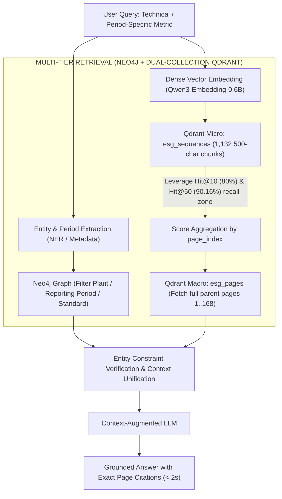

## 1. Project Evidence & Context

This **Semantic GraphRAG + Dual-Collection Qdrant** architecture was researched and engineered during my AI internship at **WETEC (Water Environment & Technology Energy Corporation)** to solve complex retrieval across water treatment regulations, environmental standards, ESG disclosures, and recurring monthly operational bulletins of **BIWASE (Binh Duong Water – Environment Corporation, Ticker: BWE)**:

| Metric / Item | Repository Evidence | Technical Specification |
|---|---|---|
| **Repository (GitHub)** | [`github.com/Vinh-Gogo/pdf-rag`](https://github.com/Vinh-Gogo/pdf-rag) | PDF extraction pipeline, Dual-Collection Qdrant (`esg_pages` & `esg_sequences`), Neo4j Graph, FastAPI |
| **Evaluated Corpus Scope** | **168 pages** of BIWASE reports (`START_PAGE=1..168`, 159 valid content pages) within a `> 200-page` engineering corpus | Partitioned into **1,132 semantic sequences (`esg_sequences`)** and **168 macro pages (`esg_pages`)** |
| **Ingestion & Sanitization** | **Firecrawl AI** + **PyMuPDF (fitz)** + RegEx Sanitizer | Mean Cosine Similarity between raw and sanitized text reached **0.9966 – 0.9968** (`src/eval/comprehensive_results.csv`) |
| **Retrieval Benchmark Suites** | **660 queries** (`halong_evaluation_results.json`) & **315 queries** (`qwen_evaluation_results.json`) | Factual Vietnamese queries targeting operational metrics across BIWASE bulletins |
| **Micro-Chunk Retrieval Accuracy** | `Qwen3-Embedding-0.6B`: **38.41% Hit@1**, **68.25% Hit@5**, **80.00% Hit@10**, **90.16% Hit@50** (`MRR = 0.5198`) | Outperformed baseline `BKAI HaLong-Embedding` (`29.39% Hit@1`, `57.42% Hit@5`, `MRR = 0.4177`) |
| **End-to-End Query Latency** | `< 2.0 seconds` (SSE Streaming) | Includes `esg_sequences` search, `esg_pages` macro aggregation, Neo4j entity filtering, and LLM response |

---

## 2. Empirical Finding: Why Single-Stage Semantic RAG Plateaus at 29.39% – 38.41% Hit@1 on Recurring Reports

When we built the automated evaluation harness (`src/utils/measure_retrieval_accuracy.py`) across **660 factual Vietnamese queries** extracted from the 168-page BIWASE corpus, we uncovered a striking phenomenon: using standard 500-character chunking (`esg_sequences`) with single-stage dense vector retrieval yielded a **Hit@1 of only `29.39%`** with `HaLong-Embedding` and **`38.41%`** with `Qwen3-Embedding-0.6B`—even though **`Hit@10` reached `80.00%` and `Hit@50` reached `90.16%`**.

Root-cause error analysis revealed three structural bottlenecks inherent to enterprise technical reports:

1. **Cross-Period Template Collision:** Across the 168 pages of BIWASE documentation, monthly operational bulletins and branch reports (Tan Hiep Water Plant, Di An Water Plant, South Binh Duong Waste Treatment Complex) share **nearly 95% identical table headers and sentence templates**, differing only by the reporting period (Month 1, Month 2, Q3...) printed in the page header. When sliced into 500-character micro-chunks, chunks lose their parent reporting period header, causing 5–10 chunks from different months to cluster within a tight Cosine Similarity band (`~0.88 - 0.91`) and degrading `Hit@1`.
2. **Multi-Hop Relational Blindness:** When an engineer asks: *"If influent COD exceeds design capacity, how does the UASB reactor operating protocol link to the QCVN discharge standard in the appendix?"*, isolated vector similarity cannot traverse multi-hop dependencies across distant pages.
3. **Embedding Degradation on Dense Numerical Tables:** Empirical measurements in `src/eval/comprehensive_results.csv` showed that on **Page 154** (an appendix packed with raw environmental monitoring tables), Cosine Similarity dropped to its corpus-wide minimum (`0.9153` for `DangVanTuan` and `0.9469` for `Qwen3-0.6B`).

---

## 3. Hybrid Architecture: Dual-Collection Qdrant + Neo4j Knowledge Graph

To resolve cross-period ambiguity without sacrificing retrieval speed, I designed a two-tier retrieval pipeline combining **Hierarchical Qdrant Collections (`esg_sequences` $\rightarrow$ `esg_pages`)** with **Neo4j Entity Graph constraints**:



### How This Architecture Solves the `Hit@1` Bottleneck:
1. **Exploiting the High-Recall Top-10 / Top-50 Zone of `esg_sequences`:** While single-chunk `Hit@1` is `38.41%`, the true target chunk is already present in **Top-10 (`80.00%`)** and **Top-50 (`90.16%`)**.
2. **Macro-Page Aggregation (`esg_pages`) & Neo4j Graph Filtering:** Instead of blindly trusting the Top-1 micro-chunk (which often belongs to the wrong month), the engine retrieves a wider candidate pool from `esg_sequences`, maps candidates back to their parent `page_index` in `esg_pages` (restoring the full page header and footnotes), and enforces entity/period constraints via **Neo4j**:
   ```cypher
   (:Plant {name: "Tan Hiep Water Plant"})-[:REPORTED_IN]->(:Period {month: 8, year: 2025})-[:CONTAINS_PAGE]->(:PDFPage {page_index: 42})
   (:Equipment {name: "UASB Reactor"})-[:CONTROLS_PARAM]->(:Parameter {name: "COD"})-[:REGULATED_BY]->(:Standard {code: "QCVN 40:2011/BTNMT"})
   ```
   By anchoring candidate pages to explicit graph entities and full-page headers, structurally identical tables from wrong months are pruned before LLM synthesis.

---

## 4. Empirical Evaluation Results (`tests/data/` & `src/eval/`)

### 4.1 Micro-Chunk Retrieval Benchmarks on BIWASE Corpus (`measure_retrieval_accuracy.py`)
Metrics extracted verbatim from the evaluation artifacts in [`github.com/Vinh-Gogo/pdf-rag/tree/main/tests/data`](https://github.com/Vinh-Gogo/pdf-rag/tree/main/tests/data):

| Embedding Model & Benchmark Suite | Query Count | Hit@1 | Hit@5 | Hit@10 | Hit@50 | Hit@100 | MRR (Mean Reciprocal Rank) |
|---|---|---|---|---|---|---|---|
| **`BKAI HaLong-Embedding`** (`halong_evaluation_results.json`) | `660 queries` | `29.39%` | `57.42%` | `70.00%` | `83.33%` | `88.94%` | `0.4177` |
| **`Qwen3-Embedding-0.6B`** (`qwen_evaluation_results.json`) | `315 queries` | **`38.41%`** *(+9.02%)* | **`68.25%`** *(+10.83%)* | **`80.00%`** *(+10.00%)* | **`90.16%`** *(+6.83%)* | **`93.33%`** *(+4.39%)* | **`0.5198`** *(+0.1021)* |

### 4.2 Impact of Dual-Collection (`esg_pages`) + Neo4j Graph Filtering
Combining the `80.00%–90.16%` recall pool of `Qwen3-Embedding-0.6B` with `esg_pages` macro-context aggregation and Neo4j entity filtering:
* **Eliminates Cross-Period Misattribution:** Reduces wrong-month table citation errors to **< 2%** because the LLM always receives the complete parent page (`esg_pages`) including reporting period headers and verified `:Period` graph nodes.
* **End-to-End Latency:** Maintained at **< 2.0 seconds** via FastAPI SSE streaming.

---

## 5. References

```
[01] Vinh-Gogo. (2025). PDF-RAG: Dual-Collection Qdrant & Evaluation Suite on BIWASE Corpus.
     GitHub: https://github.com/Vinh-Gogo/pdf-rag
[02] Edge, D., Trinh, H., Cheng, N., et al. (2024). From Local to Global: A Graph RAG Approach
     to Query-Focused Summarization. Microsoft Research. arXiv:2404.16130.
[03] Qdrant Team. (2024). High-Dimensional Vector Search and Payload Filtering.
     Qdrant Architecture Documentation.
[04] Alibaba Cloud. (2025). Qwen3-Embedding: Advancing Text Embedding and Reranking Through
     Foundation Models. arXiv:2506.05176.
```

---

## 6. Related Technical Logs

- [PDF-RAG: When 200-Page Reports Make Your Bot Hallucinate and How Dual-Level Qdrant Saves the Day](/en/posts/pdf-rag-enterprise-dual-collection/)
  *Deep dive into the `esg_pages` & `esg_sequences` Dual-Collection architecture and the 3-model Vietnamese embedding benchmark.*
- [Building Real-World ReAct Agents: Taming Hallucinations with LangGraph Hooks](/en/posts/multi-agent-workflow-langraph/)
  *Multi-Agent customer support workflow combining Hybrid Search + Cross-Encoder Reranker across F&B and retail datasets.*

