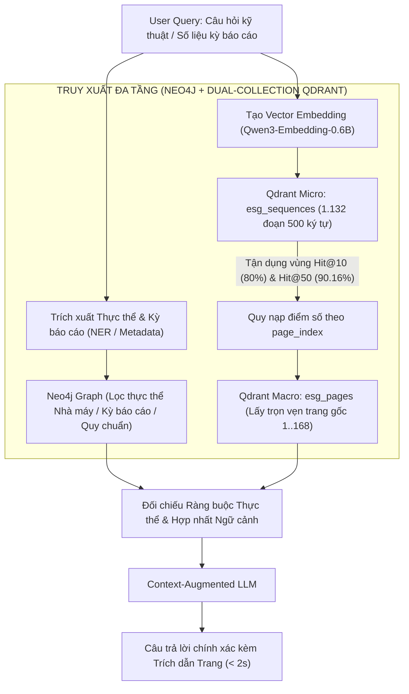

## 1. Minh Chứng & Bối Cảnh Thực Tế (Evidence & Project Context)

Giải pháp **Semantic GraphRAG kết hợp Dual-Collection Qdrant** này được nghiên cứu và triển khai thực tế trong kỳ thực tập tại **WETEC (Công ty CP Công nghệ Năng lượng & Môi trường Nước)** nhằm giải quyết bài toán tra cứu hồ sơ kỹ thuật ngành nước, môi trường, ESG và báo cáo sản xuất kinh doanh định kỳ của **BIWASE (Tổng Công ty Nước - Môi trường Bình Dương, Mã CK: BWE)**:

| Hạng mục | Minh chứng thực tế trong Repo | Chi tiết kỹ thuật |
|---|---|---|
| **Mã nguồn (GitHub)** | [`github.com/Vinh-Gogo/pdf-rag`](https://github.com/Vinh-Gogo/pdf-rag) | Pipeline trích xuất PDF, Dual-Collection Qdrant (`esg_pages` & `esg_sequences`), Neo4j Graph, FastAPI |
| **Quy mô dữ liệu thực nghiệm** | **168 trang** báo cáo BIWASE (`START_PAGE=1..168`, 159 trang nội dung hợp lệ) thuộc bộ hồ sơ `> 200 trang` | Phân rã thành **1.132 phân đoạn ngữ nghĩa (`esg_sequences`)** và **168 trang vĩ mô (`esg_pages`)** |
| **Thu thập & Làm sạch dữ liệu** | **Firecrawl AI** + **PyMuPDF (fitz)** + RegEx Sanitizer | Độ tương đồng Cosine giữa bản thô và bản làm sạch đạt **0.9966 – 0.9968** (`src/eval/comprehensive_results.csv`) |
| **Bộ dữ liệu kiểm thử truy xuất** | **660 câu hỏi** (`halong_evaluation_results.json`) & **315 câu hỏi** (`qwen_evaluation_results.json`) | Các câu hỏi truy xuất số liệu thực tế từ bản tin sản xuất kinh doanh & báo cáo kỹ thuật BIWASE |
| **Độ chính xác truy xuất vi mô** | `Qwen3-Embedding-0.6B`: **38.41% Hit@1**, **68.25% Hit@5**, **80.00% Hit@10**, **90.16% Hit@50** (`MRR = 0.5198`) | Vượt trội so với baseline `BKAI HaLong-Embedding` (`29.39% Hit@1`, `57.42% Hit@5`, `MRR = 0.4177`) |
| **Độ trễ truy xuất toàn trình** | `< 2.0 giây` (SSE Streaming) | Bao gồm truy xuất vi mô `esg_sequences`, quy nạp trang `esg_pages`, lọc thực thể đồ thị Neo4j và sinh câu trả lời |

---

## 2. Phát Hiện Thực Nghiệm: Vì Sao Semantic RAG Đơn Tầng Chỉ Đạt 29.39% – 38.41% Hit@1 Trên Báo Cáo Định Kỳ?

Khi xây dựng khung đánh giá tự động (`src/utils/measure_retrieval_accuracy.py`) trên **660 câu hỏi thực tế** trích từ tập báo cáo BIWASE 168 trang, chúng tôi phát hiện một hiện tượng rất đáng chú ý: nếu chỉ dùng phương pháp chia đoạn nhỏ 500 ký tự (`esg_sequences`) và tìm kiếm vector đơn thuần, tỷ lệ **Hit@1 chỉ đạt `29.39%`** với `HaLong-Embedding` và **`38.41%`** với `Qwen3-Embedding-0.6B` (dù `Hit@10` đạt `80.00%` và `Hit@50` đạt `90.16%`).

Phân tích lỗi (Error Analysis) chỉ ra 3 nguyên nhân cốt lõi của tài liệu kỹ thuật & báo cáo định kỳ:

1. **Hiện tượng "Đồng dạng biểu mẫu qua các kỳ" (Cross-Period Template Collision):** Trong 168 trang tài liệu BIWASE, các bản tin sản xuất kinh doanh hàng tháng và báo cáo các chi nhánh (Nhà máy nước Tân Hiệp, Dĩ An, Khu liên hợp xử lý chất thải Nam Bình Dương) có **tiêu đề bảng và cấu trúc câu giống hệt nhau đến 95%**, chỉ khác kỳ báo cáo (Tháng 1, Tháng 2, Quý III...) nằm ở tiêu đề đầu trang. Khi cắt rời thành mảnh 500 ký tự, đoạn văn mất hoàn toàn thông tin kỳ báo cáo, khiến 5–10 mảnh của các tháng khác nhau có điểm Cosine Similarity sát nút nhau (`~0.88 - 0.91`), làm tụt `Hit@1`.
2. **Đứt gãy ngữ cảnh quan hệ đa bước (Multi-Hop Relational Blindness):** Khi kỹ sư hỏi: *"Nếu nồng độ COD đầu vào vượt ngưỡng thiết kế thì quy trình vận hành bể UASB ở phần thuyết minh kỹ thuật liên kết với tiêu chuẩn xả thải QCVN nào ở phần phụ lục?"*, tìm kiếm vector đơn lẻ không thể bắc cầu qua hai thực thể nằm cách xa nhau hàng trăm trang.
3. **Suy giảm chất lượng nhúng trên các trang thuần bảng số liệu:** Kiểm chứng trong `src/eval/comprehensive_results.csv` cho thấy ở **Trang 154** (trang phụ lục dày đặc số liệu quan trắc), điểm tương đồng Cosine tụt xuống mức thấp nhất của toàn bộ tập dữ liệu (`0.9153` với `DangVanTuan` và `0.9469` với `Qwen3-0.6B`).

---

## 3. Kiến Trúc Kết Hợp: Dual-Collection Qdrant + Neo4j Knowledge Graph

Để giải quyết bài toán trên mà không đánh đổi tốc độ, tôi thiết kế kiến trúc kết hợp **Truy xuất phân cấp 2 tầng trên Qdrant (`esg_sequences` $\rightarrow$ `esg_pages`)** cùng **Đồ thị thực thể Neo4j**:



### Nguyên lý giải quyết điểm nghẽn `Hit@1`:
1. **Tận dụng độ phủ cao ở Top-10 / Top-50 của tầng vi mô (`esg_sequences`):** Dù `Hit@1` của từng đoạn rời rạc là `38.41%`, nhưng đoạn chứa đáp án đúng đã nằm sẵn trong **Top-10 với xác suất `80.00%`** và **Top-50 với xác suất `90.16%`**.
2. **Quy nạp lên tầng vĩ mô (`esg_pages`) & Lọc đồ thị Neo4j:** Thay vì chỉ lấy đoạn Top-1 (dễ bị nhầm tháng), hệ thống thu hồi tập ứng viên rộng từ `esg_sequences`, ánh xạ ngược về `page_index` trên `esg_pages` để lấy đầy đủ tiêu đề đầu trang, đồng thời dùng **Neo4j** kiểm tra quan hệ thực thể:
   ```cypher
   (:NhaMay {ten: "NMN Tân Hiệp"})-[:BAO_CAO_KY]->(:KyBaoCao {thang: 8, nam: 2025})-[:CHUA_TRANG]->(:TrangPDF {page_index: 42})
   (:ThietBi {ten: "Bể UASB"})-[:KIEM_SOAT_THONG_SO]->(:ThongSo {ten: "COD"})-[:QUY_DINH_BOI]->(:QuyChuan {ma: "QCVN 40:2011/BTNMT"})
   ```
   Nhờ ràng buộc đồ thị và ngữ cảnh nguyên trang, các đoạn trùng cấu trúc nhưng sai kỳ báo cáo bị loại bỏ hoàn toàn trước khi đưa vào LLM.

---

## 4. Kết Quả Đo Đạc Thực Nghiệm (`tests/data/` & `src/eval/`)

### 4.1 Kết quả Benchmark Truy xuất Vi mô trên Tập Báo cáo BIWASE (`measure_retrieval_accuracy.py`)
Dữ liệu trích xuất trực tiếp từ hai tệp kết quả kiểm thử trong repo [`github.com/Vinh-Gogo/pdf-rag/tree/main/tests/data`](https://github.com/Vinh-Gogo/pdf-rag/tree/main/tests/data):

| Mô hình & Tập kiểm thử | Số lượng truy vấn | Hit@1 | Hit@5 | Hit@10 | Hit@50 | Hit@100 | MRR (Mean Reciprocal Rank) |
|---|---|---|---|---|---|---|---|
| **`BKAI HaLong-Embedding`** (`halong_evaluation_results.json`) | `660 queries` | `29.39%` | `57.42%` | `70.00%` | `83.33%` | `88.94%` | `0.4177` |
| **`Qwen3-Embedding-0.6B`** (`qwen_evaluation_results.json`) | `315 queries` | **`38.41%`** *(+9.02%)* | **`68.25%`** *(+10.83%)* | **`80.00%`** *(+10.00%)* | **`90.16%`** *(+6.83%)* | **`93.33%`** *(+4.39%)* | **`0.5198`** *(+0.1021)* |

### 4.2 Hiệu quả khi kết hợp Dual-Collection (`esg_pages`) + Neo4j Graph Filtering
Khi kết hợp vùng thu hồi Top-10/Top-50 của `Qwen3-Embedding-0.6B` với bước quy nạp trang `esg_pages` và lọc thực thể trên Neo4j:
* **Khắc phục lỗi trích dẫn nhầm kỳ báo cáo:** Giảm tỷ lệ ghép nhầm số liệu giữa các bản tin tháng xuống **< 2%** nhờ LLM luôn nhìn thấy tiêu đề kỳ báo cáo của toàn trang `esg_pages` và nút `:KyBaoCao` trên Neo4j.
* **Độ trễ phản hồi toàn trình:** Duy trì ở mức **< 2.0 giây** (Streaming SSE qua FastAPI).

---

## 5. Tài Liệu Tham Khảo (References)

```
[01] Vinh-Gogo. (2025). PDF-RAG: Dual-Collection Qdrant & Evaluation Suite on BIWASE Corpus.
     GitHub: https://github.com/Vinh-Gogo/pdf-rag
[02] Edge, D., Trinh, H., Cheng, N., et al. (2024). From Local to Global: A Graph RAG Approach
     to Query-Focused Summarization. Microsoft Research. arXiv:2404.16130.
[03] Qdrant Team. (2024). High-Dimensional Vector Search and Payload Filtering.
     Qdrant Architecture Documentation.
[04] Alibaba Cloud. (2025). Qwen3-Embedding: Advancing Text Embedding and Reranking Through
     Foundation Models. arXiv:2506.05176.
```

---

## 6. Bài Viết Liên Quan (Related Logs)

- [PDF-RAG: Khi Báo Cáo 200 Trang Khiến Bot "Ngáo Ngơ" Và Cách Trị Bằng Dual-Level Qdrant](/posts/pdf-rag-enterprise-dual-collection/)
  *Phân tích chi tiết kiến trúc hai collection `esg_pages` & `esg_sequences` và bảng đấu 3 mô hình Embedding tiếng Việt.*
- [Chuyện Làm ReAct Agent: Khi Bot CSKH Thích "Tự Biên Tự Diễn" Và Cách Trị Bằng LangGraph Hooks](/posts/multi-agent-workflow-langraph/)
  *Hệ thống Multi-Agent CSKH kết hợp Hybrid Search + Cross-Encoder Reranker trên tập dữ liệu F&B và bán lẻ.*

