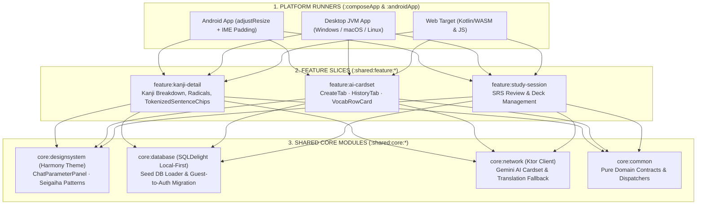

> *"The hardest part of learning Japanese Kanji isn't memorizing isolated stroke orders—it's reading Kanji in real sentences where readings shift between Kun'yomi and On'yomi, yet most apps only display a static sentence translation without letting you inspect how individual morphemes are segmented and pronounced!"*

That frustration motivated the **Mainichi Kanji** ecosystem (comprising **`mainichi-app-v2`** built with **Kotlin Multiplatform + Compose Multiplatform** and **`mainichi-kanji-app`** built with **.NET 10 + Avalonia UI**).

Designed around a strict **Local-First** philosophy, Mainichi Kanji focuses on three core engineering pillars:
1. **Zero-Latency Pre-Packaged Seed Database & Non-Destructive Account Linking:** Thousands of JLPT N5–N1 Kanji, vocabulary entries, radicals, and pre-tokenized example sentences ship directly inside the local SQLite seed database—loading seamlessly during Guest onboarding and preserving 100% of study progress via `migrateGuestData` when linking a Google account.
2. **Interactive Morpheme Inspection (`TokenizedSentenceChips`):** Every Japanese example sentence is rendered as interactive morphological tokens (`JapaneseToken`); tapping any word triggers an instant 3-tier lookup pipeline without leaving the study screen.
3. **Contextual AI Cardset Generation & Harmony Design System:** Integrates Gemini AI to generate custom JLPT-graded flashcard decks rendered inside the **Harmony Design System**, blending traditional Japanese *Ukiyo-e* aesthetics and *Seigaiha* wave motifs with responsive mobile ergonomics.

---

## 1. Architectural Overview & System Specifications

| Dimension | Technical Implementation | Architectural Value |
|---|---|---|
| **Ecosystem Implementations** | **`mainichi-app-v2`** (Kotlin 2.3 + Compose Multiplatform) · **`mainichi-kanji-app`** (.NET 10 + Avalonia UI) · **`kytu`** (KMP + Ktor) | Cross-ecosystem validation of Modular Clean Architecture across JVM/KMP and .NET |
| **Target Platforms** | **Desktop** (Windows / macOS / Linux) · **Mobile** (Android) · **Web** (WASM/JS) | Unifies `:shared:core` and `:shared:feature` across all targets |
| **Data Persistence** | **Local-First SQLite (SQLDelight) + Seed DB Migration** | Zero backend lock-in; seamless Guest-to-Google progress migration (`migrateGuestData`) |
| **Design System** | **Harmony Design System (`:shared:core:designsystem`)** | Standardized `12.dp`/`8.dp` card tokens, *Seigaiha* motifs, and reactive `.imePadding()` keyboard adaptation |
| **Linguistic Interaction** | **`TokenizedSentenceChips` + 3-Tier Lookup Fallback** | Inline JSON Token Metadata (`0ms`) $\rightarrow$ Local SQLite Query $\rightarrow$ Async Bilingual Translation (`TranslationService`) |
| **Cross-Platform Auth** | **Native Google Sign-In + Desktop OAuth Proxy (`OAuthProxyServer`)** | Bypasses Android 14+ `Credential Manager` and `ServerSocket` `EPERM` blocks during development via `adb reverse` |

---

## 2. Multi-Module Clean Architecture (`:shared:core` & `:shared:feature`)

Governed by Gradle Convention Plugins in `build-logic`, `mainichi-app-v2` enforces strict module boundaries between platform runners, feature slices, and core infrastructure:

---

## 3. Instant Morpheme Lookup (`TokenizedSentenceChips`) & 3-Tier Fallback Pipeline

When studying a Kanji character (such as **食**), learners need to see how it behaves inside authentic sentences (`ContextualUsageSection`). Instead of rendering example sentences as flat strings, `mainichi-app-v2` renders them through **`TokenizedSentenceChips`**:
* Each sentence is segmented into `JapaneseToken` objects carrying surface forms, Hiragana readings, part-of-speech tags, and pre-attached definitions.
* Tapping any token dispatches `KanjiDetailsIntent.LookupTokenData(token)`, executing a **3-Tier Lookup Pipeline**:
  1. **Tier 1 — Inline Metadata Fast-Path (`0ms` Zero-DB Roundtrip):** If the `JapaneseToken` carries `meaningVi` in its inline JSON metadata, the detail dialog renders instantaneously without touching SQLite.
  2. **Tier 2 — Local SQLDelight Dictionary Lookup (`lookupToken`):** If inline metadata is partial, the ViewModel queries the local SQLite dictionary for full grammatical and lexical entries.
  3. **Tier 3 — Asynchronous Bilingual Fallback (`TranslationService`):** For inflected or colloquial tokens missing Vietnamese or English glosses in the local database, the dialog displays the surface reading immediately while firing a non-blocking `translateToAll(tokenText)` request to populate both Vietnamese and English meanings in real time.

---

## 4. AI Cardset Ergonomics & Responsive Japanese Typography on Mobile

The **`:shared:feature:ai-cardset`** module lets learners generate tailored vocabulary and Kanji decks for any scenario (e.g., *"JLPT N3 medical clinic vocabulary"* or *"N2 software engineering meeting terms"*).

Refining this experience for compact mobile screens led to three key architectural improvements in the **Harmony Design System**:
1. **Replacing 1:1 Square Grids with Full-Width `VocabRowCard`:** Japanese words paired with Furigana and bilingual Vietnamese/English definitions are horizontally dense. Forcing them into 1:1 square cards (`VocabSquareCard`) caused awkward line breaks and text truncation. Switching to a single-column **`VocabRowCard`** (Japanese headword + reading on the left, vertical divider, Vietnamese + English meanings on the right) eliminated truncation completely.
2. **Auto-Collapsing `ChatParameterPanel` & IME Co-Resizing:** Stacked the *Card Category*, *Quantity Stepper*, and *JLPT Level* selectors into full-width rows with `12.dp`/`8.dp` Harmony corner tokens, and bound `isConfigExpanded` to automatically collapse when the prompt input gains focus (`onFocus`) alongside `.imePadding()`—maximizing viewport space above the virtual keyboard.
3. **Solving Android 14+ OAuth Restrictions via `OAuthProxyServer`:** To overcome missing Play Services credentials on emulators and Android 14+ `EPERM` blocks on local `ServerSocket` loopback callbacks, we built a lightweight Desktop proxy (`:composeApp:runOAuthProxy` tunneled over `adb reverse tcp:8765 tcp:8765`) handling `/start` $\rightarrow$ `/redirect` $\rightarrow$ long-polled `/result`, seamlessly feeding into `migrateGuestData`.

---

## 5. Conclusion

The **Mainichi Kanji** ecosystem (`mainichi-app-v2` & `mainichi-kanji-app`) demonstrates how **Local-First SQLite persistence**, **morpheme-level interactive typography (`TokenizedSentenceChips`)**, and **culturally grounded UI engineering (`Harmony Design System`)** combine to create a fast, resilient cross-platform language learning experience.
