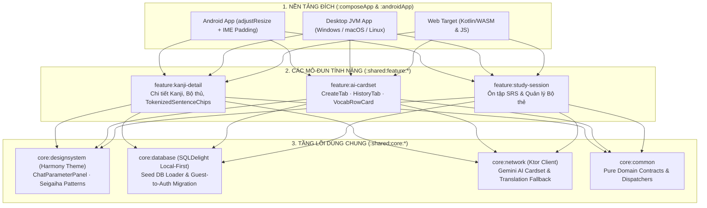

> *"Học chữ Hán (Kanji) tiếng Nhật khó nhất không phải là nhớ nét vẽ đơn lẻ, mà là khi chữ Kanji đó ghép vào câu thực tế: cùng một chữ nhưng đứng một mình đọc âm Kun, ghép thành từ vựng đọc âm On, bấm vào câu ví dụ trên app thì chỉ hiện dịch cả câu chứ không biết từng từ trong câu được tách và đọc như thế nào!"*

Đó là lý do tôi khởi xướng hệ sinh thái **Mainichi Kanji** (gồm hai nhánh triển khai: **`mainichi-app-v2`** trên nền tảng **Kotlin Multiplatform + Compose Multiplatform** và **`mainichi-kanji-app`** trên **.NET 10 + Avalonia UI**).

Mục tiêu cốt lõi của dự án là xây dựng một ứng dụng học Kanji và từ vựng tiếng Nhật hàng ngày (*"Mainichi"*) theo triết lý **Local-First (Ưu tiên dữ liệu cục bộ)**:
1. **Khởi động tức thì với Cơ sở dữ liệu hạt giống (Pre-packaged Seed Database):** Hàng nghìn chữ Kanji (JLPT N5–N1), từ vựng, bộ thủ và câu ví dụ phân tách từ tố được đóng gói sẵn và nạp vào SQLite cục bộ ngay khi người dùng vào chế độ Khách (Guest) hoặc Đăng nhập Google mà không gây đơ giao diện (Zero UI Blocking) và không làm mất tiến độ khi nâng cấp schema.
2. **Tra cứu câu phân tách từ tố một chạm (`TokenizedSentenceChips`):** Mỗi câu ví dụ tiếng Nhật được phân tách thành các chip từ tố (`JapaneseToken`) chứa sẵn nghĩa và cách đọc; chạm vào bất kỳ từ nào trong câu sẽ bật ngay hộp thoại tra cứu nhanh đa tầng mà không cần thoát khỏi màn hình đang học.
3. **Sinh bộ thẻ thông minh theo ngữ cảnh (`AI Cardset Generator`):** Tích hợp Gemini AI sinh tự động bộ thẻ từ vựng và Kanji theo chủ đề, cấp độ JLPT và số lượng tùy chỉnh, hiển thị trên hệ thống thiết kế **Harmony Design System** lấy cảm hứng từ nghệ thuật tranh khắc gỗ truyền thống Nhật Bản (*Ukiyo-e* & họa tiết sóng biển *Seigaiha*).

---

## 1. Tổng Quan Kiến Trúc & Thông Số Kỹ Thuật (System Overview & Specs)

| Hạng mục | Thông số & Giải pháp kỹ thuật | Giá trị kiến trúc cốt lõi |
|---|---|---|
| **Các nhánh triển khai** | **`mainichi-app-v2`** (Kotlin 2.3 + Compose Multiplatform) · **`mainichi-kanji-app`** (.NET 10 + Avalonia UI) · **`kytu`** (KMP + Ktor Server) | Thử nghiệm và đối sánh kiến trúc Clean Architecture trên cả hệ sinh thái JVM/KMP lẫn .NET đa nền tảng |
| **Nền tảng mục tiêu** | **Desktop** (Windows / macOS / Linux) · **Mobile** (Android) · **Web** (WASM/JS) | Chia sẻ trọn vẹn tầng `:shared:core` và `:shared:feature` |
| **Triết lý Dữ liệu** | **Local-First SQLite (SQLDelight) + Seed Database Migration** | Bảo toàn 100% tiến độ học tập qua luồng `migrateGuestData` khi liên kết tài khoản Google |
| **Hệ thống Thiết kế (Design System)** | **Harmony Design System (`:shared:core:designsystem`)** | Hệ token màu sắc, bo góc chuẩn (`12.dp`/`8.dp`), họa tiết truyền thống *Seigaiha* và thích ứng bàn phím di động (`.imePadding()`) |
| **Tương tác Ngôn ngữ học** | **`TokenizedSentenceChips` + 3-Tier Lookup Fallback** | Ưu tiên đọc JSON Token Metadata (`0ms`) $\rightarrow$ Truy vấn SQLite cục bộ $\rightarrow$ Dịch ngầm đa ngôn ngữ (`TranslationService` VI/EN) |
| **Xác thực Đa nền tảng** | **Native Google Sign-In + Desktop OAuth Proxy (`OAuthProxyServer`)** | Giải quyết giới hạn `Credential Manager` và `ServerSocket` trên thiết bị thực/máy ảo Android 14+ qua đường hầm `adb reverse` |

---

## 2. Kiến Trúc Phân Tầng Đa Mô-Đun (`:shared:core` & `:shared:feature`)

Để ứng dụng biên dịch mượt mà cho cả Desktop, Android và Web mà không bị phụ thuộc chéo, `mainichi-app-v2` được tổ chức theo kiến trúc mô-đun hóa nghiêm ngặt quản lý bởi `build-logic` Convention Plugins:

---

## 3. Tra Cứu Từ Tố Tức Thì (`TokenizedSentenceChips`) & Chuỗi Dự Phòng 3 Tầng

Khi người học xem chi tiết một chữ Kanji (ví dụ chữ **食** — *Thực*), phần quan trọng nhất là hiểu cách chữ đó xuất hiện trong các câu văn ngữ cảnh (`ContextualUsageSection`). Thay vì hiển thị câu ví dụ như một chuỗi văn bản chết, `mainichi-app-v2` xây dựng thành phần **`TokenizedSentenceChips`**:
* Mỗi câu tiếng Nhật được phân tách sẵn thành danh sách đối tượng `JapaneseToken` (chứa mặt chữ `surface`, cách đọc `reading` Hiragana/Furigana, từ loại `pos` và nghĩa tiếng Việt/tiếng Anh `meaningVi`/`meaningEn`).
* Khi người dùng nhấn vào bất kỳ chip từ tố nào trong câu, sự kiện `KanjiDetailsIntent.LookupTokenData(token)` kích hoạt **Chuỗi tra cứu 3 tầng (3-Tier Lookup Pipeline)**:
  1. **Tầng 1 — Siêu dữ liệu nội tuyến (`0ms` Zero-DB Roundtrip):** Nếu đối tượng `JapaneseToken` trong câu đã đính kèm sẵn `meaningVi` trong metadata JSON, hộp thoại tra cứu hiển thị ngay lập tức mà không cần truy vấn cơ sở dữ liệu.
  2. **Tầng 2 — Truy vấn Từ điển SQLite Cục bộ (`lookupToken`):** Nếu token chưa có nghĩa đầy đủ, ViewModel truy vấn bảng từ vựng trong SQLDelight cục bộ để lấy thông tin ngữ pháp và giải nghĩa.
  3. **Tầng 3 — Bổ sung dịch tự động bất đồng bộ (`TranslationService`):** Nếu từ tố là một biến thể khẩu ngữ hiếm gặp chưa có đủ nghĩa song ngữ Việt – Anh trong CSDL hạt giống, hệ thống hiển thị trước mặt chữ và cách đọc, đồng thời gọi ngầm `translateToAll(tokenText)` để điền bổ sung nghĩa Tiếng Việt và Tiếng Anh lên hộp thoại một cách mượt mà.

---

## 4. AI Cardset Generator & Tối Ưu Hóa Giao Diện Chữ Nhật Trên Mobile

Mô-đun **`:shared:feature:ai-cardset`** cho phép người học yêu cầu AI tạo bộ thẻ học tập theo bất kỳ chủ đề thực tế nào (ví dụ: *"Từ vựng đi khám bệnh tại Nhật trình độ N3"* hoặc *"Thuật ngữ họp kỹ thuật phần mềm N2"*).

Trong quá trình tinh chỉnh trải nghiệm thực tế trên màn hình điện thoại nhỏ, ba quyết định thiết kế quan trọng đã được áp dụng trong hệ thống **Harmony Design System**:
1. **Phá bỏ bố cục thẻ vuông 1:1 (`VocabSquareCard` $\rightarrow$ `VocabRowCard`):** Chữ Nhật kết hợp Furigana và nghĩa tiếng Việt/tiếng Anh rất dài theo chiều ngang. Khi nhốt vào các ô lưới vuông 1:1, chữ bị cắt cụt (`...`) hoặc xuống dòng vụn vặt. Việc chuyển sang **`VocabRowCard`** (bố cục hàng ngang toàn chiều rộng: bên trái là từ tiếng Nhật + Hiragana, ngăn cách bởi đường kẻ dọc thanh mảnh với nghĩa Tiếng Việt + Tiếng Anh bên phải) giúp hiển thị trọn vẹn 100% thông tin mà không bao giờ bị tràn dòng.
2. **Bảng tham số xếp chồng thông minh (`ChatParameterPanel.kt`):** Chuyển đổi các bộ chọn *Loại thẻ*, *Số lượng* (Stepper) và *Cấp độ JLPT* thành 3 hàng ngang toàn chiều rộng có bo góc chuẩn `12.dp`/`8.dp`, và tự động thu gọn (`isConfigExpanded = false`) ngay khi ô nhập văn bản nhận tiêu điểm (`onFocus`) hoặc khi bàn phím ảo bật lên (`.imePadding()`), nhường tối đa không gian hiển thị cho danh sách thẻ kết quả.
3. **Vượt rào cản Google OAuth trên Android 14+ với `OAuthProxyServer`:** Khi phát triển trên máy ảo hoặc thiết bị thiếu Google Play Credential Manager và bị chặn mở `ServerSocket` cục bộ do quyền `EPERM`, dự án tích hợp một máy chủ proxy nhẹ trên Desktop (`:composeApp:runOAuthProxy` kết hợp `adb reverse tcp:8765 tcp:8765`) xử lý trọn vẹn vòng đời `/start` $\rightarrow$ `/redirect` $\rightarrow$ `/result` (long-polling), sau đó chuyển giao mượt mà dữ liệu từ tài khoản Guest sang tài khoản chính thức qua `migrateGuestData`.

---

## 5. Kết Luận

Hệ sinh thái **Mainichi Kanji** (`mainichi-app-v2` & `mainichi-kanji-app`) thể hiện rõ cách kết hợp **kiến trúc Local-First bền vững**, **xử lý ngôn ngữ học chi tiết đến từng hình vị (`TokenizedSentenceChips`)** và **thẩm mỹ thiết kế bản địa (`Harmony Design System`)** để giải quyết những điểm đau thực tế nhất của người học tiếng Nhật trên đa nền tảng.
