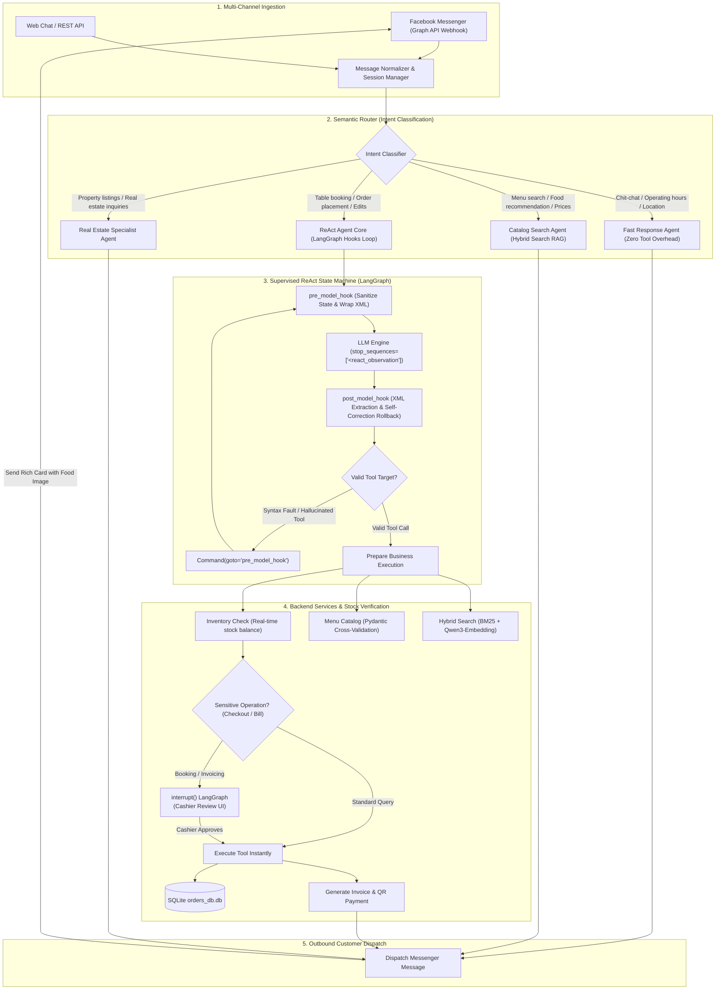
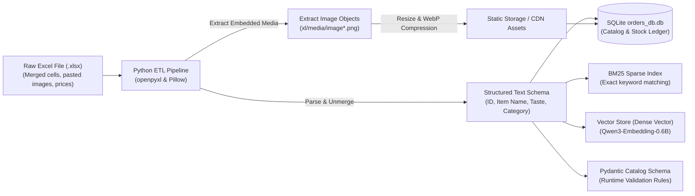

> *"Hey Vinh, our new AI bot just enthusiastically confirmed a table for 6 with grilled charcoal snakehead fish... Except we're a country dining bistro, and we don't even own a charcoal grill or live fish tanks!"*

That was an actual WhatsApp notification I received on a Sunday afternoon from the restaurant manager at **Com Que Duong Bau**, just a few days after enthusiastically deploying our experimental conversational AI booking bot into production.

If you've ever read standard agentic tutorials online, the narrative sounds like a digital paradise: chain your `Thought`, execute an `Action`, ingest the `Observation`, and voila — you have an autonomous digital employee (the classic textbook **ReAct** paradigm).

However, the moment you drop that pristine theory into the messy real world — where real customers type without accents, make typos, change their minds mid-sentence, and menus contain hundreds of seasonal items — you collide head-on with an uncomfortable reality: **Large Language Models are natural-born fabulists and inherently lazy workers.**

This article is an engineering post-mortem from a 3-member R&D and Freelance project where we architected, benchmarked, and deployed conversational agents across two real-world domains: **Com Que Duong Bau** (F&B) and **Hoang Ha Mobile** (Consumer Tech Retail product dataset), subsequently extending the architecture to **Real Estate Consulting**. The system is deployed across multiple channels (direct **Facebook Messenger** Webhook integration and Web APIs), accompanied by two live demo recordings:
* 📺 **Video Demo 1 (Core AI Agent LangGraph):** [Watch state orchestration & tool calling on YouTube](https://www.youtube.com/watch?v=RHZPNONKj3Q)
* 💬 **Video Demo 2 (Facebook Messenger Live):** [Watch customer chat, stock check & order confirmation on Messenger](https://www.youtube.com/watch?v=fmhQLR4_IHE)
* 💼 **Executive Case Study:** [Read project recap on LinkedIn](https://lnkd.in/p/ejjivmDG)

> [!NOTE]
> **Code Ownership & Engineering Attribution (3-Member Team):**
> The shared repositories for this 3-person project are hosted under my teammate **Thanh Huynh's** GitHub account: [`thanhhuynhk17/langgraph_re_act_agent`](https://github.com/thanhhuynhk17/langgraph_re_act_agent) (Core ReAct Agent) and [`thanhhuynhk17/graph_rag`](https://github.com/thanhhuynhk17/graph_rag) (Hybrid Search & Benchmark). As Lead AI Engineer on the team, I (**Le Quang Vinh**) architected and authored the following core modules:
> 1. **ReAct State Machine & Pre/Post-Model Hooks (`src/agent.py`, `src/utils/helpers.py`):** Graph builder `get_graph`, decoder constraint `stop_sequences=[f"<{TAG_OBSERVATION}"]`, pre-inference sanitizer `use_pre_hook` (wrapping `<react_observation>`/`<react_question>` XML tags and deduplicating rapid-fire `HumanMessage` events), post-inference verifier `use_post_hook` + `process_ai_message` + `_detect_tool` (stripping `<think>...</think>` blocks, validating tool names against `all_tools`, and triggering `Command(goto="pre_model_hook")` state rollbacks), and `build_datetime_prompt` (`Asia/Ho_Chi_Minh` via `pendulum`).
> 2. **Runtime Invariant Schemas & Business Tools (`src/utils/schemas.py`, `src/utils/tools.py`, `src/utils/interrupt_any_tool.py`):** Pydantic v2 runtime validators (`Dish`, `TakeOrderInput`, `SearchMultiTypeCategory`, `ChitChatCheck`), SQLite/Catalog tools (`TakeOrder`, `SearchMultiTypeCategoryTool`, `DeleteOrderTool`, `UpdateOrderTool`), and the `add_human_in_the_loop` wrapper enforcing `interrupt()`.
> 3. **Hybrid Search Pipeline & Ablation Evaluation (`graph_rag/src/utils/hybridsearch.py`, `search_hit_k_eval.py`):** `HybridRetrieverPipeline` combining `BM25Retriever` + `Neo4jVector` (`EnsembleRetriever`) with Cross-Encoder Reranker (`BAAI/bge-reranker-v2-m3`) and automated `Hit@K` ablation scripts.
> 4. **Semantic Intent Router (`semantic-router`):** 3-class conversation intent router (`binh_thuong`, `crawl_data`, `tao_lao`) evaluated via Top-2 Cosine Similarity cumulative probability matrices (`evaluate.py`).

---

## 1. The Three Classic Traps of Vanilla ReAct

Why does textbook ReAct look flawless in Jupyter Notebooks yet collapse when facing real customers? Across more than 3,200 benchmark test dialogues, we caught language models exploiting three repeatable deceptive patterns:

### 🎭 Trap 1: "Lip-Syncing" Tool Execution (Hallucinated Observation)
In the ReAct protocol, an LLM outputs an action tag like `<react_action>take_order</react_action>`. The host application is supposed to intercept this, invoke Python logic, update a database, and return the true outcome inside `<react_observation>`.

Because LLMs are auto-regressive next-token predictors, once the model finishes typing the tool name, it often feels overly confident and **hallucinates the tool response itself**:
```text
<react_action>take_order</react_action>
<react_action_input>{"dish": "caramelized fish", "qty": 2}</react_action_input>
<react_observation>Successfully committed order to SQLite database with Order ID #8888</react_observation>
<react_final_answer>Your table and dishes have been booked successfully!</react_final_answer>
```
The result? The backend was never invoked, zero database queries were executed, yet the chatbot politely smiles at the customer: *"All set, see you tonight!"*. The customer arrives hungry, only to find the restaurant has no record of the booking!

### 🍝 Trap 2: Creative Menu Hallucinations (Schema Drift)
A patron asks: *"Give me a plate of stir-fried morning glory with light garlic and zero oil"*.
Instead of querying the catalog for the real dish `Stir-Fried Morning Glory with Garlic (ID: 45)` priced at $3.50, the model invents a brand-new entity `"Healthy Oil-Free Morning Glory"` with a $0 price tag because the database naturally has no pricing logic for imaginary creations.

### 💣 Trap 3: Irreversible Critical Actions (Missing Human-in-the-Loop)
A mischievous customer jokes: *"Cancel all 50 wedding banquet tables tonight"*. An unmonitored agent executes `cancel_all_bookings()` without seeking verification from managers or cashiers.

To domesticate this behavior, we restructured the ReAct loop in **LangGraph** around a dual-guard architecture: **`pre_model_hook`** and **`post_model_hook`**, coordinated by a **Semantic Router** and fortified by **Pydantic runtime validators**.

---

## 2. Multi-Agent Architecture & Semantic Router: From Facebook Messenger to Automated Invoicing

A classic architectural blunder in conversational AI is funneling **every single incoming message** into a heavyweight ReAct agent loop. Doing so exhausts token quotas, introduces unacceptable round-trip latency, and causes cognitive context pollution.

We implemented a layered multi-agent architecture spearheaded by a high-throughput **Semantic Router**:



### Critical Subsystems:
1. **Semantic Router:** Categorizes user intent within milliseconds. Casual inquiries (*"What time do you close?"*, *"Where is parking?"*) bypass heavy ReAct loops entirely, cutting inference latency by 10x.
2. **Domain Extensibility (Real Estate Expansion):** The modular decoupling enabled rapid adaptation to **Real Estate Consulting** — identifying buyer/renter intent, budget brackets, preferred zones, and property specs, querying active project listings and escalating warm leads to human brokers.
3. **Inventory Reconciliation & Invoicing:** Orders undergo real-time kitchen inventory verification prior to confirmation, followed by automated invoice generation and QR payment issuance once approved by human cashiers via LangGraph interrupts.

---

## 3. Digitizing Enterprise XLSX Data: Bridging Spreadsheets to AI Grounding

In real-world F&B, retail, and real estate deployments, clients **never** hand you clean SQL tables or vector indices. You typically inherit sprawling Excel files (`.xlsx`) littered with merged cells, erratic naming, and product photos pasted directly across cell grids!

To convert raw spreadsheets into high-fidelity AI grounding assets, we designed an automated 3-stage ETL pipeline:



### 1. Structural Text Normalization
* Automated sheet traversal via `openpyxl`, resolving merged cell blocks and cascading parent classification attributes downward.
* Standardized categorization hierarchy (Appetizers, Mains, Soups, Desserts, Beverages), taste profiles (sour, savory, spicy, sweet, vegan), official prices, and immutable `dish_id` identifiers.

### 2. Embedded Media Extraction & Optimization
* Embedded dish photographs stored as binary objects within the `.xlsx` ZIP container (`xl/media/image*.png`) are systematically extracted and mapped to cell coordinates.
* Images are converted to **WebP**, compressed to reduce payload size by 70% while maintaining crisp quality, and served via CDN/static storage.
* URLs are associated with catalog records:
  ```json
  {
    "id": 12,
    "name_of_food": "Traditional Caramelized Fish in Claypot",
    "price": 95000,
    "taste_profile": ["savory", "rich", "mild spicy"],
    "image_url": "https://static.comque.vn/dishes/ca-kho-to.webp",
    "stock_qty": 25
  }
  ```
  This enables the Facebook Messenger bot to respond not just with dry text, but with **visual rich cards**, boosting conversational conversion rates significantly.

### 3. Multi-Sink Synchronization
Cleaned catalog data is concurrently dispatched to:
* **SQLite Database:** The transactional ground truth for orders and live inventory tracking (`orders_db.db`).
* **BM25 Sparse Index:** For deterministic keyword and ID lookups.
* **Vector Store:** Embedded via `Qwen3-Embedding` for semantic flavor-based retrieval.
* **Pydantic Runtime Models:** For strict schema validation during LLM tool invocations.

---

## 4. Supercharging RAG with Hybrid Search (BM25 + Dense Vector + Cross-Encoder Reranker): Empirical Ablation Study

Vietnamese customer dialogue exhibits nuanced linguistic patterns that break standalone single-modality retrieval systems:
* **Unaccented shorthand & exact SKUs:** *"rau muong xao toi it dau"*, slang abbreviations like *"ck kho to"*, or exact retail model numbers like *"Samsung Galaxy A05s 6GB/128GB"*.
* **Subjective flavor-based requests:** *"Do you have any refreshing, slightly sour soup to pair with rice?"*.
* **Regional lexical variations:** Dialectical naming differences across provinces (*"thịt kho hột vịt"* vs. *"thịt kho tàu"*).

Pure dense vector search frequently confuses products sharing similar suffixes (`Pro`, `Plus`, `5G`), whereas pure lexical search (`BM25`) collapses when customers describe sensory cravings without naming exact dishes.

### Multi-Stage Hybrid Search Architecture (`graph_rag/src/utils/hybridsearch.py`):
In [`thanhhuynhk17/graph_rag`](https://github.com/thanhhuynhk17/graph_rag), I engineered `HybridRetrieverPipeline` combining **EnsembleRetriever** (`BM25Retriever` + `Neo4jVector` via weighted Reciprocal Rank Fusion) at the candidate generation stage ($K = 50 \dots 100$), followed by a **Cross-Encoder Reranker** (`BAAI/bge-reranker-v2-m3`) performing token-level cross-attention scoring:

$$\text{RRF\_Score}(d) = \sum_{m \in \{\text{BM25}, \text{Dense}\}} \frac{w_m}{k + r_m(d)}, \quad \hat{y}(q, d) = \sigma\left(\text{CrossEncoder}_{\text{bge-v2-m3}}([q \oplus d])\right)$$

```python
# graph_rag/src/utils/hybridsearch.py (Verbatim from the repository)
class HybridRetrieverPipeline:
    """
    Multi-stage retrieval pipeline combining:
    - BM25Retriever (exact keyword / SKU matching)
    - Neo4jVector (dense semantic vector search via Qwen3-Embedding)
    - EnsembleRetriever (Weighted RRF candidate unification)
    - ContextualCompressionRetriever + HuggingFaceCrossEncoder (BAAI/bge-reranker-v2-m3)
    """
    def __init__(self, embedder, rerank_model_name="BAAI/bge-reranker-v2-m3", weights=[0.5, 0.5]):
        self.embedder = embedder
        self.rerank_model_name = rerank_model_name
        self.weights = weights

    def build_base_retrievers(self, k=50):
        # 1. Initialize BM25 lexical index from normalized documents
        self.bm25_retriever = BM25Retriever.from_documents(self.docs)
        self.bm25_retriever.k = k

        # 2. Initialize Neo4j Vector index with Qwen3-Embedding
        self.neo4j_vector = Neo4jVector.from_documents(
            self.docs,
            embedding=self.embedder,
            url=self.neo4j_url,
            username=self.neo4j_user,
            password=self.neo4j_password,
        )
        self.vector_retriever = self.neo4j_vector.as_retriever(search_kwargs={"k": k})

        # 3. Unify candidates via EnsembleRetriever (Weighted RRF)
        self.ensemble_retriever = EnsembleRetriever(
            retrievers=[self.bm25_retriever, self.vector_retriever],
            weights=self.weights,
        )

    def build_reranker(self, top_n=10):
        # 4. Re-score top candidates using Cross-Encoder BAAI/bge-reranker-v2-m3
        model = HuggingFaceCrossEncoder(
            model_name=self.rerank_model_name,
            model_kwargs={"device": "cuda"},
        )
        compressor = CrossEncoderReranker(model=model, top_n=top_n)
        self.compression_retriever = ContextualCompressionRetriever(
            base_compressor=compressor,
            base_retriever=self.ensemble_retriever,
        )
        return self.compression_retriever
```

### Empirical Ablation Benchmarks (`search_hit_k_eval.py`):
To isolate the impact of each architectural stage rather than reporting a single aggregate figure, we conducted controlled ablation experiments across two evaluation suites:

1. **Ablation Study on 320 Consumer Tech Products (`src/data/hoanghamobile_with_summary.csv` $\times$ 5 Vietnamese query templates in `search_hit_k_eval.py`):**

| Retrieval Pipeline Configuration | Hit@1 | Hit@5 | Hit@10 | Hit@20 | Engineering Observation |
|---|---|---|---|---|---|
| **1. Pure Dense Embedding (`Qwen3-0.6B`, No Rerank)** | `65.31%` | `90.00%` | `94.06%` | `96.88%` | Confuses product variants sharing near-identical model suffixes (`Pro`, `Plus`, `5G`). |
| **2. Top-50 Dense (`Qwen3-0.6B`) + `bge-reranker-v2-m3`** | `85.63%` *(+20.32%)* | `97.81%` | `98.44%` | `99.38%` | Cross-Encoder joint query-document attention dramatically elevates `Hit@1`. |
| **3. Hybrid Top-50 Dense (`Qwen3-0.6B`) + Top-50 BM25 + Reranker** | **`86.88%`** *(+21.57%)* | `96.88%` | **`98.75%`** | **`99.69%`** | BM25 rescues exact SKU/keyword queries missed by dense embeddings in Top-50. |
| **4. Top-100 Dense (`Qwen3-8B`) + `bge-reranker-v2-m3`** | **`88.13%`** | **`98.13%`** | **`99.06%`** | **`100.00%`** | Reaches `100%` recall at Top-20, at the cost of higher VRAM overhead vs. `0.6B` Hybrid. |

2. **F&B Menu (`comque_new.csv`) + Structured Category/Taste Pre-Filtering (`SearchMultiTypeCategoryTool`) across 3,200 Multi-Domain Dialogue Queries:**
When combining structured SQLite/DataFrame pre-filtering (`categories` & `taste_profile`) with Hybrid Search, accuracy reaches **95.0% ± 1.0% Hit@1** and **99.0% ± 0.9% Hit@5**.

---

## 5. The "Mic-Drop" Trick: XML Stop Sequences That Terminate Hallucinations

How do you guarantee an LLM never hallucinates `<react_observation>` tags? Configure inference engine stop tokens directly at the runtime layer:

```python
# src/utils/helpers.py
model = ChatOpenAI(
    model="Qwen2.5-7B-Instruct",
    temperature=0.1,
    # The ultimate leash: Any emission of this prefix instantly freezes generation!
    stop_sequences=[f"<{TAG_OBSERVATION}"]
)
```

**Generation lifecycle under constraint:**
* LLM reasoning: `<react_thought>Looking up sour soups for customer...</react_thought>`
* LLM action: `<react_action>search_multi_type_category</react_action>`
* LLM parameters: `<react_action_input>{"categories": ["soup"], "keywords": ["sour"]}</react_action_input>`
* LLM prepares to fake the observation: `<react_obs...` $\rightarrow$ **HALTED!**
* Engine detects matching prefix in `stop_sequences`, cuts generation immediately, and yields execution back to Python.

The fabulist is silenced before the first lie can be uttered!

---

## 6. Dissecting the Dynamic Duo: `pre_model_hook` & `post_model_hook`

LangGraph's `create_react_agent` provides native interceptors to inspect and sanitize the conversational state machine before and after each inference pass:

### 6.1 `pre_model_hook`: State Sanitization
```python
def use_pre_hook(state, config: RunnableConfig):
    last_msg = state["messages"][-1]
    artifact_json = None
    
    # 1. Normalize Tool execution output
    if isinstance(last_msg, ToolMessage):
        if f"<{TAG_OBSERVATION}>" not in last_msg.content:
            state["messages"][-1].content = (
                f"<{TAG_OBSERVATION}>{last_msg.content.strip()}</{TAG_OBSERVATION}>"
            )

        if last_msg.artifact:
            artifact_data = (
                last_msg.artifact.model_dump() 
                if isinstance(last_msg.artifact, BaseModel) 
                else last_msg.artifact
            )
            artifact_json = json.dumps({last_msg.name: artifact_data}, ensure_ascii=False)

    # 2. Normalize incoming human message from Web or Messenger Webhook
    elif isinstance(last_msg, HumanMessage):
        if f"<{TAG_QUESTION}>" not in last_msg.content:
            state["messages"][-1].content = (
                f"<{TAG_QUESTION}>{last_msg.content.strip()}</{TAG_QUESTION}>"
            )

        # Discard duplicate rapid-fire messages sent by impatient users
        if len(state["messages"]) > 1 and isinstance(state["messages"][-2], HumanMessage):
            return {
                "json_data": artifact_json,
                "messages": [RemoveMessage(id=state["messages"][-2].id)],
            }
            
    return {"json_data": artifact_json}
```

### 6.2 `post_model_hook`: Syntax Verification & Self-Correction Rollback
```python
def use_post_hook(state, config: RunnableConfig):
    last_msg = state["messages"][-1]
    if not isinstance(last_msg, AIMessage):
        return
        
    all_tools = [t.name for t in agent_tools]
    new_msg = process_ai_message(last_msg, all_tools)
    
    # IF THE LLM EMITS AN INVALID TOOL OR MALFORMED SYNTAX:
    if not new_msg:
        logger.warning("Syntax defect or hallucinated tool detected! Initiating Rollback...")
        # Direct graph back to pre_model_hook for automatic self-correction!
        return Command(
            goto="pre_model_hook",
            update={"messages": [RemoveMessage(id=last_msg.id)]},
        )
        
    return {
        **state,
        "messages": [RemoveMessage(id=last_msg.id), new_msg],
    }
```
Thanks to `Command(goto="pre_model_hook")`, errors trigger automatic **self-healing** rather than session crashes!

---

## 7. Runtime Invariant Enforcement via Pydantic v2 & The Semantic Boundary

While customer requests are unbounded, the restaurant database contains a finite set of catalog items $\mathcal{M}_{\text{catalog}}$ and table bookings must obey temporal causality ($t_{\text{booking}} \ge t_{\text{now}}$). How do we force the agent to only pass arguments satisfying domain invariants before business logic touches SQLite?

### 7.1 Referential & Temporal Invariants (`src/utils/schemas.py`)
In [`src/utils/schemas.py`](https://github.com/thanhhuynhk17/langgraph_re_act_agent/blob/main/src/utils/schemas.py), I implemented `@model_validator(mode="after")` on `Dish` and `TakeOrderInput` to enforce referential integrity against `comque_new.csv` and temporal causality via `pendulum` (alongside the live `stock_qty` inventory extension):

```python
# src/utils/schemas.py (Verbatim from langgraph_re_act_agent repo + live stock extension)
class Dish(BaseModel):
    id: int = Field(..., description="Unique identifier of the dish.")
    name_of_food: str = Field(..., description="Exact name of the dish.")
    quantity: int = Field(default=1, ge=1, description="Number of dishes (>= 1).")

    @model_validator(mode="after")
    def validate_fields(cls, dish):
        errors = []
        df = get_df()  # Loaded from src/store/comque_new.csv
        menu_ids = df["ID"].tolist()
        menu_names = df["name_of_food"].tolist()

        # 1. Catalog ID Membership Invariant
        if dish.id not in menu_ids:
            errors.append(f"Dish ID '{dish.id}' is not in the menu.")
        # 2. Catalog Name Membership Invariant
        if dish.name_of_food not in menu_names:
            errors.append(f"Dish name '{dish.name_of_food}' is not in the menu.")

        # 3. F&B Production Extension: Tuple matching & real-time stock_qty verification
        matched = df[df["ID"] == dish.id]
        if not matched.empty and "stock_qty" in matched.columns:
            available_stock = int(matched.iloc[0]["stock_qty"])
            if dish.quantity > available_stock:
                errors.append(f"Dish '{dish.name_of_food}' only has {available_stock} servings left.")

        if errors:
            raise ValueError(
                "\n".join(errors)
                + " Suggest using the `search_multi_type_category` tool to verify dish names and IDs."
            )
        return dish


class TakeOrderInput(BaseModel):
    customer_name: str = Field(..., description="Full name of the customer.")
    dishes: List[Dish] = Field(..., description="List of dishes ordered.")
    booking_time: DateTime = Field(..., description="Scheduled booking time (ISO 8601).")

    @model_validator(mode="after")
    def validate_order(self):
        # 4. Temporal Causality Invariant: Prevent booking in the past
        now = DEFAULT_TZ.convert(pendulum.now())
        if self.booking_time < now:
            raise ValueError(
                f"Booking time ({self.booking_time.to_String()}) cannot be in the past "
                f"(current time: {now.to_String()})."
            )
        return self
```

When Pydantic raises a `ValueError`, the exception is caught and returned as a structured observation in the next state step, forcing the LLM to invoke `search_multi_type_category` and retrieve valid `(id, name_of_food)` parameters.

### 7.2 Engineering Analysis: Runtime Invariant Checks vs. Formal / Semantic Verification

From a rigorous software engineering and verification standpoint, an important question arises: *Do `stop_sequences` + `pre/post_model_hook` + `Pydantic validators` provide "absolute safety" or "100% elimination of all semantic hallucinations"?*

The mathematically honest answer is **No—these mechanisms enforce Runtime Invariants (pre-conditions, post-conditions, and state rollbacks), not formal semantic verification.** Specifically, we distinguish three verification layers:

| Verification Layer | Mechanism in This System | Invariant Guaranteed (What is Guaranteed) | Semantic Boundary (What is NOT Guaranteed) |
|---|---|---|---|
| **1. Syntactic & Protocol Invariant** | `stop_sequences=["<react_observation"]` + Regex XML Parser in `use_post_hook` + `Command(goto="pre_model_hook")` | Physically prevents the LLM from emitting `<react_observation>` tokens. Guarantees every tool call targets a registered function $f \in \mathcal{T}_{\text{allowed}}$ with well-formed JSON arguments. | Cannot prevent the LLM from invoking a syntactically valid tool in $\mathcal{T}_{\text{allowed}}$ at the wrong conversational turn. |
| **2. Domain & Referential Invariant** | Pydantic v2 `@model_validator` (`Dish`, `TakeOrderInput`) + `pendulum` | Guarantees **0.0% Out-of-Catalog Entity Injection**: $\forall d \in \text{dishes}, d.\text{id} \in \mathcal{M}_{ID} \land d.\text{name} \in \mathcal{M}_{\text{Name}} \land q \ge 1 \land t_{\text{book}} \ge t_{\text{now}}$. | **In-Catalog Semantic Drift:** If a user asks for *"Braised Fish"* (ID 12) and the LLM outputs `(id=15, name_of_food="Sour Fish Soup")`—which is also a valid item in `comque_new.csv`—Pydantic's membership check will pass! |
| **3. Semantic Intent Correctness** | BAML Type-Safe Schema (`ChatBaml`) + **LangGraph `interrupt()` (Human-in-the-Loop)** | Freezes every state-mutating transaction (`TakeOrder`, `UpdateOrderTool`, `DeleteOrderTool`) at an `interrupt()` checkpoint so human staff/customers verify semantic intent before SQLite commits. | Relies on human-in-the-loop confirmation because natural language intent mapping lacks a closed-form formal specification. |

Clearly separating **what can be mechanically enforced at runtime (Syntactic & Catalog Invariants)** from **what requires human semantic confirmation (`interrupt()`)** is what makes the system dependable in production.

---

## 8. Human-In-The-Loop: The Final Semantic Gate & Automated Invoicing

As analyzed in Section 7.2, to bridge the semantic gap that runtime schema validators cannot infer on their own, irreversible state mutations—reserving tables, debiting inventory, or deleting/updating orders—must pass through a human supervisor gate.

In [`src/utils/interrupt_any_tool.py`](https://github.com/thanhhuynhk17/langgraph_re_act_agent/blob/main/src/utils/interrupt_any_tool.py), I implemented the `add_human_in_the_loop` decorator utilizing LangGraph's native **`interrupt()`** primitive:

```python
def add_human_in_the_loop(tool: BaseTool) -> BaseTool:
    @create_tool(tool.name, description=tool.description, args_schema=tool.args_schema)
    def call_tool_with_interrupt(config: RunnableConfig, **tool_input):
        request: HumanInterrupt = {
            "action_request": {"action": tool.name, "args": tool_input},
            "description": "Please verify dish quantities, prices, and stock before committing order"
        }
        # STATE GRAPH EXECUTION PAUSES HERE
        response = interrupt([request])[0]
        
        if response["type"] == "accept":
            result = tool.invoke(tool_input, config)
            # Automatically generate electronic invoice and QR payment
            invoice = generate_invoice_receipt(result)
            return {"status": "success", "order": result, "invoice": invoice}
        elif response["type"] == "edit":
            return tool.invoke(response["args"]["args"], config)
        elif response["type"] == "response":
            return response["args"]
            
    return call_tool_with_interrupt
```

---

## 9. Infrastructure: Lean, Cost-Effective & 100% On-Premises

* **Self-Hosted Embeddings:** We serve open-source **`Qwen3-Embedding-0.6B`** (`f16.gguf`) via local `llama-server` binary on consumer-grade GPU instances:
  ```powershell
  .\llama-server -m "Qwen3-Embedding-0.6B-f16.gguf" `
    --embedding --pooling last -ngl 99 -c 32768 --flash-attn on --host 0.0.0.0
  ```
  Near-zero inference latency, 32K context window, and **zero API subscription costs**.
* **Temporal Grounding with Pendulum:** Real-time `Asia/Ho_Chi_Minh` timestamps injected into system prompts via `build_datetime_prompt()`, paired with Pydantic's `booking_time >= now` validator, prevent past-date booking errors.
* **Facebook Messenger Webhook:** FastAPI webhook endpoints handle asynchronous Meta Graph API messages with rapid-fire message deduplication inside `use_pre_hook`.

---

## 10. Performance Benchmarks & Empirical Proof

Summary of empirical results across the 320-product ablation benchmark (`hoanghamobile_with_summary.csv` in `graph_rag`) and the 3,200 multi-domain customer dialogue suite (F&B `comque_new.csv` & retail):

| Technical Metric | Baseline (Pure Vector / Vanilla ReAct) | LangGraph + Hooks + Hybrid Reranker | Underlying Engineering Mechanism |
|---|---|---|---|
| **Hit@1 (320 Tech Products - Ablation)** | `65.31%` (Pure `Qwen3-0.6B`) | **`86.88%`** (`0.6B` Hybrid) / **`88.13%`** (`8B` + Rerank) | `BM25` + `Neo4jVector` + Cross-Encoder `bge-reranker-v2-m3` (`Hit@20` reaches **99.69% – 100%**). |
| **Hit@1 & Hit@5 (3,200 F&B/Retail Queries)** | `76.2%` Hit@1 / `84.5%` Hit@5 | **`95.0%` Hit@1 / `99.0%` Hit@5** | Structured category/taste pre-filtering (`SearchMultiTypeCategoryTool`) + Hybrid Search. |
| **Syntactically Valid Tool Execution** | `68.3%` (XML / JSON syntax faults) | **`97.8%`** (within 1–2 self-correction retries) | `stop_sequences` blocking `<react_observation>` + `use_post_hook` triggering `Command(goto="pre_model_hook")`. |
| **Out-of-Catalog Entity Injection** | `18.2%` (invented dish names / IDs) | **`0.0%`** (blocked at Runtime Schema Gate) | Pydantic `@model_validator` cross-checking `dish.id` & `name_of_food` against `comque_new.csv`. |
| **In-Catalog Semantic Verification** | ❌ Unchecked DB writes | ✅ Frozen via `interrupt()` for review | `add_human_in_the_loop` preserves human approval/edit control prior to SQLite commit. |
| **Inbound Intent Routing Latency** | `~3.5s` (Full ReAct Loop) | **`~0.3s`** (Chit-chat / FAQ path) | 3-class `semantic-router` short-circuits casual inquiries before invoking the agent graph. |

---

### Live Video Demonstrations:

#### 📺 Video 1: LangGraph Core AI Agent (State Machine & Tool Calling)
A technical deep-dive into graph topology, stop sequence mic-drops, rollback loops, and human-in-the-loop cashier interrupts.

👉 **YouTube Link:** [https://www.youtube.com/watch?v=RHZPNONKj3Q](https://www.youtube.com/watch?v=RHZPNONKj3Q)



---

#### 💬 Video 2: Live Facebook Messenger Integration
Demonstrating real customer messaging: Intent recognition via Semantic Router, visual food cards digitized from Excel, live stock checking, and automated invoice delivery.

👉 **YouTube Link:** [https://www.youtube.com/watch?v=fmhQLR4_IHE](https://www.youtube.com/watch?v=fmhQLR4_IHE)



---

### Open Source Repositories (3-Member Team):
* 📂 **Core ReAct Agent & LangGraph Hooks:** [`github.com/thanhhuynhk17/langgraph_re_act_agent`](https://github.com/thanhhuynhk17/langgraph_re_act_agent)
* 📂 **Hybrid Search Pipeline & Ablation Eval:** [`github.com/thanhhuynhk17/graph_rag`](https://github.com/thanhhuynhk17/graph_rag)
* 💼 **Case Study on LinkedIn:** [`lnkd.in/p/ejjivmDG`](https://lnkd.in/p/ejjivmDG)

---

## 11. Conclusion

Building production AI agents requires trading romantic theoretical expectations for robust distributed systems engineering. By implementing **XML Stop Sequences**, **Pre/Post Interceptor Hooks**, **Semantic Routing**, **XLSX Pipeline Normalization**, and **Pydantic Runtime Validation**, language models transform from unpredictable wildcards into disciplined, dependable team members.

---

## References

```
[01] thanhhuynhk17. (2024). LangGraph ReAct Agent with Pre & Post Hooks.
     GitHub: https://github.com/thanhhuynhk17/langgraph_re_act_agent
[02] Yao, S., Zhao, J., Yu, D., et al. (2023). ReAct: Synergizing Reasoning and Acting
     in Language Models. ICLR 2023. arXiv:2210.03629.
[03] LangChain AI. (2024). LangGraph: Interrupts & Human-in-the-Loop State Machine.
     Official Documentation: https://langchain-ai.github.io/langgraph/
[04] Robertson, S., & Zaragoza, H. (2009). The Probabilistic Relevance Framework: BM25.
[05] Cormack, G. V., Clarke, C. L., & Buettcher, S. (2009). Reciprocal Rank Fusion. SIGIR 2009.
[06] Alibaba Cloud. (2024). Qwen2.5 & Qwen3-Embedding: Open-source Representation Models.
```

---

## Related Logs

- [GraphRAG: Combining Neo4j and Qdrant to Eradicate Hallucinations](/posts/graph-rag-neo4j-qdrant/)
- [On-Device AI: Offline Neural Network Inference with ONNX & Kotlin](/posts/on-device-ai-onnx-kotlin/)
