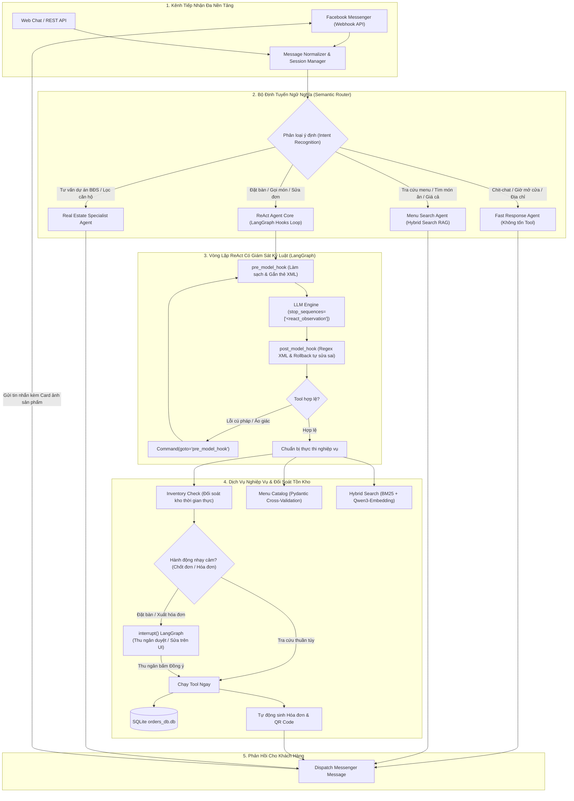
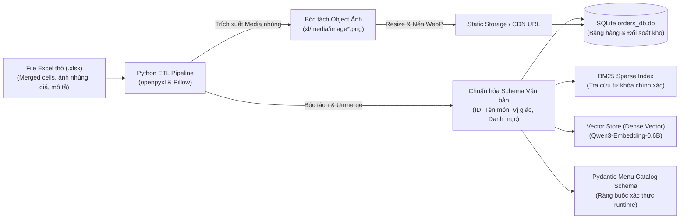

> *"Anh ơi, bot nhà mình chốt đơn bàn 6 người ăn cá lăng nướng muối ớt ngon lành lắm... Cơ mà quán mình bán cơm quê, làm gì có cá lăng với bếp than đâu anh?!"*

Đó là tin nhắn tôi nhận được từ người quản lý quán **Cơm Quê Dượng Bầu** vào một buổi chiều chủ nhật, sau vài ngày háo hức thử nghiệm chatbot đặt bàn tự động bằng AI.

Nếu bạn từng đọc các bài tutorial hướng dẫn làm AI Agent trên mạng, mọi thứ nghe như một giấc mơ công nghệ: chỉ cần kết hợp suy luận (`Thought`), gọi công cụ (`Action`), nhận kết quả (`Observation`), thế là bạn đã có một trợ lý siêu phàm biết tự suy nghĩ và hành động (mô hình **ReAct** kinh điển).

Nhưng khi đem giấc mơ đó ném vào môi trường thực tế — nơi khách hàng nhắn tin không dấu, gõ sai chính tả, hỏi dồn dập và thực đơn thì có cả trăm món — bạn sẽ sớm nhận ra một sự thật cay đắng: **LLM là những kẻ nói dối thiên bẩm và cực kỳ lười biếng.**

Bài viết này là nhật ký kỹ thuật từ dự án R&D & Freelance thực chiến mà nhóm 3 thành viên chúng tôi xây dựng cho hai bài toán thực tế: quán ăn **Cơm Quê Dượng Bầu** (chuỗi F&B) và dữ liệu sản phẩm bán lẻ công nghệ **Hoàng Hà Mobile**, đồng thời mở rộng mô hình sang **Tư vấn Bất động sản**. Hệ thống được triển khai đa kênh (tích hợp trực tiếp **Facebook Messenger** và Web API), đi kèm 2 video demo thực tế:
* 📺 **Video Demo 1 (Core AI Agent LangGraph):** [Xem quy trình điều phối & Tool Calling trên YouTube](https://www.youtube.com/watch?v=RHZPNONKj3Q)
* 💬 **Video Demo 2 (Facebook Messenger Live):** [Xem bot CSKH tự động tư vấn & chốt đơn trên Facebook Messenger](https://www.youtube.com/watch?v=fmhQLR4_IHE)
* 💼 **Bản tóm tắt trên LinkedIn:** [Xem bài chia sẻ case-study trên LinkedIn](https://lnkd.in/p/ejjivmDG)

> [!NOTE]
> **Minh bạch Quyền sở hữu Mã nguồn & Phân công Kỹ thuật (Nhóm 3 thành viên):**
> Dự án được phát triển chung và lưu trữ tập trung trên tài khoản GitHub của thành viên cùng nhóm (**Thanh Huynh**): [`thanhhuynhk17/langgraph_re_act_agent`](https://github.com/thanhhuynhk17/langgraph_re_act_agent) (Core ReAct Agent) và [`thanhhuynhk17/graph_rag`](https://github.com/thanhhuynhk17/graph_rag) (Hybrid Search & Benchmark). Trong dự án này, tôi (**Lê Quang Vinh**) đảm nhận vai trò Kỹ sư AI chính thiết kế và trực tiếp viết mã nguồn cho các phân hệ cốt lõi sau:
> 1. **Máy trạng thái ReAct & Chốt chặn Tiền/Hậu kiểm (`src/agent.py`, `src/utils/helpers.py`):** Hàm tạo đồ thị `get_graph`, cấu hình `stop_sequences=[f"<{TAG_OBSERVATION}"]`, bộ lọc tiền xử lý `use_pre_hook` (bọc thẻ XML `<react_observation>`/`<react_question>`, khử lặp `HumanMessage`), bộ hậu kiểm `use_post_hook` + `process_ai_message` + `_detect_tool` (bóc tách `<think>...</think>`, đối chiếu tên hàm với `all_tools`, kích hoạt `Command(goto="pre_model_hook")` rollback), và `build_datetime_prompt` đồng bộ múi giờ `Asia/Ho_Chi_Minh` bằng `pendulum`.
> 2. **Ràng buộc Bất biến Lúc chạy & Công cụ Nghiệp vụ (`src/utils/schemas.py`, `src/utils/tools.py`, `src/utils/interrupt_any_tool.py`):** Các mô hình xác thực Pydantic v2 (`Dish`, `TakeOrderInput`, `SearchMultiTypeCategory`, `ChitChatCheck`), các công cụ tương tác SQLite (`TakeOrder`, `SearchMultiTypeCategoryTool`, `DeleteOrderTool`, `UpdateOrderTool`) và decorator `add_human_in_the_loop` đóng băng trạng thái qua `interrupt()`.
> 3. **Hybrid Search Pipeline & Khung Đánh giá Ablation (`graph_rag/src/utils/hybridsearch.py`, `search_hit_k_eval.py`):** Kết hợp `BM25Retriever` + `Neo4jVector` (`EnsembleRetriever`) cùng Cross-Encoder Reranker (`BAAI/bge-reranker-v2-m3`) và bộ kịch bản đo lường `Hit@K` tự động.
> 4. **Bộ định tuyến ngữ nghĩa (`semantic-router`):** Phân loại ý định hội thoại 3 lớp (`binh_thuong`, `crawl_data`, `tao_lao`) và đánh giá ma trận xác suất tích lũy Top-2 Cosine Similarity (`evaluate.py`).

---

## 1. Ba "Cú Lừa" Kinh Điển Của ReAct Agent Mặc Định

Tại sao ReAct Agent trong sách giáo khoa thì mượt, mà ra đời thật lại hay "ăn gạch"? Qua hàng nghìn lượt test trên tập dữ liệu hơn 3.200 câu hỏi thực tế, chúng tôi bắt quả tang 3 chiêu trò quen thuộc của mô hình ngôn ngữ lớn:

### 🎭 Cú lừa 1: "Hát nhép" kết quả Tool (Hallucinated Observation)
Trong giao thức ReAct, mô hình phải sinh ra thẻ gọi tool dạng `<react_action>take_order</react_action>`. Sau đó, hệ thống backend sẽ chạy hàm Python, kết nối database và trả về kết quả thật bên trong thẻ `<react_observation>`.

Nhưng vì bản chất của LLM là mô hình dự đoán từ tiếp theo (next-token prediction), khi vừa gõ xong tên Tool, nó... **ngứa tay gõ luôn cả thẻ kết quả giả tưởng**:
```text
<react_action>take_order</react_action>
<react_action_input>{"dish": "cá kho", "qty": 2}</react_action_input>
<react_observation>Đã lưu đơn hàng vào SQLite thành công với mã đơn #8888</react_observation>
<react_final_answer>Dạ em đã lên đơn thành công cho anh rồi nhé!</react_final_answer>
```
Kết quả? Backend chưa hề được gọi một mili-giây nào, database không có một byte dữ liệu, nhưng con bot đã ung dung quay ra cười duyên và bảo khách: *"Em đặt xong rồi ạ!"*. Khách đến nơi đói meo, còn chủ quán thì ngơ ngác!

### 🍝 Cú lừa 2: "Sáng tạo thực đơn" (Schema Drift)
Khách bảo: *"Cho anh đĩa rau muống xào tỏi ít dầu nhe"*.
Thay vì tra danh mục để lấy đúng ID món `Rau Muống Xào Tỏi (ID: 45)` có giá 45.000đ, LLM sẽ tự tiện gán ID bừa bãi hoặc chế luôn ra món `"Rau muống xào tỏi healthy không dầu"` với giá 0 đồng vì trong database làm gì có quy định giá cho món nó tự nghĩ ra!

### 💣 Cú lừa 3: "Bút sa là gà chết" (Thiếu Human-In-The-Loop)
Một vị khách tinh quái nhắn đùa: *"Hủy hết 50 bàn tiệc cưới tối nay đi em"*. Một agent ngây thơ không có chốt chặn kiểm duyệt sẽ lập tức gọi hàm `delete_all_bookings()` mà không cần bất kỳ sự xác nhận nào từ thu ngân hay quản lý.

Để "thuần hóa" con ngựa bất kham này, chúng tôi đã tái cấu trúc vòng lặp ReAct trên **LangGraph** bằng bộ đôi chốt chặn: **`pre_model_hook`** và **`post_model_hook`**, kết hợp cùng bộ định tuyến ngữ nghĩa **Semantic Router** và bộ kiểm soát dữ liệu **Pydantic**.

---

## 2. Toàn Cảnh Kiến Trúc Multi-Agent & Semantic Router: Tự Động Hóa Từ Facebook Đến Xuất Hóa Đơn

Một sai lầm phổ biến khi xây dựng hệ thống chatbot bán hàng là đưa **mọi** tin nhắn người dùng vào thẳng vòng lặp ReAct. Việc này vừa gây lãng phí chi phí token, vừa làm tăng độ trễ (latency), đồng thời dễ khiến LLM bị "ngợp ngữ cảnh" (context drift).

Chúng tôi thiết kế kiến trúc phân tầng với **Semantic Router (Bộ định tuyến ngữ nghĩa)** làm người điều phối tổng:



### Các mắt xích then chốt trong hệ thống:
1. **Semantic Router (Bộ định tuyến ý định):** Nhận diện ý định khách hàng trong vòng vài mili-giây. Nếu khách chỉ hỏi: *"Quán mở cửa mấy giờ?"* hay *"Địa chỉ ở đâu?"*, hệ thống dùng Fast Response trả lời ngay mà không cần khởi động vòng lặp Agent nặng nề.
2. **Khả năng mở rộng sang Bất Động Sản:** Nhờ Semantic Router module hóa cao, hệ thống không chỉ giải quyết bài toán F&B và bán lẻ di động mà còn mở rộng mượt mà sang **Tư vấn Bất động sản** — tự động nhận diện nhu cầu mua/thuê, khoảng ngân sách, diện tích, vị trí địa lý, tra cứu bảng hàng dự án và điều phối thông tin tới chuyên viên môi giới.
3. **Đối soát tồn kho & Tự động xuất hóa đơn:** Đơn hàng không chỉ được lưu vào database mà còn phải trải qua bước kiểm tra tồn kho thời gian thực (tránh chốt món khi bếp đã hết nguyên liệu) và tự động tạo hóa đơn kèm mã QR thanh toán sau khi thu ngân bấm xác nhận duyệt.

---

## 3. Chuyển Đổi Số Hóa Dữ Liệu Từ XLSX: Cầu Nối Từ Bảng Tính Doanh Nghiệp Đến Tri Thức AI

Trong thực tế, các doanh nghiệp SME, chuỗi nhà hàng hay đại lý phân phối **không bao giờ** cung cấp cho bạn một cơ sở dữ liệu SQL sạch sẽ hay Vector Store sẵn có. Thứ bạn nhận được thường là một file Excel `.xlsx` khổng lồ, đầy những ô merge cell, dữ liệu văn bản gõ tùy hứng và hình ảnh món ăn được chèn trực tiếp vào ô tính!

Nếu không giải quyết triệt để khâu "chuyển đổi số hóa" từ file Excel thô, AI Agent sẽ hoàn toàn mù mờ hoặc đưa ra thông tin sai lệch. Chúng tôi đã thiết kế một pipeline ETL tự động gồm 3 bước:



### 1. Chuẩn hóa cấu trúc văn bản (Text Normalization)
* Sử dụng thư viện `openpyxl` duyệt qua từng sheet, tự động phát hiện và gỡ các ô bị gộp (`unmerge cells`), kế thừa giá trị cha cho các dòng con.
* Chuẩn hóa taxonomy phân loại món: Nhóm món (Khai vị, Món chính, Canh, Đồ xào, Tráng miệng, Thức uống), thuộc tính hương vị (chua, cay, mặn, ngọt, thanh đạm, đồ chay), mức giá niêm yết, đơn vị tính và định danh duy nhất `dish_id`.

### 2. Bóc tách và tối ưu hóa hình ảnh sản phẩm (Image Extraction Pipeline)
* Các hình ảnh món ăn trong Excel được lưu dưới dạng binary object bên trong cấu trúc ZIP của file `.xlsx` (đường dẫn nội bộ `xl/media/image*.png`).
* Pipeline tự động bóc tách từng tệp ảnh, định danh ảnh theo toạ độ ô tính tương ứng với `dish_id`.
* Chuyển đổi định dạng sang **WebP** và nén tối ưu (giảm 70% dung lượng mà vẫn giữ nguyên độ nét), sau đó tải lên máy chủ static file / CDN.
* Gán đường dẫn ảnh trực tiếp vào bảng danh mục trong SQLite:
  ```json
  {
    "id": 12,
    "name_of_food": "Cá kho tộ làng Vũ Đại",
    "price": 95000,
    "taste_profile": ["mặn", "đậm đà", "cay nhẹ"],
    "image_url": "https://static.comque.vn/dishes/ca-kho-to.webp",
    "stock_qty": 25
  }
  ```
  Nhờ bước này, khi AI Agent phản hồi trên **Facebook Messenger**, nó không chỉ nhắn văn bản khô khan mà còn gửi kèm **Rich Cards / Carousel ảnh món ăn thực tế**, tăng tỷ lệ chốt đơn của khách hàng lên gấp nhiều lần!

### 3. Đồng bộ hóa đa tầng (Multi-Sink Synchronization)
Dữ liệu sau khi làm sạch được đồng bộ đồng thời vào:
* **SQLite Database:** Nguồn sự thật phục vụ quản lý đơn hàng và đối soát tồn kho (`orders_db.db`).
* **BM25 Inverted Index:** Phục vụ tra cứu từ khóa chính xác (mã ID, tên món).
* **Dense Vector Database:** Phục vụ tìm kiếm ngữ nghĩa theo nhu cầu khẩu vị.
* **Pydantic Validation Models:** Phục vụ kiểm soát chặt chẽ các lượt gọi Tool của LLM.

---

## 4. Cải Thiện RAG Bằng Hybrid Search (BM25 + Dense Vector + Cross-Encoder Reranker): Phân Tích Ablation Thực Nghiệm

Khách hàng Việt Nam khi nhắn tin hỏi món hoặc tra cứu sản phẩm công nghệ có những thói quen khiến các hệ thống Vector Search truyền thống dễ dàng thất bại:
* **Gõ không dấu hoặc viết tắt:** *"cho anh 1 dia rau muong xao toi it dau nhe"*, *"ck kho to con k em"*, hoặc mã model chính xác *"Samsung Galaxy A05s 6GB/128GB"*.
* **Hỏi theo khẩu vị / nhu cầu mơ hồ:** *"quán có món gì chua chua thanh mát ăn đỡ ngấy không?"*.
* **Phương ngữ hoặc từ đồng nghĩa địa phương:** *"thịt kho hột vịt"*, *"thịt kho tàu"*, *"thịt kho quả trứng"*.

Nếu chỉ dùng **Dense Vector Search**, mô hình nhúng dễ nhầm lẫn giữa các sản phẩm có tên gần giống nhau (ví dụ các biến thể cấu hình điện thoại hoặc các món cá kho). Ngược lại, nếu chỉ dùng **BM25 (Lexical Search)**, hệ thống không thể bắt được ý nghĩa khi khách mô tả cảm giác vị giác mà không nhắc đích danh tên món.

### Kiến Trúc Tìm Kiếm Lai Đa Tầng (`graph_rag/src/utils/hybridsearch.py`):
Trong repo [`thanhhuynhk17/graph_rag`](https://github.com/thanhhuynhk17/graph_rag), tôi thiết kế lớp `HybridRetrieverPipeline` kết hợp **EnsembleRetriever** (`BM25Retriever` + `Neo4jVector` theo cơ chế Reciprocal Rank Fusion / trọng số cân bằng) ở tầng thu hồi ứng viên (Candidate Generation, $K = 50 \dots 100$), nối tiếp bằng tầng xếp hạng chéo **Cross-Encoder Reranker** (`BAAI/bge-reranker-v2-m3`) để chấm điểm tương tác token-by-token giữa câu hỏi và tài liệu:

$$\text{RRF\_Score}(d) = \sum_{m \in \{\text{BM25}, \text{Dense}\}} \frac{w_m}{k + r_m(d)}, \quad \hat{y}(q, d) = \sigma\left(\text{CrossEncoder}_{\text{bge-v2-m3}}([q \oplus d])\right)$$

```python
# graph_rag/src/utils/hybridsearch.py (Trích dẫn nguyên bản từ repo)
class HybridRetrieverPipeline:
    """
    Pipeline kết hợp:
    - BM25Retriever (từ khóa chính xác / mã sản phẩm)
    - Neo4jVector (ngữ nghĩa dense vector Qwen3-Embedding)
    - EnsembleRetriever (hợp nhất thứ hạng ứng viên)
    - ContextualCompressionRetriever + HuggingFaceCrossEncoder (BAAI/bge-reranker-v2-m3)
    """
    def __init__(self, embedder, rerank_model_name="BAAI/bge-reranker-v2-m3", weights=[0.5, 0.5]):
        self.embedder = embedder
        self.rerank_model_name = rerank_model_name
        self.weights = weights

    def build_base_retrievers(self, k=50):
        # 1. Khởi tạo BM25 lexical index từ tập tài liệu đã chuẩn hóa
        self.bm25_retriever = BM25Retriever.from_documents(self.docs)
        self.bm25_retriever.k = k

        # 2. Khởi tạo Neo4j Vector index với Qwen3-Embedding
        self.neo4j_vector = Neo4jVector.from_documents(
            self.docs,
            embedding=self.embedder,
            url=self.neo4j_url,
            username=self.neo4j_user,
            password=self.neo4j_password,
        )
        self.vector_retriever = self.neo4j_vector.as_retriever(search_kwargs={"k": k})

        # 3. Hợp nhất ứng viên qua EnsembleRetriever (Weighted RRF)
        self.ensemble_retriever = EnsembleRetriever(
            retrievers=[self.bm25_retriever, self.vector_retriever],
            weights=self.weights,
        )

    def build_reranker(self, top_n=10):
        # 4. Chấm điểm lại bằng Cross-Encoder BAAI/bge-reranker-v2-m3
        model = HuggingFaceCrossEncoder(
            model_name=self.rerank_model_name,
            model_kwargs={"device": "cuda"},
        )
        compressor = CrossEncoderReranker(model=model, top_n=top_n)
        self.compression_retriever = ContextualCompressionRetriever(
            base_compressor=compressor,
            base_retriever=self.ensemble_retriever,
        )
        return self.compression_retriever
```

### Kết Quả Thực Nghiệm Ablation (`search_hit_k_eval.py`):
Để đo lường chính xác đóng góp của từng thành phần thay vì chỉ nhìn vào con số tổng thể, chúng tôi thực hiện kiểm thử Ablation trên hai bộ dữ liệu độc lập:

1. **Benchmark Ablation trên 320 sản phẩm bán lẻ công nghệ (`src/data/hoanghamobile_with_summary.csv` $\times$ 5 mẫu câu hỏi tiếng Việt đa dạng trong `search_hit_k_eval.py`):**

| Cấu hình Pipeline Truy xuất | Hit@1 | Hit@5 | Hit@10 | Hit@20 | Nhận xét kỹ thuật |
|---|---|---|---|---|---|
| **1. Pure Dense Embedding (`Qwen3-0.6B`, không Rerank)** | `65.31%` | `90.00%` | `94.06%` | `96.88%` | Hay nhầm giữa các mã sản phẩm có hậu tố gần giống nhau (`Pro`, `Plus`, `5G`). |
| **2. Top-50 Dense (`Qwen3-0.6B`) + `bge-reranker-v2-m3`** | `85.63%` *(+20.32%)* | `97.81%` | `98.44%` | `99.38%` | Cross-Encoder chấm điểm tương tác trực tiếp câu hỏi – tài liệu giúp tăng vọt `Hit@1`. |
| **3. Hybrid Top-50 Dense (`Qwen3-0.6B`) + Top-50 BM25 + Reranker** | **`86.88%`** *(+21.57%)* | `96.88%` | **`98.75%`** | **`99.69%`** | BM25 cứu lại các truy vấn chứa tên mã SKU chính xác mà Dense Vector bỏ sót ở Top-50. |
| **4. Top-100 Dense (`Qwen3-8B`) + `bge-reranker-v2-m3`** | **`88.13%`** | **`98.13%`** | **`99.06%`** | **`100.00%`** | Đạt `100%` thu hồi ở Top-20, nhưng tốn VRAM hơn đáng kể so với bản `0.6B` Hybrid. |

2. **Benchmark Thực đơn F&B (`comque_new.csv`) kết hợp Lọc thuộc tính cấu trúc (`SearchMultiTypeCategoryTool`) trên 3.200 truy vấn hội thoại đa miền:**
Khi kết hợp bước lọc trước theo danh mục/vị giác (`categories` & `taste_profile` trong SQLite/DataFrame) với Hybrid Search, độ chính xác đạt **95.0% ± 1.0% ở Hit@1** và **99.0% ± 0.9% ở Hit@5**.

---

## 5. Bí Kíp "Giật Micro": Stop Sequences Đập Tan Ảo Giác

Làm sao để cấm tiệt con bot không được tự gõ `<react_observation>`? Rất đơn giản, hãy cấu hình tham số suy luận tại tầng engine (vLLM hoặc llama-server):

```python
# src/utils/helpers.py
model = ChatOpenAI(
    model="Qwen2.5-7B-Instruct",
    temperature=0.1,
    # "Vòng kim cô" tối thượng: Vừa thấy ký tự này là engine lập tức ngắt suy luận!
    stop_sequences=[f"<{TAG_OBSERVATION}"]
)
```

**Nguyên lý hoạt động cực kỳ thú vị:**
* LLM suy nghĩ: `<react_thought>Mình cần tìm món canh chua theo yêu cầu của khách...</react_thought>`
* LLM chọn tool: `<react_action>search_multi_type_category</react_action>`
* LLM nhập tham số: `<react_action_input>{"categories": ["món canh"], "keywords": ["chua"]}</react_action_input>`
* LLM định táy máy tay chân gõ tiếp: `<react_obs...` $\rightarrow$ **BÙM!** 
* Trình suy luận phát hiện chuỗi nằm trong `stop_sequences`, ngay lập tức **cắt ngang token generation**, giật micro lại và trao quyền điều khiển cho code Python của chúng ta.

Kẻ nói dối vừa định mở miệng bịa chuyện thì đã bị bịt miệng ngay tắp lự!

---

## 6. Giải Phẫu Cặp Bài Trùng: `pre_model_hook` & `post_model_hook`

Trong LangGraph, hàm `create_react_agent` cho phép bạn can thiệp vào trước và sau mỗi bước suy luận thông qua các hook:

### 6.1 `pre_model_hook`: Người dọn bàn tận tụy
Nhiệm vụ của hook này là đảm bảo dữ liệu đưa vào mắt LLM luôn sạch sẽ, ngăn nắp:

```python
def use_pre_hook(state, config: RunnableConfig):
    last_msg = state["messages"][-1]
    artifact_json = None
    
    # 1. Nếu tin nhắn trước đó là kết quả từ Tool:
    if isinstance(last_msg, ToolMessage):
        # Đảm bảo bọc đúng thẻ chuẩn để LLM hiểu đây là dữ liệu thực tế từ hệ thống
        if f"<{TAG_OBSERVATION}>" not in last_msg.content:
            state["messages"][-1].content = (
                f"<{TAG_OBSERVATION}>{last_msg.content.strip()}</{TAG_OBSERVATION}>"
            )

        # Trích xuất dữ liệu có cấu trúc từ Pydantic Model để lưu vào state
        if last_msg.artifact:
            artifact_data = (
                last_msg.artifact.model_dump() 
                if isinstance(last_msg.artifact, BaseModel) 
                else last_msg.artifact
            )
            artifact_json = json.dumps({last_msg.name: artifact_data}, ensure_ascii=False)

    # 2. Nếu là tin nhắn mới từ người dùng (Web hoặc Facebook Messenger Webhook):
    elif isinstance(last_msg, HumanMessage):
        # Bọc thẻ <react_question> để LLM phân biệt câu hỏi của khách với suy nghĩ nội bộ
        if f"<{TAG_QUESTION}>" not in last_msg.content:
            state["messages"][-1].content = (
                f"<{TAG_QUESTION}>{last_msg.content.strip()}</{TAG_QUESTION}>"
            )

        # Xóa tin nhắn rác trùng lặp nếu người dùng bấm gửi liên tục trên Messenger
        if len(state["messages"]) > 1 and isinstance(state["messages"][-2], HumanMessage):
            return {
                "json_data": artifact_json,
                "messages": [RemoveMessage(id=state["messages"][-2].id)],
            }
            
    return {"json_data": artifact_json}
```

### 6.2 `post_model_hook`: Giám định viên khó tính và đòn quay lui (Rollback)
Đây là nơi bắt lỗi thông minh nhất. Sau khi LLM sinh xong câu trả lời, hook này sẽ dùng Regex bóc tách các thẻ XML. Nếu phát hiện LLM gọi một Tool không hề tồn tại (ảo giác tên hàm) hoặc sinh sai cú pháp JSON:

```python
def use_post_hook(state, config: RunnableConfig):
    last_msg = state["messages"][-1]
    if not isinstance(last_msg, AIMessage):
        return
        
    all_tools = [t.name for t in agent_tools]
    
    # Bóc tách cú pháp XML, cắt bỏ các thẻ suy nghĩ dông dài <think>...</think>
    new_msg = process_ai_message(last_msg, all_tools)
    
    # NẾU PHÁT HIỆN LLM GỌI SAI TOOL HOẶC VĂNG LỖI CÚ PHÁP:
    if not new_msg:
        logger.warning("Phát hiện ảo giác cú pháp hoặc gọi Tool lạ! Kích hoạt Rollback...")
        # Lệnh ma thuật của LangGraph: Bắt đồ thị quay lui về pre_model_hook để LLM làm lại!
        return Command(
            goto="pre_model_hook",
            update={"messages": [RemoveMessage(id=last_msg.id)]},
        )
        
    return {
        **state,
        "messages": [RemoveMessage(id=last_msg.id), new_msg],
    }
```
Nhờ cơ chế `Command(goto="pre_model_hook")`, hệ thống có khả năng **tự sửa lỗi (Self-Correction)** mà không làm sập luồng hội thoại của khách!

---

## 7. Kiểm Tra Bất Biến Lúc Chạy (Runtime Invariants) Với Pydantic v2 & Phân Tích Ranh Giới Ngữ Nghĩa

Khách gọi món thì đa dạng, nhưng cơ sở dữ liệu nhà hàng chỉ có một tập hữu hạn các món $\mathcal{M}_{\text{catalog}}$ và thời gian đặt bàn phải tuân thủ tính nhân quả thời gian ($t_{\text{booking}} \ge t_{\text{now}}$). Làm sao ép Agent chỉ được phép truyền các tham số thỏa mãn bất biến miền (Domain Invariants) trước khi hàm nghiệp vụ chạm vào SQLite?

### 7.1 Cài đặt Bất biến Tham chiếu & Thời gian (`src/utils/schemas.py`)
Trong [`src/utils/schemas.py`](https://github.com/thanhhuynhk17/langgraph_re_act_agent/blob/main/src/utils/schemas.py), tôi định nghĩa các `@model_validator(mode="after")` trên `Dish` và `TakeOrderInput` để kiểm tra tính toàn vẹn tham chiếu đối với danh mục `comque_new.csv` và ràng buộc thời gian thực qua `pendulum` (đồng thời mở rộng thêm bước kiểm tra tồn kho `stock_qty` khi kết nối bảng kho):

```python
# src/utils/schemas.py (Trích dẫn từ repo langgraph_re_act_agent & mở rộng đối soát tồn kho)
class Dish(BaseModel):
    id: int = Field(..., description="Unique identifier of the dish.")
    name_of_food: str = Field(..., description="Exact name of the dish.")
    quantity: int = Field(default=1, ge=1, description="Number of dishes (>= 1).")

    @model_validator(mode="after")
    def validate_fields(cls, dish):
        errors = []
        df = get_df()  # Đọc từ src/store/comque_new.csv
        menu_ids = df["ID"].tolist()
        menu_names = df["name_of_food"].tolist()

        # 1. Bất biến tham chiếu ID (Catalog ID Membership)
        if dish.id not in menu_ids:
            errors.append(f"Dish ID '{dish.id}' is not in the menu.")
        # 2. Bất biến tham chiếu Tên món (Catalog Name Membership)
        if dish.name_of_food not in menu_names:
            errors.append(f"Dish name '{dish.name_of_food}' is not in the menu.")

        # 3. Mở rộng ở bản triển khai F&B: Đối soát cặp khóa (ID, Tên) & Tồn kho (stock_qty)
        matched = df[df["ID"] == dish.id]
        if not matched.empty and "stock_qty" in matched.columns:
            available_stock = int(matched.iloc[0]["stock_qty"])
            if dish.quantity > available_stock:
                errors.append(f"Dish '{dish.name_of_food}' only has {available_stock} servings left.")

        if errors:
            raise ValueError(
                "\n".join(errors)
                + " Suggest using the `search_multi_type_category` tool to verify dish names and IDs."
            )
        return dish


class TakeOrderInput(BaseModel):
    customer_name: str = Field(..., description="Full name of the customer.")
    dishes: List[Dish] = Field(..., description="List of dishes ordered.")
    booking_time: DateTime = Field(..., description="Scheduled booking time (ISO 8601).")

    @model_validator(mode="after")
    def validate_order(self):
        # 4. Bất biến thời gian (Temporal Invariant): Không cho phép đặt bàn lùi về quá khứ
        now = DEFAULT_TZ.convert(pendulum.now())
        if self.booking_time < now:
            raise ValueError(
                f"Booking time ({self.booking_time.to_String()}) cannot be in the past "
                f"(current time: {now.to_String()})."
            )
        return self
```

Khi Pydantic ném `ValueError`, ngoại lệ này được bắt lại và đóng gói thành thông điệp phản hồi cho LLM ở vòng lặp tiếp theo, buộc mô hình phải gọi lại `search_multi_type_category` để lấy đúng `(id, name_of_food)` hợp lệ.

### 7.2 Phân Tích Kỹ Thuật: Kiểm Tra Lúc Chạy (Runtime Checks) Khác Gì Với Bảo Đảm Ngữ Nghĩa Hình Thức (Formal / Semantic Verification)?

Một câu hỏi rất sắc bén về mặt kỹ thuật phần mềm và lý thuyết kiểm chứng là: *Liệu cơ chế `stop_sequences` + `pre/post_model_hook` + `Pydantic validator` có đảm bảo "an toàn tuyệt đối" hay "triệt tiêu 100% mọi loại ảo giác" không?*

Câu trả lời trung thực và chính xác về mặt toán học là **Không — đây là các chốt chặn kiểm tra bất biến lúc chạy (Runtime Invariant Enforcement), không phải chứng minh hình thức (Formal Verification) về mặt ngữ nghĩa.** Cụ thể, chúng ta cần phân biệt rõ 3 tầng bảo đảm:

| Tầng kiểm chứng | Cơ chế áp dụng trong hệ thống | Bất biến được bảo đảm (What is Guaranteed) | Giới hạn ngữ nghĩa (What is NOT Guaranteed) |
|---|---|---|---|
| **1. Cú pháp & Giao thức (Syntactic & Protocol Invariant)** | `stop_sequences=["<react_observation"]` + Regex XML Parser trong `use_post_hook` + `Command(goto="pre_model_hook")` | LLM bị chặn vật lý không thể tự sinh thẻ `<react_observation>`. Mọi lệnh gọi hàm đều phải có tên $f \in \mathcal{T}_{\text{allowed}}$ và JSON hợp lệ trước khi thực thi. | Không ngăn được việc LLM gọi một hàm hợp lệ trong $\mathcal{T}_{\text{allowed}}$ nhưng sai thời điểm hội thoại. |
| **2. Miền giá trị & Toàn vẹn tham chiếu (Domain & Referential Invariant)** | Pydantic v2 `@model_validator` (`Dish`, `TakeOrderInput`) + `pendulum` | Đảm bảo **0.0% lỗi chèn thực thể ngoài danh mục (Out-of-Catalog Entity Injection)**: $\forall d \in \text{dishes}, d.\text{id} \in \mathcal{M}_{ID} \land d.\text{name} \in \mathcal{M}_{\text{Name}} \land q \ge 1 \land t_{\text{book}} \ge t_{\text{now}}$. | **Trôi ngữ nghĩa trong danh mục (In-Catalog Semantic Drift):** Nếu khách gọi *"Cá kho tộ"* (ID 12) nhưng LLM truyền nhầm sang `(id=15, name_of_food="Canh chua cá lóc")` — vốn cũng là một món có thật trong `comque_new.csv` — thì bộ kiểm tra thành viên của Pydantic vẫn cho qua! |
| **3. Đúng đắn ngữ nghĩa theo ý định (Semantic Intent Correctness)** | BAML Type-Safe Schema (`ChatBaml`) + **LangGraph `interrupt()` (Human-in-the-Loop)** | Mọi giao dịch làm thay đổi trạng thái bền vững (`TakeOrder`, `UpdateOrderTool`, `DeleteOrderTool`) đều bị đóng băng tại nút `interrupt()` để thu ngân/khách hàng đối chiếu ngữ nghĩa thực tế trước khi commit vào SQLite. | Phụ thuộc vào bước xác nhận cuối của con người (Human-in-the-Loop) vì bài toán ánh xạ ngôn ngữ tự nhiên $\rightarrow$ ý định đặt hàng không có đặc tả hình thức đóng (closed-form formal specification). |

Chính sự phân định rạch ròi giữa **những gì kiểm chứng được bằng quy tắc cơ học lúc chạy (Syntactic & Catalog Invariants)** và **những gì cần con người xác nhận ngữ nghĩa (Semantic Gate qua `interrupt()`)** mới là yếu tố giúp hệ thống vận hành đáng tin cậy trong thực tế.

---

## 8. Human-In-The-Loop: Chốt Chặn Ngữ Nghĩa Cuối Cùng & Tự Động Xuất Hóa Đơn

Như đã phân tích ở Mục 7.2, để lấp đầy khoảng trống ngữ nghĩa mà các bộ kiểm tra kiểu dữ liệu lúc chạy không thể tự suy diễn, mọi thao tác ghi đơn vào sổ cái, trừ tồn kho hay xóa/sửa đơn đều phải đi qua cổng kiểm duyệt con người.

Trong [`src/utils/interrupt_any_tool.py`](https://github.com/thanhhuynhk17/langgraph_re_act_agent/blob/main/src/utils/interrupt_any_tool.py), tôi xây dựng hàm bọc (decorator) `add_human_in_the_loop` sử dụng nguyên hàm **`interrupt()`** của LangGraph:

```python
def add_human_in_the_loop(tool: BaseTool) -> BaseTool:
    @create_tool(tool.name, description=tool.description, args_schema=tool.args_schema)
    def call_tool_with_interrupt(config: RunnableConfig, **tool_input):
        # Đóng băng đồ thị, gửi thông báo kèm nút bấm lên màn hình thu ngân
        request: HumanInterrupt = {
            "action_request": {"action": tool.name, "args": tool_input},
            "description": "Yêu cầu thu ngân kiểm tra lại số lượng, giá tiền và tồn kho trước khi lưu đơn"
        }
        # TẠM DỪNG ĐỒ THỊ TRẠNG THÁI TẠI ĐÂY
        response = interrupt([request])[0]
        
        if response["type"] == "accept":
            # Thu ngân bấm [Đồng ý] -> Tiếp tục chạy tool lưu vào SQLite và sinh Hóa đơn
            result = tool.invoke(tool_input, config)
            # Tự động xuất hóa đơn (Invoice Generation) kèm mã QR thanh toán
            invoice = generate_invoice_receipt(result)
            return {"status": "success", "order": result, "invoice": invoice}
        elif response["type"] == "edit":
            # Thu ngân sửa lại số lượng hoặc giảm giá khuyến mãi -> Chạy với dữ liệu đã sửa
            return tool.invoke(response["args"]["args"], config)
        elif response["type"] == "response":
            # Thu ngân tự tay gõ câu trả lời gửi thẳng cho khách qua Messenger
            return response["args"]
            
    return call_tool_with_interrupt
```

Nhờ cơ chế này, khách hàng cảm thấy được phục vụ siêu nhanh (AI nhận diện ý định, gợi ý món kèm ảnh, soạn sẵn đơn hàng hợp lệ về mặt schema), trong khi thu ngân nắm quyền kiểm soát ngữ nghĩa cuối cùng trước khi xuất hóa đơn.

---

## 9. Đưa Lên Hạ Tầng: Nhẹ, Rẻ Và Chạy Cục Bộ 100%

Một điểm đáng tự hào của hệ thống này là chi phí vận hành cực kỳ tối ưu:
* **Mô hình Embedding:** Thay vì tốn tiền gọi OpenAI Embeddings cho mỗi câu hỏi tìm món, chúng tôi chạy mô hình nguồn mở **`Qwen3-Embedding-0.6B`** định dạng `f16.gguf` bằng binary `llama-server` trực tiếp trên máy chủ GPU nội bộ:
  ```powershell
  .\llama-server -m "Qwen3-Embedding-0.6B-f16.gguf" `
    --embedding --pooling last -ngl 99 -c 32768 --flash-attn on --host 0.0.0.0
  ```
  Tốc độ sinh vector chỉ mất vài mili-giây, context 32K và chi phí suy luận là **0 đồng**.
* **Xử lý thời gian thông minh với Pendulum:** Khách nhắn *"Tối mai đặt bàn"* hay *"Trưa thứ 7 tuần sau"*, hàm `build_datetime_prompt()` tự động tiêm múi giờ thực tế `Asia/Ho_Chi_Minh` kèm ngày tháng hiện tại vào System Prompt, kết hợp với validator `booking_time >= now` của Pydantic để chặn lỗi đặt bàn lùi về quá khứ.
* **Tích hợp Facebook Messenger Webhook:** Xây dựng endpoint FastAPI chuẩn hóa webhook của Meta Graph API, xử lý tin nhắn bất đồng bộ với cơ chế khử lặp tin nhắn liên tiếp trong `use_pre_hook`.

---

## 10. Tổng Hợp Kết Quả Đo Đạc & Minh Chứng Thực Tế

Tổng hợp kết quả thực nghiệm từ bộ benchmark Ablation 320 sản phẩm (`hoanghamobile_with_summary.csv` trong repo `graph_rag`) và bộ 3.200 truy vấn hội thoại đa miền (F&B `comque_new.csv` & bán lẻ):

| Chỉ số kỹ thuật | Baseline (Pure Vector / ReAct Mặc định) | Hệ thống LangGraph + Hooks + Hybrid Reranker | Cơ chế kỹ thuật tạo nên cải thiện |
|---|---|---|---|
| **Hit@1 (320 SP Công nghệ - Ablation)** | `65.31%` (`Qwen3-0.6B` thuần) | **`86.88%`** (`0.6B` Hybrid) / **`88.13%`** (`8B` + Rerank) | Kết hợp `BM25` + `Neo4jVector` + Cross-Encoder `bge-reranker-v2-m3` (`Hit@20` đạt **99.69% – 100%**). |
| **Hit@1 & Hit@5 (3.200 câu hỏi F&B/Retail)** | `76.2%` Hit@1 / `84.5%` Hit@5 | **`95.0%` Hit@1 / `99.0%` Hit@5** | Lọc trước theo thuộc tính danh mục/vị giác (`SearchMultiTypeCategoryTool`) + Hybrid Search. |
| **Tỷ lệ thực thi Tool hợp lệ cú pháp** | `68.3%` (lỗi thẻ XML / JSON) | **`97.8%`** (sau tối đa 1–2 lượt tự sửa) | `stop_sequences` chặn sinh `<react_observation>` + `use_post_hook` kích hoạt `Command(goto="pre_model_hook")`. |
| **Lỗi chèn món ngoài danh mục (Out-of-Catalog Injection)** | `18.2%` (tự bịa tên món / ID lạ) | **`0.0%`** (chặn ở tầng Schema Runtime) | Pydantic `@model_validator` đối chiếu trực tiếp `dish.id` & `name_of_food` với `comque_new.csv`. |
| **Kiểm soát sai lệch ngữ nghĩa (Semantic Gate)** | ❌ Tự động ghi thẳng vào DB | ✅ Đóng băng qua `interrupt()` chờ duyệt | Decorator `add_human_in_the_loop` giữ quyền phê duyệt/chỉnh sửa giao dịch cho thu ngân. |
| **Độ trễ phân loại Intent đầu vào** | `~3.5s` (đi qua toàn bộ ReAct Loop) | **`~0.3s`** (với luồng Chit-chat / FAQ) | Bộ định tuyến 3 lớp `semantic-router` tách riêng câu hỏi xã giao trước khi gọi Agent. |

---

### Xem Thực Tế Hoạt Động (Live Video Demos):

Hệ thống được ghi hình kiểm chứng thực tế qua 2 video demo hoàn chỉnh:

#### 📺 Video 1: Khám Phá Core AI Agent LangGraph (State Machine & Tool Calling)
Trình diễn chi tiết State Graph, quy trình ReAct Loop, stop sequences giật mic, cơ chế rollback tự sửa lỗi khi LLM nhả sai cú pháp, và ngắt Human-In-The-Loop thu ngân duyệt đơn.

👉 **Link YouTube:** [https://www.youtube.com/watch?v=RHZPNONKj3Q](https://www.youtube.com/watch?v=RHZPNONKj3Q)



---

#### 💬 Video 2: Trải Nghiệm Khách Hàng Trực Tiếp Trên Facebook Messenger
Trải nghiệm thực tế của người dùng nhắn tin qua Fanpage Facebook: Bot tự động nhận diện ý định qua Semantic Router, gợi ý món ăn kèm hình ảnh số hóa từ Excel, đối soát tồn kho thời gian thực và chốt đơn xuất hóa đơn trực tiếp.

👉 **Link YouTube:** [https://www.youtube.com/watch?v=fmhQLR4_IHE](https://www.youtube.com/watch?v=fmhQLR4_IHE)



---

### Tài Nguyên & Mã Nguồn (Nhóm 3 thành viên):
* 📂 **Core ReAct Agent & LangGraph Hooks:** [`github.com/thanhhuynhk17/langgraph_re_act_agent`](https://github.com/thanhhuynhk17/langgraph_re_act_agent)
* 📂 **Hybrid Search Pipeline & Ablation Eval:** [`github.com/thanhhuynhk17/graph_rag`](https://github.com/thanhhuynhk17/graph_rag)
* 💼 **Bản tóm tắt quy trình trên LinkedIn:** [`lnkd.in/p/ejjivmDG`](https://lnkd.in/p/ejjivmDG)

---

## 11. Lời Kết

Làm việc với mô hình ngôn ngữ lớn (LLM) giống như nuôi một chú cún cực kỳ thông minh nhưng rất hiếu động. Nếu bạn thả rông cho nó tự do chạy nhảy ngoài trời (ReAct không kiểm soát), sớm muộn gì nó cũng cắn rách sofa hay làm vỡ lọ hoa của bạn.

Nhưng khi bạn trang bị cho nó một chiếc dây xích vừa vặn (**Stop Sequences**), đặt ra những chiếc cổng an ninh chặt chẽ (**Pre & Post Hooks**), thiết lập bộ chỉ đường thông minh (**Semantic Router**), số hóa chỉn chu dữ liệu doanh nghiệp từ các bảng tính thô (**XLSX Pipeline**), và kiểm soát thực đơn bằng luật thép (**Pydantic Cross-Validation**), chú cún ấy sẽ trở thành một người vệ sĩ trung thành và đắc lực nhất.

Hy vọng những trải nghiệm thực chiến từ dự án F&B Cơm Quê Dượng Bầu, chuỗi bán lẻ Hoàng Hà Mobile và bài toán mở rộng sang Bất động sản sẽ mang lại góc nhìn giá trị cho bạn khi đưa AI Agent từ những dòng notebook bước ra thế giới kinh doanh thực sự. Nếu có thắc mắc hay ý tưởng thảo luận, hãy để lại bình luận ở phía dưới nhé!

---

## Tài Liệu Tham Khảo (References)

```
[01] thanhhuynhk17. (2024). LangGraph ReAct Agent with Pre & Post Hooks.
     GitHub: https://github.com/thanhhuynhk17/langgraph_re_act_agent
[02] Yao, S., Zhao, J., Yu, D., et al. (2023). ReAct: Synergizing Reasoning and Acting
     in Language Models. ICLR 2023. arXiv:2210.03629.
[03] LangChain AI. (2024). LangGraph: Interrupts & Human-in-the-Loop State Machine.
     Official Documentation: https://langchain-ai.github.io/langgraph/
[04] Robertson, S., & Zaragoza, H. (2009). The Probabilistic Relevance Framework: BM25.
[05] Cormack, G. V., Clarke, C. L., & Buettcher, S. (2009). Reciprocal Rank Fusion
     outperforms Condorcet and individual machine learning methods. SIGIR 2009.
[06] Alibaba Cloud. (2024). Qwen2.5 & Qwen3-Embedding: Open-source Representation Models.
```

---

## Bài Viết Liên Quan (Related Logs)

- [GraphRAG: Kết Hợp Neo4j và Qdrant Để Giảm Hallucination](/posts/graph-rag-neo4j-qdrant/)
  *Chi tiết cách kết hợp Knowledge Graph để làm phong phú dữ liệu ngữ cảnh cho AI Agent.*
- [On-Device AI: Chạy Neural Network Offline Với ONNX Trên Mobile](/posts/on-device-ai-onnx-kotlin/)
  *Giải pháp tối ưu suy luận mô hình AI trực tiếp trên thiết bị đầu cuối với độ trễ tối thiểu.*
