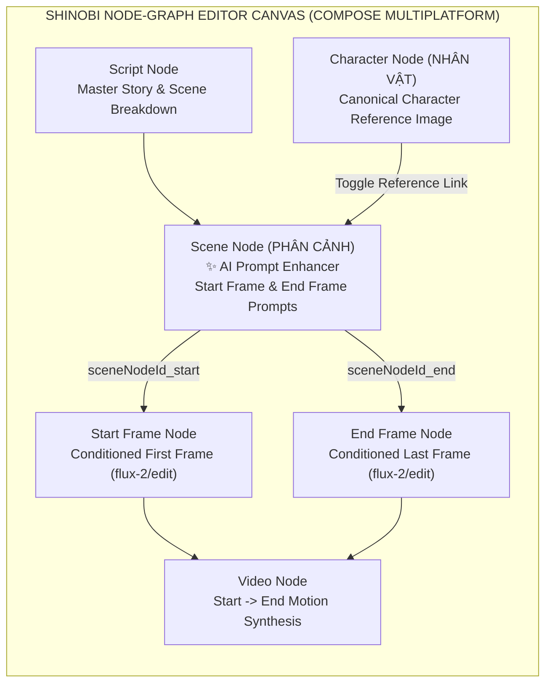

> *"Creating a multi-scene AI video inside a linear chat box feels like painting blindfolded: you can't see which character reference feeds into which scene, which image serves as the Start Frame versus the End Frame, and tweaking a single character's outfit breaks visual continuity across the entire storyboard!"*

While command-line pipelines excel at batch automation, visual directors and storyboard artists need a **spatial Node-Graph Canvas**—where Script Nodes, Character Nodes, Scene Nodes, Start/End Frame Nodes, and Video Nodes can be wired together visually and inspected at a glance.

To address this workflow, I built **Shinobi AI Video Studio (`ai-video`)**—a cross-platform AI storyboard and video generation application targeting **Desktop (Windows/macOS/Linux) and Android**, engineered with **Kotlin Multiplatform (KMP)**, **Compose Multiplatform**, **Decompose Navigation**, **Gemini AI**, and **Fal.ai FLUX (`flux-2/edit`, `flux/schnell`, `seedream/v4/edit`)**.

---

## 1. System Overview & Architectural Specifications

| Dimension | Technical Implementation | Architectural Highlight |
|---|---|---|
| **Project & Target Platforms** | **`ai-video` (Shinobi Editor)** · **Desktop JVM** & **Android** | **Clean Architecture + Strict Vertical Slicing** with **Decompose** component navigation |
| **Interactive Graph Surface** | **Shinobi Node-Graph Editor (`ShinobiEditorScreen.kt`)** | Multi-touch/mouse Pan, Zoom, Node Dragging, Wire Connection Mode, and dynamic Z-Order management |
| **Identity Conditioning** | **Character-to-Scene Reference Linking** | Filters connected nodes strictly by `category == "NHÂN VẬT"` (*Character*) to inject identity reference images into scene generation |
| **Temporal Frame Control** | **First / Last Frame Conditioning (`startFrame` & `endFrame`)** | Powered by `ImproveSceneFramesUseCase` (Gemini AI expands scene descriptions into distinct Start & End visual prompts) |
| **Generative Backends** | **Fal.ai Providers (`FalImageProvider.kt`) + Gemini Soft Fallback** | Supports `fal-ai/flux-2/edit`, `flux/schnell`, `nano-banana`, and `seedream/v4/edit` with resilient prompt translation fallback |
| **Reactive State & I/O** | **MVI State Tracking (`ShinobiEditorContract.kt`) + Okio Base64** | Decouples `trackingId` (`sceneNodeId_start` / `sceneNodeId_end`) from `targetNodeId` and persists `ByteString.base64()` directly in the Data layer |

---

## 2. Node-Graph Workflow for Multi-Scene Identity & Frame Conditioning

Instead of locking creators into a rigid linear form, **Shinobi Editor** models the entire production pipeline as an interactive 2D **Directed Graph**:

### The 4-Step Visual Storyboarding Loop Inside a `Scene Node`:
1. **Character Reference Wiring:** Connecting one or more `Character Nodes` to a `Scene Node` populates an interactive avatar strip inside `SceneNodeConfig.kt`. Creators toggle which connected characters appear in the current shot.
2. **AI Start/End Frame Expansion (`ImproveSceneFramesUseCase`):** Smooth 5-second video synthesis requires coherent boundary keyframes. Clicking **`✨ AI Improve`** invokes Gemini to decompose the raw scene action into two persistent visual prompts: a *Start Frame Prompt* (`startFramePrompt`) and an *End Frame Prompt* (`endFramePrompt`) saved in `SceneData`.
3. **Identity-Preserving Keyframe Generation (`fal-ai/flux-2/edit`):** Clicking **`GENERATE START FRAME`** or **`GENERATE END FRAME`** pairs the active character's reference portrait with the respective frame prompt and dispatches an image-to-image editing request to `fal-ai/flux-2/edit`, preserving character facial features and attire across shots.
4. **Motion Interpolation (`Video Node`):** Once both `Start Frame` and `End Frame` nodes materialize on the graph, they wire into a downstream `Video Node` for temporal synthesis.

---

## 3. Three Practical Engineering Solutions in Cross-Platform Graph Editing

Building a reactive node-graph editor that runs identically across Desktop mouse/keyboard and Android touchscreens required solving three subtle state and I/O challenges:

### 3.1 Decoupling `trackingId` from `targetNodeId` in MVI State
Inside `SceneNodeConfig.kt`, the **`GENERATE START FRAME`** and **`GENERATE END FRAME`** buttons sit side by side.
* **The Bug:** On initial generation, the destination `Frame Node` does not yet exist on the canvas (it is spawned only after the API returns). Keying loading state on `targetNodeId` caused either both buttons to block simultaneously or neither button to show a spinner.
* **The Fix (`ShinobiEditorContract.kt`):** We introduced a deterministic `trackingId` (`"${sceneNodeId}_start"` and `"${sceneNodeId}_end"`) decoupled from `targetNodeId`. Each button binds its loading indicator strictly to its own `trackingId`. When `generateFrameResult` emits, `ShinobiEditorScreen.kt` checks whether the target frame node already exists—either spawning a new node and wire connection on the graph or updating the existing node in place.

### 3.2 Platform-Agnostic Image Rendering with `Okio ByteString`
Relying solely on local file paths (`filePath`) across Android's scoped storage and Desktop filesystems frequently led to null bitmap renders due to lifecycle cache eviction or path resolution differences.
* In `ImageRepositoryImpl` and `FalImageProvider.kt`, raw image bytes returned from Fal.ai are immediately encoded via **Okio** (`bytes.toByteString().base64()`) and attached to `GeneratedImage.base64Data` at the Data layer—guaranteeing instant, zero-flake image rendering across both Android and Desktop canvases.

### 3.3 Resilient Prompt Translation via Soft Fallback
Before invoking `fal-ai/flux-2/edit`, user prompts written in Vietnamese are translated and cinematically enriched in English via Gemini. However, failing the entire image generation job whenever the translation API hits a transient timeout or rate limit creates a brittle user experience.
* In `PanelHelpers.kt`, prompt translation is wrapped in a **Soft Fallback** handler: if Gemini translation fails, the pipeline transparently falls back to the original user prompt and proceeds with Fal.ai synthesis uninterrupted.

---

## 4. Conclusion

**Shinobi AI Video Studio (`ai-video`)** complements headless CLI video factories with a tactile visual canvas—demonstrating that **Kotlin Multiplatform and Compose Multiplatform** can power complex **Node-Graph creative studios** orchestrating multimodal AI pipelines across Desktop and Mobile.
