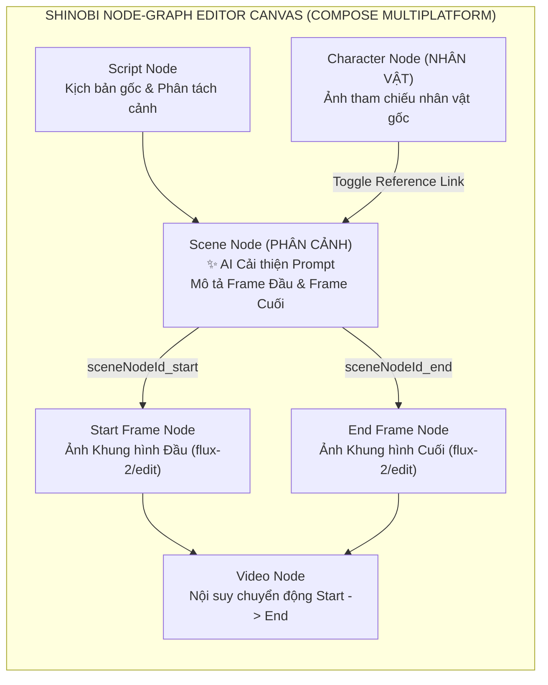

> *"Dùng giao diện chat thông thường để làm video AI nhiều phân cảnh giống như việc nhắm mắt vẽ tranh: bạn không thấy được nhân vật nào đang nối vào cảnh nào, bức ảnh nào là khung hình mở đầu (Start Frame), bức ảnh nào là khung hình kết thúc (End Frame), và chỉ cần sửa lại ngoại hình một nhân vật là toàn bộ mạch truyện rối tung!"*

Trong khi các công cụ dòng lệnh (CLI) rất mạnh cho việc tự động hóa hàng loạt, người sáng tạo nội dung trực quan (Visual Storyboarders & Directors) lại cần một **bàn dựng đồ thị nút (Node-Graph Canvas)** — nơi mỗi Kịch bản (`Script Node`), Nhân vật (`Character Node`), Phân cảnh (`Scene Node`), Khung hình Đầu/Cuối (`Frame Node`) và Video (`Video Node`) được nhìn thấy và kéo dây kết nối trực tiếp trên màn hình.

Đó là lý do tôi phát triển **Shinobi AI Video Studio (`ai-video`)** — một ứng dụng biên tập và tạo sinh video AI đa nền tảng (**Desktop Windows/macOS/Linux & Android**) xây dựng bằng **Kotlin Multiplatform (KMP)**, **Compose Multiplatform**, **Decompose Navigation**, kết hợp **Gemini AI** và **Fal.ai FLUX (`flux-2/edit`, `flux/schnell`, `seedream/v4/edit`)**.

---

## 1. Tổng Quan Kiến Trúc & Thông Số Kỹ Thuật (System Overview & Specs)

| Hạng mục | Thông số & Giải pháp kỹ thuật | Điểm nhấn kiến trúc |
|---|---|---|
| **Dự án & Nền tảng** | **`ai-video` (Shinobi Editor)** · **Desktop JVM** & **Android** | Kiến trúc **Clean Architecture + Strict Vertical Slicing** kết hợp **Decompose** |
| **Giao diện Đồ thị Nút (Canvas)** | **Shinobi Node-Graph Editor (`ShinobiEditorScreen.kt`)** | Hỗ trợ Pan, Zoom, Drag-and-Drop, Connect Mode (nối dây giữa các nút) và quản lý thứ tự lớp Z-Order |
| **Kiểm soát Nhân vật & Phân cảnh** | **Character-to-Scene Reference Linking** | Lọc chính xác nút `category == "NHÂN VẬT"` đang kết nối với `Scene Node` để truyền làm ảnh tham chiếu (Image-to-Image Reference) |
| **Điều khiển Khung hình Đầu/Cuối** | **First / Last Frame Conditioning (`startFrame` & `endFrame`)** | Tích hợp `ImproveSceneFramesUseCase` (Gemini AI tự động viết prompt chi tiết cho Frame Đầu & Frame Cuối từ mô tả cảnh) |
| **Động cơ Sinh ảnh & Video** | **Fal.ai Providers (`FalImageProvider.kt`) + Gemini Fallback** | Hỗ trợ `fal-ai/flux-2/edit`, `flux/schnell`, `nano-banana`, `seedream/v4/edit`; tự động dịch prompt kèm cơ chế **Soft Fallback** |
| **Quản lý Trạng thái Bất đồng bộ** | **MVI State Tracking (`ShinobiEditorContract.kt`) + Okio Base64** | Tách biệt `trackingId` (`sceneNodeId_start` / `sceneNodeId_end`) khỏi `targetNodeId` và lưu trữ trực tiếp `ByteString.base64()` tại tầng Data |

---

## 2. Kiến Trúc Đồ Thị Nút (Node-Graph Workflow) Cho Video Đa Phân Cảnh

Thay vì ép người dùng làm việc trên một danh sách tuyến tính cứng nhắc, **Shinobi Editor** biểu diễn toàn bộ quy trình sản xuất phim dưới dạng một **Đồ thị có hướng (Directed Graph)** trên mặt phẳng 2D tương tác:

### Quy trình 4 bước trực quan trên một `Scene Node`:
1. **Liên kết Nhân vật Tham chiếu (Character Reference Toggle):** Khi nối một hoặc nhiều `Character Node` vào `Scene Node`, bảng cấu hình `SceneNodeConfig.kt` hiển thị danh sách avatar các nhân vật đang kết nối. Người dùng chỉ cần chạm để bật/tắt nhân vật nào xuất hiện trong cảnh đó.
2. **Mở rộng Kịch bản thành Khung hình Đầu & Cuối (`ImproveSceneFramesUseCase`):** Một phân cảnh video 5 giây muốn mượt mà cần có điểm bắt đầu và điểm kết thúc rõ ràng. Nút **`✨ AI CẢI THIỆN`** gọi Gemini phân tích nội dung phân cảnh gốc để tự động viết hai bản mô tả thị giác tách biệt: *Mô tả Frame Đầu* (`startFramePrompt`) và *Mô tả Frame Cuối* (`endFramePrompt`), lưu bền vững vào cơ sở dữ liệu qua `SceneData`.
3. **Sinh Khung hình Độc lập với Ảnh Nhân vật Gốc (`fal-ai/flux-2/edit`):** Khi nhấn **`TẠO FRAME ĐẦU`** hoặc **`TẠO FRAME CUỐI`**, hệ thống lấy ảnh gốc của nhân vật đang được chọn kết hợp với prompt tương ứng gửi tới mô hình `fal-ai/flux-2/edit` để vẽ ra khung hình mới giữ nguyên 100% khuôn mặt và trang phục nhân vật.
4. **Kết xuất Video Nội suy (`Video Node`):** Hai nút `Start Frame` và `End Frame` sau khi sinh xong được nối thẳng vào `Video Node` để tổng hợp đoạn video chuyển động mượt mà giữa hai trạng thái.

---

## 3. Ba Bài Toán Kỹ Thuật Thực Chiến Khi Xây Dựng Node-Graph Trên KMP

Khi triển khai một trình dựng đồ thị tương tác phức tạp chạy trên cả chuột máy tính (Desktop) lẫn màn hình cảm ứng (Android), ba bài toán kỹ thuật thú vị đã được giải quyết triệt để:

### 3.1 Tách biệt `trackingId` và `targetNodeId` trong MVI State
Trên bảng điều khiển của một `Scene Node`, người dùng có hai nút nằm cạnh nhau: **`TẠO FRAME ĐẦU`** và **`TẠO FRAME CUỐI`**.
* **Vấn đề:** Ở lần tạo đầu tiên, nút `Frame Node` đích trên đồ thị *chưa hề tồn tại* (nó chỉ được sinh ra sau khi API trả ảnh về). Nếu dùng `targetNodeId` để hiển thị vòng xoay tiến trình (loading indicator), hoặc cả hai nút sẽ cùng quay, hoặc không nút nào hiện trạng thái đang tải!
* **Giải pháp (`ShinobiEditorContract.kt`):** Thiết kế trường định danh theo dõi riêng biệt `generatingFrameTargetId = "${sceneNodeId}_start"` hoặc `"${sceneNodeId}_end"` độc lập hoàn toàn với `targetNodeId`. Nhờ đó, nút nào đang gọi API thì chỉ đúng nút đó hiển thị trạng thái loading mà không khóa (block) nút còn lại; khi kết quả trả về (`generateFrameResult`), nếu `Frame Node` chưa có trên canvas thì hệ thống tự động khởi tạo nút mới kèm dây nối, còn nếu đã có thì cập nhật trực tiếp ảnh mới vào nút hiện hữu.

### 3.2 Truyền tải ảnh đa nền tảng không phụ thuộc đường dẫn tệp cục bộ với `Okio ByteString`
Trên môi trường đa nền tảng (Android sandboxed storage vs. Windows/macOS filesystem), việc chỉ lưu đường dẫn tệp cục bộ (`filePath`) sau khi tải ảnh từ mạng về rất dễ gây lỗi mất ảnh (`null` bitmap) do khác biệt quyền truy cập file hoặc cơ chế thu hồi bộ nhớ đệm.
* Tại tầng Data (`ImageRepositoryImpl` & `FalImageProvider.kt`), ngay khi nhận mảng byte hình ảnh từ Fal.ai, hệ thống sử dụng thư viện đa nền tảng **Okio** (`bytes.toByteString().base64()`) để điền trực tiếp dữ liệu `base64Data` vào thực thể `GeneratedImage` trước khi trả lên tầng UI, đảm bảo ảnh hiển thị tức thì 100% trên mọi hệ điều hành.

### 3.3 Cơ chế Suy giảm Mềm (Soft Fallback) trong Chuỗi Dịch Prompt AI
Trước khi gọi mô hình sinh ảnh `flux-2/edit`, hệ thống thường gọi Gemini để dịch và làm giàu câu mô tả tiếng Việt sang tiếng Anh chuyên ngành nhiếp ảnh. Tuy nhiên, nếu mạng chập chờn hoặc Gemini chạm giới hạn tần suất (Rate Limit 429) mà hệ thống báo lỗi dừng luôn toàn bộ luồng thì trải nghiệm người dùng sẽ rất tệ.
* Trong `PanelHelpers.kt`, luồng dịch được bọc cơ chế **Soft Fallback**: nếu bước dịch qua Gemini gặp sự cố, hệ thống tự động ghi nhận cảnh báo nhẹ và chuyển thẳng câu mô tả gốc sang Fal.ai để quá trình tạo khung hình không bao giờ bị đứt gãy.

---

## 4. Kết Luận

**Shinobi AI Video Studio (`ai-video`)** là mảnh ghép trực quan bổ sung hoàn hảo cho các pipeline tự động hóa dòng lệnh: chứng minh rằng **Kotlin Multiplatform và Compose Multiplatform** hoàn toàn đủ sức mạnh để xây dựng những ứng dụng đồ họa tương tác phức tạp dạng **Node-Graph Canvas**, kết hợp linh hoạt đa mô hình AI (Gemini + FLUX) trên cả Desktop và Mobile.
